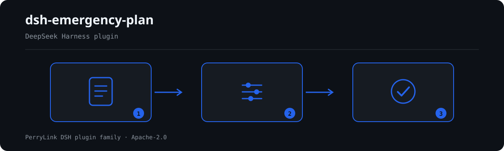

# dsh-emergency-plan — Completude dos elementos do plano de emergência e localização por página ao nível da cláusula

[English](README.md) · [简体中文](README-zh.md) · [Español](README-es.md) · [Português](README-pt.md) · [हिन्दी](README-hi.md)

[](https://dsh.market/)
[](https://dshfind.com/en/plugins/PerryLink/dsh-emergency-plan?ref=badge)

`dsh-emergency-plan` lê um plano de emergência —a sua árvore de secções, títulos, números de página e texto— e verifica a completude dos elementos desse plano face ao guia de redação: que elementos estão presentes, quais faltam, quais aparecem apenas como título sem texto por baixo e onde se situa cada um, por página quando o material traz números de página e por linha caso contrário. Aplica um pacote de regras versionado ao tipo de plano que o material declara, e cada achado indica a cláusula de onde vem e se essa cláusula é um requisito direto, um princípio ou uma configuração local; uma verificação que não pôde correr di-lo em `skipped` em vez de passar em silêncio.

## Install

```sh
dsh plugin --profile <name> add dsh-emergency-plan
dsh --profile <name> --dump-config | grep 'dsh-emergency-plan'
```

## Como é a saída



*Visão geral do fluxo: chamada → plugin → resultado. Os exemplos abaixo usam a superfície real de comandos.*


Saída real deste plugin sobre o seu próprio fixture de teste `EP-004` — não é uma simulação. O pacote de regras não inventa citações, por isso cada achado nomeia a cláusula aplicada e avisa que o seu texto não foi obtido.

## O que ele responde

### Exemplos

A tabela abaixo é o conjunto de exemplos: a primeira linha é o caso detalhado e as demais são casos curtos.

| Você pergunta | O que ele responde |
|---|---|
| O material não diz qual dos três tipos de plano é. O que acontece? | `EP-004` reporta que o material não declara `planType`, porque cada um dos três tipos tem a sua própria lista de elementos. Verifica apenas que a declaração existe, não que esteja correta; enquanto faltar, `EP-002` e `EP-003` indicam em `skipped` que lista de elementos assumiram. |
| Um 综合应急预案 não tem o capítulo 后期处置. Isso é reportado? É também obrigatório um ponto 编制目的? | `EP-002` procura um a um os cinco elementos de primeiro nível do capítulo 6 do guia em vigor (6.1~6.5) e reporta cada um que não encontra, portanto um 后期处置 em falta é reportado. 编制目的 não é um desses cinco: a edição em vigor removeu-o e o pacote só o aceita como alias de 总则. O achado é `warn`, porque o guia de redação é uma norma nacional recomendada, não obrigatória. |
| Que elementos são obrigatórios num 专项应急预案 e num 现场处置方案? | `EP-001` exige os elementos 7.1~7.4 do 专项应急预案 e `EP-003` os 8.1~8.4 do 现场处置方案, e reporta cada elemento que não encontra na árvore de secções; se o título existe mas não há texto por baixo, é reportado como vazio. Ambas as listas são mínimos, não listas fechadas —a cláusula do 现场处置 diz 包括但不限于—, pelo que um elemento a mais não gera achado. Em `EP-001` o elemento 7.5 应急保障 continua a ser recomendado; em `EP-003` a lista mais curta da 《生产安全事故应急预案管理办法》 é citada como base separada e nunca é fundida com a do guia. |
| Depois de fundir dois planos, o mesmo título de elemento aparece duas vezes. Isso é detetado? | `EP-007` reporta um elemento exigido que aparece mais de uma vez e enumera todos os títulos que com ele coincidiram. Nenhuma cláusula o diz expressamente —o pacote deduz-o da unicidade da ordem do 目次—, por isso fica limitado a `warn`, e o pacote pede confirmação humana, porque a duplicação costuma vir da fusão de vários planos. Compara a lista de elementos que aplica, não todos os títulos repetidos do material. |
| O relatório mostra `EP-005` como `skipped`. Porquê? Numerar as páginas do plano é obrigatório? | `EP-005` só consegue comparar a ordem dos elementos quando pelo menos dois deles têm `page` ou `line`; caso contrário, di-lo em `skipped` em vez de presumir uma ordem. `EP-006` trata os números de página como informação de localização: fica em silêncio quando a proporção de secções com página atinge `minPageRatio` (0,5 por omissão) e, abaixo dessa proporção, emite apenas um aviso de nível `info`. Ambas ficam limitadas a `info` —a expectativa de ordem é deduzida de um anexo informativo, não do corpo da norma— e um plano sem páginas nunca é reportado como incumprimento de uma cláusula: o relatório localiza por número de linha. |
| Porque é que `EP-008` e `EP-009` aparecem em `skipped` em vez de passar? | Ambas esperam configuração. `EP-009` só corre com `requireAttachments` em `true`, porque quem chama costuma entregar o corpo do plano sem os anexos e dar os anexos ausentes como faltas seria enganador; ativada, procura os oito elementos de anexo e reporta os que não encontra. `EP-008` só corre se houver `versionPatterns` configurados: com a lista vazia não dita como deve ser escrito o identificador de versão e, uma vez configurada, verifica apenas se o marcador aparece em algum título de secção, nunca se o conteúdo da revisão está correto. |

## Normas que segue

| Documento | Número | Regras que o citam |
|---|---|---|
| 《生产经营单位生产安全事故应急预案编制导则》 | GB/T 29639-2020 | EP-001, EP-002, EP-003, EP-004, EP-005, EP-006, EP-007, EP-008, EP-009 |
| 《生产安全事故应急预案管理办法》 | 国家安全生产监督管理总局令第88号（应急管理部令第2号修正） | EP-001, EP-002, EP-003, EP-009 |

**Boundary:** this plugin checks an **emergency plan's element completeness** against the drafting
guideline and locates each element by page, reporting literal differences against cited clauses. It is
not `dsh-rulefile-check` (which audits a regulatory document's legality) and not
`dsh-hidden-risk-map` (which maps a hazard ledger to determination clauses). It reads one plan and
reports which elements are present, absent or empty, and where.

> ### ⚠️ Two corrections this plugin is built on — please read
>
> **1. "八要素" is not a current requirement.** The familiar list — 总则, 事故风险描述, 应急组织机构及职责,
> 预警及信息报告, 应急响应, 信息公开, 后期处置, 保障措施, 应急预案管理 — belongs to
> **GB/T 29639—2013**, which has been **entirely replaced**. Its namesake is not found in any current
> national document. The standard in force, **GB/T 29639-2020**, gives the comprehensive plan **five**
> first-level elements in clause 6 (6.1 总则 / 6.2 应急组织机构及职责 / 6.3 应急响应 / 6.4 后期处置 /
> 6.5 应急保障), and its foreword records that **编制目的 was removed**. Any rule citing 2013 clause
> numbers is citing a withdrawn standard. This pack cites only the 2020 clause numbers, and a test
> asserts that the 2013 number never appears.
>
> **2. Page numbers have no mandatory basis.** No national document requires a plan to carry page
> numbers; the appendix that governs 目次 is a **资料性附录** (informative, not normative) and does not
> contain the word 页码. Page numbers are therefore treated as **locating information that helps a
> reviewer**, reported at `info`, and never phrased as "does not comply with X". When a plan carries no
> page numbers the report falls back to line numbers.

A third, smaller correction is recorded in the pack: 《生产安全事故应急预案管理办法》's correct version
is **国家安全生产监督管理总局令第88号 (2016), amended by 应急管理部令第2号 (2019)** — not a bare
"应急管理部令第2号" — and 国办发〔2013〕101号 has been replaced by 国办发〔2024〕5号.

## Compatibility

| Superfície | Estado |
|---|---|
| Harness | Faixa de peers `>=0.1.2-rc.1 <0.2.0 \|\| >=0.2.0-0 <0.3.0` — verificada para aceitar tanto `0.2.0-rc.2` quanto `0.2.1-rc.2`. **`engines.dsh` é declarado como `>=0.2.1-0 <0.3.0`** e o host o aplica desde 0.2.1 |
| Node | `^22.19.0 || >=24.0.0` |
| Plataformas | Todas (ESM puro; sem código nativo, sem rede, sem chamada ao modelo) |
| Modo de ferramenta | Funciona em `native` e `ptc`; para um diretório inteiro use `ptc` |

## What it does

A tabela de regras, os campos e o comportamento detalhado estão em [README.md](README.md#what-it-does) (versão principal em inglês). O plugin apenas lista divergências literais frente às cláusulas citadas e indica em `skipped` cada verificação que não pôde ser executada.

## Configuration

Todos os parâmetros ajustáveis ficam no esquema Schemastery de `src/config.ts`, portanto mudam pelo `cordis.yml` sem editar código; os limites por regra ficam no pacote de regras sob `rules/`.

| Chave | Tipo | Padrão | Descrição |
|---|---|---|---|
| `rulesFile` | string | `rules/emergency-plan.yaml` | Caminho do pacote de regras, relativo à raiz do pacote |
| `disabledRules` | string[] | `[]` | Ids de regras a desativar; cada uma aparece em `skipped` |
| `onlyRules` | string[] | `[]` | Executar apenas estas regras; vazio executa todas |
| `skipNotes` | string | `""` | Nota acrescentada a cada motivo de `skipped` |
| `timeoutMs` | number | `120000` | Orçamento de tempo limite cooperativo da ferramenta |

## Material format

Aceita JSON ou YAML. O exemplo completo de campos está em [README.md](README.md#material-format) (versão principal em inglês). Os campos são opcionais na camada de leitura e validados pelo motor, de modo que uma exportação parcial gera achados sobre o que falta em vez de falhar.

## Rule sources

Os dados das regras ficam separados do código: cada regra traz documento, número, cláusula na numeração própria da fonte, trecho literal e URL de origem. O carregador impõe que o trecho seja citação real de pelo menos oito caracteres e que uma verificação baseada apenas em princípio geral (`kind: derived-from-principle`, teto `warn`) ou em política local (`kind: institutional-configuration`, teto `info`) nunca seja declarada `error`.

Os limites verificados e as conclusões deliberadamente **não** afirmadas estão em [README.md](README.md#rule-sources) (versão principal em inglês) e em `rules/evidence/`.

## Troubleshooting

- **O plugin instala mas a ferramenta não aparece**: confirme que `main` resolve para `lib/index.mjs` e que `pnpm run build` o gerou.
- **`dsh plugin add` recusa o pacote**: a faixa de peers cobre `0.1.x` e `0.2.x`; fora dela, conceda isenção explícita com `dsh plugin --profile <name> allow-version <pkg@ver> --dsh-version <runtime> --accept-risk`.
- **Uma regra não executou**: leia o arranjo `skipped`.
- **`check` informa `manifest-peers` como falha**: problema conhecido do `dsh-plugin-dev`; o runtime aplica a compatibilidade na instalação.
- **Os horários parecem deslocados**: toda a aritmética é de hora local sobre as cadeias fornecidas.

## Development

```sh
pnpm install
pnpm run typecheck
pnpm test
pnpm run build
node ../scripts/sync-shared.mjs dsh-emergency-plan
```

O último comando copia o kit compartilhado de `../_shared` para `src/shared/`; execute-o novamente após cada alteração compartilhada.

## PerryLink DSH Plugin Family

Este projeto faz parte da família de plugins do DeepSeek Harness da [PerryLink](https://github.com/PerryLink). O registro fica recolhido abaixo para que cada README mantenha uma primeira tela curta; expanda para ver cada linha e seu status.

<details>
<summary>Expandir todos os plugins</summary>

| Plugin | Status |
|---|---|
| **[dsh-aqua-input-check](https://github.com/PerryLink/dsh-aqua-input-check)** |  |
| **[dsh-archive-check](https://github.com/PerryLink/dsh-archive-check)** |  |
| **[dsh-auto-review](https://github.com/PerryLink/dsh-auto-review)** |  |
| **[dsh-autotier](https://github.com/PerryLink/dsh-autotier)** |  |
| **[dsh-bid-ca-precheck](https://github.com/PerryLink/dsh-bid-ca-precheck)** |  |
| **[dsh-bid-qual-check](https://github.com/PerryLink/dsh-bid-qual-check)** |  |
| **[dsh-cert-mcp](https://github.com/PerryLink/dsh-cert-mcp)** |  |
| **[dsh-checkpoint-rewind](https://github.com/PerryLink/dsh-checkpoint-rewind)** |  |
| **[dsh-click](https://github.com/PerryLink/dsh-click)** |  |
| **[dsh-composer-history](https://github.com/PerryLink/dsh-composer-history)** |  |
| **[dsh-contract-stance](https://github.com/PerryLink/dsh-contract-stance)** |  |
| **[dsh-customs-doc-check](https://github.com/PerryLink/dsh-customs-doc-check)** |  |
| **[dsh-data-quality](https://github.com/PerryLink/dsh-data-quality)** |  |
| **[dsh-demurrage-ledger](https://github.com/PerryLink/dsh-demurrage-ledger)** |  |
| **[dsh-doublecheck](https://github.com/PerryLink/dsh-doublecheck)** |  |
| **[dsh-drill-script-check](https://github.com/PerryLink/dsh-drill-script-check)** |  |
| **[dsh-eia-guide-check](https://github.com/PerryLink/dsh-eia-guide-check)** |  |
| **[dsh-emergency-plan](https://github.com/PerryLink/dsh-emergency-plan)** |  |
| **[dsh-essay-rubric-check](https://github.com/PerryLink/dsh-essay-rubric-check)** |  |
| **[dsh-evidence-check](https://github.com/PerryLink/dsh-evidence-check)** |  |
| **[dsh-export-ctl-check](https://github.com/PerryLink/dsh-export-ctl-check)** |  |
| **[dsh-fast](https://github.com/PerryLink/dsh-fast)** |  |
| **[dsh-fmea-table-check](https://github.com/PerryLink/dsh-fmea-table-check)** |  |
| **[dsh-forecast-penalty](https://github.com/PerryLink/dsh-forecast-penalty)** |  |
| **[dsh-fund-research](https://github.com/PerryLink/dsh-fund-research)** |  |
| **[dsh-github](https://github.com/PerryLink/dsh-github)** |  |
| **[dsh-gongwen-flow-check](https://github.com/PerryLink/dsh-gongwen-flow-check)** |  |
| **[dsh-gongwen-word-check](https://github.com/PerryLink/dsh-gongwen-word-check)** |  |
| **[dsh-guard-plan-qc](https://github.com/PerryLink/dsh-guard-plan-qc)** |  |
| **[dsh-hazchem-check](https://github.com/PerryLink/dsh-hazchem-check)** |  |
| **[dsh-hazplan-check](https://github.com/PerryLink/dsh-hazplan-check)** |  |
| **[dsh-hidden-risk-map](https://github.com/PerryLink/dsh-hidden-risk-map)** |  |
| **[dsh-hs-classify](https://github.com/PerryLink/dsh-hs-classify)** |  |
| **[dsh-icd-rule-check](https://github.com/PerryLink/dsh-icd-rule-check)** |  |
| **[dsh-industry-research](https://github.com/PerryLink/dsh-industry-research)** |  |
| **[dsh-lawcite-adapter](https://github.com/PerryLink/dsh-lawcite-adapter)** |  |
| **[dsh-laya](https://github.com/PerryLink/dsh-laya)** |  |
| **[dsh-lc-doc-check](https://github.com/PerryLink/dsh-lc-doc-check)** |  |
| **[dsh-learning-gap-check](https://github.com/PerryLink/dsh-learning-gap-check)** |  |
| **[dsh-library](https://github.com/PerryLink/dsh-library)** |  |
| **[dsh-local-ai](https://github.com/PerryLink/dsh-local-ai)** |  |
| **[dsh-lsp-actions](https://github.com/PerryLink/dsh-lsp-actions)** |  |
| **[dsh-mask](https://github.com/PerryLink/dsh-mask)** |  |
| **[dsh-mcp-panel](https://github.com/PerryLink/dsh-mcp-panel)** |  |
| **[dsh-medrec-qc](https://github.com/PerryLink/dsh-medrec-qc)** |  |
| **[dsh-memento](https://github.com/PerryLink/dsh-memento)** |  |
| **[dsh-nsfc-form-check](https://github.com/PerryLink/dsh-nsfc-form-check)** |  |
| **[dsh-nurse-record-check](https://github.com/PerryLink/dsh-nurse-record-check)** |  |
| **[dsh-observe](https://github.com/PerryLink/dsh-observe)** |  |
| **[dsh-origin-rvc-check](https://github.com/PerryLink/dsh-origin-rvc-check)** |  |
| **[dsh-ota-review-check](https://github.com/PerryLink/dsh-ota-review-check)** |  |
| **[dsh-output-styles](https://github.com/PerryLink/dsh-output-styles)** |  |
| **[dsh-paper-doc-adapter](https://github.com/PerryLink/dsh-paper-doc-adapter)** |  |
| **[dsh-permission-rules](https://github.com/PerryLink/dsh-permission-rules)** |  |
| **[dsh-permit-report-check](https://github.com/PerryLink/dsh-permit-report-check)** |  |
| **[dsh-pipeline-check](https://github.com/PerryLink/dsh-pipeline-check)** |  |
| **[dsh-pleading-draft](https://github.com/PerryLink/dsh-pleading-draft)** |  |
| **[dsh-plugin-doctor](https://github.com/PerryLink/dsh-plugin-doctor)** |  |
| **[dsh-plugin-guide](https://github.com/PerryLink/dsh-plugin-guide)** |  |
| **[dsh-plugin-kit](https://github.com/PerryLink/dsh-plugin-kit)** |  |
| **[dsh-plugin-upgrade](https://github.com/PerryLink/dsh-plugin-upgrade)** |  |
| **[dsh-policy-brief-draft](https://github.com/PerryLink/dsh-policy-brief-draft)** |  |
| **[dsh-power-loss-split](https://github.com/PerryLink/dsh-power-loss-split)** |  |
| **[dsh-power-ticket-check](https://github.com/PerryLink/dsh-power-ticket-check)** |  |
| **[dsh-ppap-check](https://github.com/PerryLink/dsh-ppap-check)** |  |
| **[dsh-protest-deadline](https://github.com/PerryLink/dsh-protest-deadline)** |  |
| **[dsh-railway-window](https://github.com/PerryLink/dsh-railway-window)** |  |
| **[dsh-repair-order-qc](https://github.com/PerryLink/dsh-repair-order-qc)** |  |
| **[dsh-research-report](https://github.com/PerryLink/dsh-research-report)** |  |
| **[dsh-review-reply-check](https://github.com/PerryLink/dsh-review-reply-check)** |  |
| **[dsh-rulefile-check](https://github.com/PerryLink/dsh-rulefile-check)** |  |
| **[dsh-safety-brief-check](https://github.com/PerryLink/dsh-safety-brief-check)** |  |
| **[dsh-score](https://github.com/PerryLink/dsh-score)** |  |
| **[dsh-session-sync](https://github.com/PerryLink/dsh-session-sync)** |  |
| **[dsh-site-log-check](https://github.com/PerryLink/dsh-site-log-check)** |  |
| **[dsh-skill-pack-security](https://github.com/PerryLink/dsh-skill-pack-security)** |  |
| **[dsh-soe-decision-check](https://github.com/PerryLink/dsh-soe-decision-check)** |  |
| **[dsh-soilwater-check](https://github.com/PerryLink/dsh-soilwater-check)** |  |
| **[dsh-sop-sync-check](https://github.com/PerryLink/dsh-sop-sync-check)** |  |
| **[dsh-spc-gbt-adapter](https://github.com/PerryLink/dsh-spc-gbt-adapter)** |  |
| **[dsh-talk](https://github.com/PerryLink/dsh-talk)** |  |
| **[dsh-tender-extract](https://github.com/PerryLink/dsh-tender-extract)** |  |
| **[dsh-tender-matrix](https://github.com/PerryLink/dsh-tender-matrix)** |  |
| **[dsh-test-drive](https://github.com/PerryLink/dsh-test-drive)** |  |
| **[dsh-ticktick](https://github.com/PerryLink/dsh-ticktick)** |  |
| **[dsh-translate](https://github.com/PerryLink/dsh-translate)** |  |
| **[dsh-warranty-calc](https://github.com/PerryLink/dsh-warranty-calc)** |  |
| **[dsh-budget](https://github.com/PerryLink/dsh-budget)** | 🧊 CONGELADO — ver o README do repositório |
| **[dsh-claude-move](https://github.com/PerryLink/dsh-claude-move)** | 🧊 CONGELADO — ver o README do repositório |
| **[dsh-defend](https://github.com/PerryLink/dsh-defend)** | 🧊 CONGELADO — ver o README do repositório |
| **[dsh-draw](https://github.com/PerryLink/dsh-draw)** | 🧊 CONGELADO — ver o README do repositório |
| **[dsh-reach](https://github.com/PerryLink/dsh-reach)** | 🧊 CONGELADO — ver o README do repositório |
| **[dsh-background-agents](https://github.com/PerryLink/dsh-background-agents)** | 🚫 RETIRADO — ver o README do repositório |
| **[dsh-session-pin](https://github.com/PerryLink/dsh-session-pin)** | 🚫 RETIRADO — ver o README do repositório |
| **[dsh-team-rooms](https://github.com/PerryLink/dsh-team-rooms)** | 🚫 RETIRADO — ver o README do repositório |

</details>

## License

[Apache License 2.0](LICENSE) © 2026 dsh-emergency-plan contributors.
