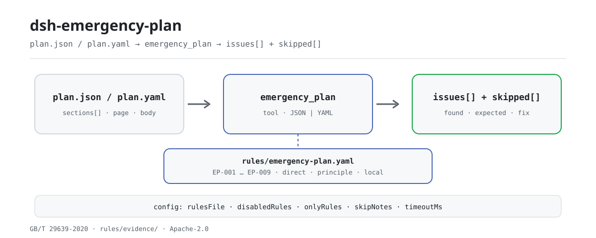

<div align="center">

<picture>
  <source media="(prefers-color-scheme: dark)" srcset="docs/assets/dsh-emergency-plan-flow-dark.svg">
  
</picture>

# dsh-emergency-plan

**Check an emergency plan's element completeness clause by clause, and locate every difference by page or line — the judgement stays with the reviewer.**

A DeepSeek Harness checker for safety managers and plan writers: it reads one plan's section tree, headings, page numbers and body text, applies a versioned rule pack for the plan type the material declares, and reports what is missing, what is empty, and where it sits.

[Install](#three-step-setup) · [Configuration](#configuration) · [FAQ](#faq) · [简体中文](README.md) · [English](README.en.md) · [Español](README.es.md) · [Português](README.pt.md) · [हिन्दी](README.hi.md)

[](LICENSE)
[](#compatibility)
[](https://www.npmjs.com/package/dsh-emergency-plan)
[](https://github.com/PerryLink/dsh-emergency-plan/actions/workflows/ci.yml)
[](#compatibility)

[](https://github.com/PerryLink/dsh-emergency-plan/stargazers)
[](https://www.npmjs.com/package/dsh-emergency-plan)
[](https://dshfind.com/plugins/PerryLink/dsh-emergency-plan?ref=badge)
[](https://securityscorecards.dev/viewer/?uri=github.com/PerryLink/dsh-emergency-plan)
[](https://dsh.market/)
[](https://gitee.com/perrylink/dsh-emergency-plan)

```sh
dsh plugin --profile <name> add dsh-emergency-plan
```

</div>

<sub>Community plugin, not affiliated with DeepSeek. Canonical repository: <https://github.com/PerryLink/dsh-emergency-plan> (Gitee is a mirror).</sub>

## What it is

`dsh-emergency-plan` reads one emergency plan — its section tree, headings, page numbers and body text — applies a versioned rule pack for the plan type the material declares (comprehensive, special or on-site), and checks the plan's element completeness: which elements are present, which are absent, which appear only as a heading with no body beneath, and where each one sits, by page when the material carries page numbers and by line otherwise. Every finding names the clause it came from and states whether that clause is a direct requirement, a principle or a local configuration; a check that could not run says so in `skipped` instead of passing silently. It reports literal differences between the material and the cited clauses only — no judgement on content quality, compliance, liability or safety. It runs entirely locally: no network requests, no model calls, and the source material is never modified.

## Three-step setup

1. **Install** (pick one channel):

   ```sh
   # git channel (latest main)
   dsh plugin --profile web add github:PerryLink/dsh-emergency-plan
   # npm channel (published releases)
   dsh plugin --profile web add dsh-emergency-plan
   # tarball channel: pnpm pack in this repo, then
   dsh plugin --profile web add ./dsh-emergency-plan-<version>.tgz
   ```

2. **Minimal config** (the defaults work; the rule pack ships in the package):

   ```yaml
   - insert:
       - id: dsh-emergency-plan
         name: dsh-emergency-plan
         config:
           rulesFile: rules/emergency-plan.yaml
           timeoutMs: 120000
   ```

3. **Verify it mounts**:

   ```sh
   dsh --profile web --dump-config | grep -A2 'id: dsh-emergency-plan'
   ```

   Then call the `emergency_plan` tool. The local quickstart needs a build first (`pnpm run build` produces `lib/`):

   ```sh
   node samples/quickstart/run.mjs
   # emergency_plan: 1 issue(s) — error 0, warn 1, info 0
   # skipped: 8
   ```

   *Observed from `samples/quickstart/expected/result.json; samples/quickstart/run.mjs`*

**Uninstall**: `dsh plugin --profile web remove dsh-emergency-plan` (or remove the row from the profile patch).

## Core capabilities

- **Element lists per plan type** — `EP-001` checks a special plan against 7.1–7.4, `EP-002` a comprehensive plan against 6.1–6.5, `EP-003` an on-site plan against 8.1–8.4. A heading that exists with no body text is reported as empty.
- **Page- or line-level location** — a finding carries the section's `page` when the material has one, otherwise its `line`, otherwise the heading itself. `EP-006` flags weak locating information when too few sections carry pages.
- **The rule pack is data** — element lists, aliases and thresholds live in `rules/emergency-plan.yaml`. Point `rulesFile` at another YAML to switch guideline versions or an institutional template; no code change.
- **Citations you can verify** — every rule carries a document, a number, a clause, a verbatim excerpt, a basis kind and a source URL. An excerpt shorter than eight characters, or a principle-derived check declared `error`, fails at load.
- **Nothing passes silently** — an unset element list, a disabled attachment check and an unorderable `EP-005` all land in `skipped`. The report lists differences only, and a wording guard rejects adjudicating language.
- **Attachments and version marks are opt-in** — `EP-009` is off by default (`requireAttachments: false`); `EP-008` runs only when `versionPatterns` is configured.

### Rules at a glance

| Rule | Check | Severity | Basis kind |
|---|---|---|---|
| `EP-001` | a special plan carries its 7.1–7.4 elements | warn | direct |
| `EP-002` | a comprehensive plan carries its 6.1–6.5 elements | warn | direct |
| `EP-003` | an on-site plan carries its 8.1–8.4 elements | warn | direct |
| `EP-004` | the material declares which of the three types it is | warn | direct |
| `EP-005` | the elements appear in the guideline's order | info | principle |
| `EP-006` | the sections carry page numbers, so a finding can be located | info | principle |
| `EP-007` | no element heading appears twice | warn | principle |
| `EP-008` | a version or revision marker is present, as configured | info | local |
| `EP-009` | the plan carries the attachment information (off by default) | info | direct |

The element lists live in the rule pack, not in the code, because they change with the guideline's version. Severities reflect that GB/T 29639 is a **recommended** national standard: an incomplete element list is a `warn`, not an `error`.

### Example (real output)

**Tool** `emergency_plan`

**Input**

~~~json
{"name":"缺要素的专项预案","planType":"special","sections":[{"title":"适用范围"},{"title":"应急组织机构及职责"},{"title":"响应启动"}]}
~~~

**Output**

~~~json
{
  "id": "dsh-emergency-plan.EP-001.811c9dc5",
  "ruleId": "EP-001",
  "severity": "warn",
  "locator": {},
  "found": "材料中未找到要素「处置措施」",
  "expected": "专项应急预案应当包含要素「处置措施」",
  "fix": "检查的别名：处置措施 / 应急处置措施 / 应急处置；如本机构使用其他表述，请在该要素的 aliases 中补充"
}
~~~

*Observed from `dsh-emergency-plan/tests/fixtures/EP-001/EP-001-unsafe.json; dsh-emergency-plan/tests/fixtures/EP-001/cases.json; dsh-emergency-plan/rules/emergency-plan.yaml; dsh-emergency-plan/tests/index.test.ts`*

The quickstart runs the same fixture and reports a summary: 1 `warn`, 0 `error` / `info`, and 8 entries in `skipped` (each disabled or unconfigured check states its reason).

### Rule-by-rule answers

| You ask | What it answers |
|---|---|
| The material never says which of the three plan types it is. What happens? | `EP-004` reports the material for not declaring `planType`, because each of the three types carries a different element list. It checks only that the declaration is there, not that it is the right one; while it is missing, `EP-002` and `EP-003` state in `skipped` which element list they assumed. |
| A comprehensive plan has no later-stage handling chapter (6.4). Is that reported — and does it also need a drafting-purpose section? | `EP-002` looks for the five first-level elements of the current guideline's chapter 6 (6.1–6.5) one by one and reports each one it cannot find, so a missing later-stage handling chapter is reported. The drafting-purpose element is not one of the five: the current edition removed it, and the pack accepts it only as an alias of the general-provisions element (6.1). The finding is `warn`, because the drafting guideline is a recommended national standard, not a mandatory one. |
| Which elements are mandatory in a special plan and in an on-site plan? | `EP-001` requires the special plan's 7.1–7.4 elements and `EP-003` the on-site plan's 8.1–8.4, each reporting the elements it cannot find in the section tree; a heading that exists with no text under it is reported as empty. Both lists are floors, not closed lists — the on-site clause reads "including but not limited to" — so an extra element is not a finding. In `EP-001` the 7.5 emergency-support element stays recommended; in `EP-003` the shorter list in the management measures is kept as a separate basis and never merged with the guideline's. |
| We merged two plans and now the same element heading appears twice. Is that caught? | `EP-007` reports a required element that appears more than once and lists every heading that matched it. No clause states this outright — the pack derives it from the uniqueness of the table-of-contents order — so it is capped at `warn`, and the pack asks for human confirmation, because a duplicate usually comes from merging several plans. It compares the element list it applies, not every repeated heading in the material. |
| The report shows `EP-005` as `skipped`. Why — and must a plan carry page numbers? | `EP-005` can compare element order only when at least two elements carry a `page` or a `line`; without them it says so in `skipped` rather than assuming an order. `EP-006` treats page numbers as locating information: it stays quiet once the share of sections carrying a page reaches `minPageRatio` (0.5 by default) and, below that share, only raises an `info` finding. Both are capped at `info` — the order expectation is drawn from an informative appendix, not the standard's body — and a plan without page numbers is never reported as a breach of a clause: the report locates by line number instead. |
| Why do `EP-008` and `EP-009` appear under `skipped` instead of passing? | Both wait for configuration. `EP-009` runs only when `requireAttachments` is set to `true`, because a caller usually supplies the plan body without its attachments and reporting those as missing would be misleading; enabled, it looks for the eight attachment items and reports the ones it cannot find. `EP-008` runs only when `versionPatterns` are configured: with the list empty it does not dictate what a version marker should look like, and once configured it checks only whether the configured marker appears in a section heading — never whether the revision content is correct. |

## Standards it follows

| Document | Number | Cited by rules |
|---|---|---|
| Guidelines for the preparation of production safety accident emergency plans for production and business units | GB/T 29639-2020 | EP-001, EP-002, EP-003, EP-004, EP-005, EP-006, EP-007, EP-008, EP-009 |
| Measures for the administration of production safety accident emergency plans | State Administration of Work Safety Order No. 88 (amended by Ministry of Emergency Management Order No. 2) | EP-001, EP-002, EP-003, EP-009 |

Original titles of the cited documents:

```text
《生产经营单位生产安全事故应急预案编制导则》 GB/T 29639-2020
《生产安全事故应急预案管理办法》 国家安全生产监督管理总局令第88号（应急管理部令第2号修正）
```

**Boundary:** this plugin checks an **emergency plan's element completeness** against the drafting guideline and locates each element by page, reporting literal differences against cited clauses. It is not `dsh-rulefile-check` (which audits a regulatory document's legality) and not `dsh-hidden-risk-map` (which maps a hazard ledger to determination clauses). It reads one plan and reports which elements are present, absent or empty, and where.

> ### ⚠️ Two corrections this plugin is built on — please read
>
> **1. "Eight elements" is not a current requirement.** The familiar nine-name list belongs to
> **GB/T 29639—2013**, which has been **entirely replaced**; its namesake is not found in any current
> national document. The standard in force, **GB/T 29639-2020**, gives the comprehensive plan **five**
> first-level elements in clause 6 (6.1–6.5), and its foreword records that the drafting-purpose
> element was removed. Any rule citing 2013 clause numbers is citing a withdrawn standard. This pack
> cites only the 2020 clause numbers, and a test asserts that the 2013 number never appears.
>
> **2. Page numbers have no mandatory basis.** No national document requires a plan to carry page
> numbers; the appendix that governs the table of contents is an **informative appendix** (not
> normative) and does not contain the word for "page number". Page numbers are therefore treated as
> **locating information that helps a reviewer**, reported at `info`, and never phrased as "does not
> comply with X". When a plan carries no page numbers the report falls back to line numbers.

The exact 2013 and 2020 element names are kept in the pack's own terminology:

```text
2013 list (withdrawn): 总则 · 事故风险描述 · 应急组织机构及职责 · 预警及信息报告 ·
                      应急响应 · 信息公开 · 后期处置 · 保障措施 · 应急预案管理
2020 comprehensive list (6.1–6.5): 总则 · 应急组织机构及职责 · 应急响应 ·
                                  后期处置 · 应急保障
Removed by the 2020 edition: 编制目的
```

A third, smaller correction is recorded in the pack: the management measure's correct version is **State Administration of Work Safety Order No. 88 (2016), amended by Ministry of Emergency Management Order No. 2 (2019)** — not a bare "Ministry of Emergency Management Order No. 2" — and the 2013 State Council document (Guobanfa [2013] No. 101) has been replaced by Guobanfa [2024] No. 5.

## Configuration

All tunables are Schemastery `Config` fields (changeable from `cordis.yml`). An id-targeted override replaces the whole row — restate every key you need. Per-rule thresholds live in the rule pack under `rules/`.

| Key | Type | Default | Meaning |
|---|---|---|---|
| `rulesFile` | string | `rules/emergency-plan.yaml` | Rule-pack path, relative to the package root |
| `disabledRules` | string[] | `[]` | Rule ids to stop running; each appears in `skipped` |
| `onlyRules` | string[] | `[]` | Run only these rule ids; empty runs every rule |
| `skipNotes` | string | `""` | Note appended to every `skipped` reason |
| `timeoutMs` | number | `120000` | Cooperative tool timeout budget in milliseconds |

<details>
<summary>Full configuration table (5 keys)</summary>

| Key | Type | Default | Meaning |
|---|---|---|---|
| `rulesFile` | string | `rules/emergency-plan.yaml` | Rule-pack path, relative to the package root; pointed elsewhere for another guideline version or an institutional template |
| `disabledRules` | string[] | `[]` | Rule ids to stop running; each disabled rule appears once in the report's `skipped` |
| `onlyRules` | string[] | `[]` | Run only these rule ids; empty runs every rule |
| `skipNotes` | string | `""` | Note appended to every `skipped` reason, e.g. naming an institutional implementation rule |
| `timeoutMs` | number | `120000` | Cooperative tool timeout budget in milliseconds |

</details>

Rule-level parameters live in `rules/emergency-plan.yaml`:

- `EP-001` / `EP-002` / `EP-003` `elements` — the element list per plan type, as `[{ name, aliases }]`. Replace it to check against a different guideline version or your own institution's template. An empty list makes the rule report that it could not run.
- `EP-006` `minPageRatio` — the share of sections that must carry a page number before the rule stays quiet; 0.5 by default.
- `EP-008` `versionPatterns` — the strings that count as a version marker for your templates. Empty means the rule does not run.
- `EP-009` `requireAttachments` — off by default, because a caller usually supplies the body without attachments; enable it only when the attachments are actually in the material.

## Material format

The tool accepts JSON or YAML, and also a plain-text plan. The section-tree form is preferred, because the caller that extracted the plan already knows where each heading sits:

```yaml
name: 某公司生产安全事故综合应急预案
planType: comprehensive         # comprehensive | special | on-site
sections:
  - { title: 总则, page: 1, body: 本预案适用于…… }
  - { title: 应急组织机构及职责, page: 2, body: 明确应急组织形式…… }
  - { title: 应急响应, page: 3, body: 规定信息报告、预警与响应程序。 }
```

Headings are matched against each element's aliases in three widening steps: exact normalized equality, containment, then a small edit distance, so that a numbered or reworded heading still finds its element:

```text
五、保障措施              → 应急保障
二、组织机构与职责        → 应急组织机构及职责
一、总则 / 1.1 / **…**    → numbering prefixes stripped
# 总则                    → markdown heading form
```

Numbering prefixes (Chinese ordinals, `1.1`, `**…**`) are stripped before comparison. Pasting markdown also works and is split on the headings, without page numbers — the report then says so. A plain-text outline works too: one short heading per line.

## Rule sources

Rule data lives in `rules/emergency-plan.yaml`. Every rule carries a document, a document number, a clause in the source's own numbering, a verbatim excerpt and the URL the excerpt was read from. The loader enforces that an excerpt is a real quotation of at least eight characters, and that a check resting only on a general principle or a local policy can never be declared `error`.

The clauses quoted come from **GB/T 29639-2020** clauses 5.1, 6, 7, 8, appendix C.1 and C.3, and from the management measure (State Administration of Work Safety Order No. 88, as amended) articles 13, 14, 15 and 16.

Three findings shaped this pack and are recorded in its header:

1. **"Eight elements" comes from a withdrawn standard.** The current comprehensive-plan list has five first-level elements, and the drafting-purpose element was removed.
2. **Page numbers have no mandatory basis**, so they are a locating aid at `info` level, never a non-conformity.
3. **The standard code prefix changed.** Ministry of Emergency Management Announcement No. 1 of 2025 moved AQ/T 9011-2019 and ten other standards to the **YJ** prefix, keeping number, year and content — so the companion evaluation guide is now written **YJ/T 9011-2019 (formerly AQ/T 9011-2019)**. The evaluation guide is separate from the drafting guideline: GB/T 29639 governs **drafting**, YJ/T 9011 governs **evaluation**.

## FAQ

<details>
<summary>Where does the material go? Does the plugin use the network?</summary>

No network requests, no model calls, no file writes. The material is read from `file` or inline `material`, checked in a pure function, and returned as the tool result; the plugin itself persists and uploads nothing. How the host records tool output is the host's decision.

</details>

<details>
<summary>Does an empty issue list mean the plan is compliant?</summary>

No. An empty issue list only means the rules that ran found no differences; every entry in `skipped` states why it did not run. All rules are capped at `warn` / `info`, the report always carries a disclaimer, and the wording guard rejects compliance, liability or correctness verdicts.

</details>

<details>
<summary>Can a plan omit page numbers?</summary>

No national document requires page numbers. `EP-006` treats them as a locating aid: it stays quiet once the share of sections with a page reaches `minPageRatio`, and below that only raises an `info` finding. Without pages the report locates by line number and never phrases the gap as a breach of a clause.

</details>

<details>
<summary>Does it fight other plugins over names?</summary>

It registers exactly one tool, `emergency_plan`; no commands, no service key, no client slot, no `webServer` prefix, and no shared-event listeners. Its bundle patch only `insert`s its own row. The point-by-point argument is in "Interoperability with other DSH plugins".

</details>

<details>
<summary>How long does one check take?</summary>

A pure function over one pass of the section tree; the pack has 9 rules, with no network or model calls. Time depends on material size and section count; the repository publishes no benchmark numbers, so none are quoted here.

</details>

## Troubleshooting

- **Every element check reports itself as skipped.** The rule pack's `elements` list is empty for that plan type, or the material never declared `planType` and the check declined to assume one.
- **A heading you know exists is reported as missing.** Add it to that element's `aliases`. Matching is literal (with the three widening steps above), not semantic, by design.
- **`EP-005` reports nothing about order.** The sections carry neither `page` nor `line`, so there is nothing to order by; the rule says so in `skipped`.
- **`EP-006` complains about page numbers on a plan that has none.** That is the point of the rule, and it is `info`: it is telling you the report can only cite line numbers. Lower `minPageRatio` or read past it.
- **The plugin installs but the tool never appears.** Check that `main` resolves to `lib/index.mjs` and that `pnpm run build` produced it; a wrong `main` makes the loader skip the entry silently.
- **`dsh plugin add` refuses the package as incompatible.** The peer range covers `0.1.x` and `0.2.x`; if your runtime sits outside it, grant an explicit exemption: `dsh plugin --profile <name> allow-version dsh-emergency-plan@0.1.0 --dsh-version <runtime> --accept-risk`
- **`check` reports `manifest-peers` as failed.** The static checker compares against a hard-coded peer range that predates the 0.2 line. The runtime enforces peer compatibility at install time, so the declared range is the correct one; this is a known upstream issue in `dsh-plugin-dev`.

## Security boundaries & known limitations

- **Read-only and local.** The plugin reads `file` or inline `material`, writes nothing back, makes no network request and calls no model; the `package.json` demo declares `network: false` and `writes: []`.
- **No adjudication.** It lists literal differences between the material and the cited clauses; compliance, liability and content quality stay with the reviewer. The rendering layer runs a wording guard and always carries a disclaimer.
- **Severity follows the evidence.** `derived-from-principle` is capped at `warn` and `institutional-configuration` at `info`; a pack that declares a principle-derived check `error` fails at load.
- **An empty result is not a pass.** An unset element list, a disabled attachment check and an unorderable item all appear in `skipped`.
- **Page numbers are not mandatory.** See FAQ and correction 2; `EP-006` is an `info` hint only.
- **Matching is literal, not semantic.** Headings go through normalized equality, containment and edit distance; add synonym spellings to the element's `aliases`. The plugin does not judge whether the body text is any good.
- **`planType` missing or unrecognised.** `EP-004` reports the missing declaration; `EP-002` / `EP-003` state in `skipped` which list they assumed; an unrecognised value adds a warning.
- **Attachments and version marks are off by default.** `EP-009` defaults to `false`; `EP-008`'s `versionPatterns` default to empty. Both say so in `skipped`.
- **Replacing the rule pack has a boundary.** Another guideline version or an institutional template still verifies excerpts against the shipped `rules/evidence/`; new quotations need their own verification record.

## Interoperability with other DSH plugins

- **Namespaced tool name.** It registers only `emergency_plan`, never a bare name owned by a shipped tool or another plugin.
- **No service-key collision.** It provides no service key at all.
- **No slot or route collision.** It registers no client slot and no `webServer` prefix.
- **No shared-event listeners.** There is no `ctx.on` subscription, so no event chain can be short-circuited.
- **It does not mount without its dependency.** It declares `inject: ['tools']`; without the `tools` service the tool is not registered.
- **The patch layer overrides nothing.** The bundle patch only `insert`s its own row; it never rewrites a built-in row's `config`.
- **No global mutation.** It does not patch prototypes, rewrite `process.env`, or replace the global fetch dispatcher.

## Compatibility

| Surface | Status |
|---|---|
| Harness | Peer range `>=0.1.2-rc.1 <0.2.0 \|\| >=0.2.0-0 <0.3.0` — verified to accept both `0.2.0-rc.2` and `0.2.1-rc.2`. `engines.dsh` is declared as `>=0.2.1-0 <0.3.0` and is enforced by the host since 0.2.1 |
| Node | `^22.19.0 \|\| >=24.0.0` |
| Platforms | All (plain ESM; no native code, no network, no model call) |
| Tool mode | Works in `native` and `ptc`; for a batch of plans use `ptc`, so the schema cost is paid once |

## Ecosystem & quality

- [Gitee mirror](https://gitee.com/perrylink/dsh-emergency-plan) (sync mirror; GitHub is canonical)
- [dshfind plugin page](https://dshfind.com/plugins/PerryLink/dsh-emergency-plan) (installs and ranking)
- [OpenSSF Scorecard report](https://securityscorecards.dev/viewer/?uri=github.com/PerryLink/dsh-emergency-plan) (driven by [.github/workflows/scorecard.yml](.github/workflows/scorecard.yml))
- [DSH Market](https://dsh.market/) (listed)
- [Choose a checker by material](https://perrylink.github.io/zh/checkers/choose/) — the family has other checkers; pick by material type
- [Ecosystem knowledge base](https://perrylink.github.io/dsh-plugin-guide/) — plugin development guide · selection data · maintenance criteria

## Development

```sh
pnpm install
pnpm run typecheck        # tsc --noEmit
pnpm test                 # vitest, paired compliant/violating fixtures per rule
pnpm run build            # tsdown -> lib/index.mjs + lib/index.d.mts
pnpm run verify:self-contained
pnpm run check:lockfile
pnpm run check:readmes
pnpm run check:citations
pnpm pack
```

`prepublishOnly` re-runs the whole gate, so an unbuilt or drifted tree cannot ship.

Directory layout:

| Path | Role |
|---|---|
| `src/index.ts` | plugin contract (`name` / `inject` / `Config` / `apply`); registers `emergency_plan` and resolves the rule pack |
| `src/config.ts` | Schemastery schema; every tunable |
| `src/check.ts` | pure check core `(input, ruleset, options) => Report`; no I/O, no clock, no model access |
| `src/parse.ts` | JSON / YAML / plain-text plan reader |
| `src/view.ts` | model-facing projection of a report; `output.schema` mirrors it |
| `src/shared/` | shared kit (ruleset loader, report shape, YAML subset, wording guard) copied in so the package stays self-contained |
| `rules/emergency-plan.yaml` | the rule pack, 9 rules |
| `rules/evidence/` | the clause-verification record for every citation |
| `tests/` | vitest; every rule has a paired compliant / violating fixture |
| `samples/quickstart/` | the quickstart sample and its expected output |
| `cordis.patch.yml` | bundle row declaration |

The README images are generated programmatically by [`scripts/gen-readme-assets.py`](scripts/gen-readme-assets.py) (Python + Pillow) and are safe to re-run:

```sh
python scripts/gen-readme-assets.py
```

It writes only `docs/assets/dsh-emergency-plan-flow-{light,dark}.svg`. The older single-theme flow diagram and demo images stay in `docs/assets/` for external links; the README references only the new light/dark pair.

Topics: `deepseek-harness`, `dsh`, `dsh-plugin`, `cordis`, `emergency`, `plan`

## Family & thanks

This project is part of the DeepSeek Harness plugin family maintained by [PerryLink](https://github.com/PerryLink) (all Apache-2.0). Full family index: [choose a checker by material](https://perrylink.github.io/zh/checkers/choose/) and [all plugins](https://github.com/PerryLink). If it helps, **a star makes the next person find it** — nothing is gated behind it.

- [@PerryLink](https://github.com/PerryLink) — creator and maintainer: the rule pack (EP-001..EP-009), the `emergency_plan` tool, the citation-verification record, and the five-language docs.

<details>
<summary>Expand all plugins</summary>

| Plugin | Status |
|---|---|
| **[dsh-aqua-input-check](https://github.com/PerryLink/dsh-aqua-input-check)** |  |
| **[dsh-archive-check](https://github.com/PerryLink/dsh-archive-check)** |  |
| **[dsh-auto-review](https://github.com/PerryLink/dsh-auto-review)** |  |
| **[dsh-autotier](https://github.com/PerryLink/dsh-autotier)** | 🧊 FROZEN — see the repo README |
| **[dsh-bid-ca-precheck](https://github.com/PerryLink/dsh-bid-ca-precheck)** |  |
| **[dsh-bid-qual-check](https://github.com/PerryLink/dsh-bid-qual-check)** |  |
| **[dsh-cert-mcp](https://github.com/PerryLink/dsh-cert-mcp)** | 🧊 FROZEN — see the repo README |
| **[dsh-checkpoint-rewind](https://github.com/PerryLink/dsh-checkpoint-rewind)** |  |
| **[dsh-click](https://github.com/PerryLink/dsh-click)** |  |
| **[dsh-composer-history](https://github.com/PerryLink/dsh-composer-history)** |  |
| **[dsh-contract-stance](https://github.com/PerryLink/dsh-contract-stance)** |  |
| **[dsh-customs-doc-check](https://github.com/PerryLink/dsh-customs-doc-check)** |  |
| **[dsh-data-quality](https://github.com/PerryLink/dsh-data-quality)** | 🧊 FROZEN — see the repo README |
| **[dsh-demurrage-ledger](https://github.com/PerryLink/dsh-demurrage-ledger)** |  |
| **[dsh-doublecheck](https://github.com/PerryLink/dsh-doublecheck)** |  |
| **[dsh-drill-script-check](https://github.com/PerryLink/dsh-drill-script-check)** |  |
| **[dsh-eia-guide-check](https://github.com/PerryLink/dsh-eia-guide-check)** |  |
| **[dsh-emergency-plan](https://github.com/PerryLink/dsh-emergency-plan)** |  |
| **[dsh-essay-rubric-check](https://github.com/PerryLink/dsh-essay-rubric-check)** |  |
| **[dsh-evidence-check](https://github.com/PerryLink/dsh-evidence-check)** |  |
| **[dsh-export-ctl-check](https://github.com/PerryLink/dsh-export-ctl-check)** |  |
| **[dsh-fast](https://github.com/PerryLink/dsh-fast)** |  |
| **[dsh-fmea-table-check](https://github.com/PerryLink/dsh-fmea-table-check)** |  |
| **[dsh-forecast-penalty](https://github.com/PerryLink/dsh-forecast-penalty)** |  |
| **[dsh-fund-research](https://github.com/PerryLink/dsh-fund-research)** |  |
| **[dsh-github](https://github.com/PerryLink/dsh-github)** |  |
| **[dsh-gongwen-flow-check](https://github.com/PerryLink/dsh-gongwen-flow-check)** |  |
| **[dsh-gongwen-word-check](https://github.com/PerryLink/dsh-gongwen-word-check)** |  |
| **[dsh-guard-plan-qc](https://github.com/PerryLink/dsh-guard-plan-qc)** |  |
| **[dsh-hazchem-check](https://github.com/PerryLink/dsh-hazchem-check)** |  |
| **[dsh-hazplan-check](https://github.com/PerryLink/dsh-hazplan-check)** |  |
| **[dsh-hidden-risk-map](https://github.com/PerryLink/dsh-hidden-risk-map)** |  |
| **[dsh-hs-classify](https://github.com/PerryLink/dsh-hs-classify)** |  |
| **[dsh-icd-rule-check](https://github.com/PerryLink/dsh-icd-rule-check)** |  |
| **[dsh-industry-research](https://github.com/PerryLink/dsh-industry-research)** |  |
| **[dsh-lawcite-adapter](https://github.com/PerryLink/dsh-lawcite-adapter)** |  |
| **[dsh-laya](https://github.com/PerryLink/dsh-laya)** |  |
| **[dsh-lc-doc-check](https://github.com/PerryLink/dsh-lc-doc-check)** |  |
| **[dsh-learning-gap-check](https://github.com/PerryLink/dsh-learning-gap-check)** |  |
| **[dsh-library](https://github.com/PerryLink/dsh-library)** |  |
| **[dsh-local-ai](https://github.com/PerryLink/dsh-local-ai)** |  |
| **[dsh-lsp-actions](https://github.com/PerryLink/dsh-lsp-actions)** |  |
| **[dsh-mask](https://github.com/PerryLink/dsh-mask)** |  |
| **[dsh-mcp-panel](https://github.com/PerryLink/dsh-mcp-panel)** |  |
| **[dsh-medrec-qc](https://github.com/PerryLink/dsh-medrec-qc)** |  |
| **[dsh-memento](https://github.com/PerryLink/dsh-memento)** | 🧊 FROZEN — see the repo README |
| **[dsh-nsfc-form-check](https://github.com/PerryLink/dsh-nsfc-form-check)** |  |
| **[dsh-nurse-record-check](https://github.com/PerryLink/dsh-nurse-record-check)** |  |
| **[dsh-observe](https://github.com/PerryLink/dsh-observe)** |  |
| **[dsh-origin-rvc-check](https://github.com/PerryLink/dsh-origin-rvc-check)** |  |
| **[dsh-ota-review-check](https://github.com/PerryLink/dsh-ota-review-check)** |  |
| **[dsh-output-styles](https://github.com/PerryLink/dsh-output-styles)** |  |
| **[dsh-paper-doc-adapter](https://github.com/PerryLink/dsh-paper-doc-adapter)** |  |
| **[dsh-permission-rules](https://github.com/PerryLink/dsh-permission-rules)** |  |
| **[dsh-permit-report-check](https://github.com/PerryLink/dsh-permit-report-check)** |  |
| **[dsh-pipeline-check](https://github.com/PerryLink/dsh-pipeline-check)** |  |
| **[dsh-pleading-draft](https://github.com/PerryLink/dsh-pleading-draft)** |  |
| **[dsh-plugin-doctor](https://github.com/PerryLink/dsh-plugin-doctor)** | 🚫 RETIRED (repo archived) |
| **[dsh-plugin-guide](https://github.com/PerryLink/dsh-plugin-guide)** |  |
| **[dsh-plugin-kit](https://github.com/PerryLink/dsh-plugin-kit)** | 🚫 RETIRED (repo archived) |
| **[dsh-plugin-upgrade](https://github.com/PerryLink/dsh-plugin-upgrade)** | 🚫 RETIRED (repo archived) |
| **[dsh-policy-brief-draft](https://github.com/PerryLink/dsh-policy-brief-draft)** |  |
| **[dsh-power-loss-split](https://github.com/PerryLink/dsh-power-loss-split)** |  |
| **[dsh-power-ticket-check](https://github.com/PerryLink/dsh-power-ticket-check)** |  |
| **[dsh-ppap-check](https://github.com/PerryLink/dsh-ppap-check)** |  |
| **[dsh-protest-deadline](https://github.com/PerryLink/dsh-protest-deadline)** |  |
| **[dsh-railway-window](https://github.com/PerryLink/dsh-railway-window)** |  |
| **[dsh-repair-order-qc](https://github.com/PerryLink/dsh-repair-order-qc)** |  |
| **[dsh-research-report](https://github.com/PerryLink/dsh-research-report)** |  |
| **[dsh-review-reply-check](https://github.com/PerryLink/dsh-review-reply-check)** |  |
| **[dsh-rulefile-check](https://github.com/PerryLink/dsh-rulefile-check)** |  |
| **[dsh-safety-brief-check](https://github.com/PerryLink/dsh-safety-brief-check)** |  |
| **[dsh-score](https://github.com/PerryLink/dsh-score)** | 🧊 FROZEN — see the repo README |
| **[dsh-session-sync](https://github.com/PerryLink/dsh-session-sync)** |  |
| **[dsh-site-log-check](https://github.com/PerryLink/dsh-site-log-check)** |  |
| **[dsh-skill-pack-security](https://github.com/PerryLink/dsh-skill-pack-security)** |  |
| **[dsh-soe-decision-check](https://github.com/PerryLink/dsh-soe-decision-check)** |  |
| **[dsh-soilwater-check](https://github.com/PerryLink/dsh-soilwater-check)** |  |
| **[dsh-sop-sync-check](https://github.com/PerryLink/dsh-sop-sync-check)** |  |
| **[dsh-spc-gbt-adapter](https://github.com/PerryLink/dsh-spc-gbt-adapter)** |  |
| **[dsh-talk](https://github.com/PerryLink/dsh-talk)** |  |
| **[dsh-tender-extract](https://github.com/PerryLink/dsh-tender-extract)** |  |
| **[dsh-tender-matrix](https://github.com/PerryLink/dsh-tender-matrix)** |  |
| **[dsh-test-drive](https://github.com/PerryLink/dsh-test-drive)** |  |
| **[dsh-ticktick](https://github.com/PerryLink/dsh-ticktick)** | 🚫 RETIRED (repo archived) |
| **[dsh-translate](https://github.com/PerryLink/dsh-translate)** |  |
| **[dsh-warranty-calc](https://github.com/PerryLink/dsh-warranty-calc)** |  |
| **[dsh-budget](https://github.com/PerryLink/dsh-budget)** | 🧊 FROZEN — see the repo README |
| **[dsh-claude-move](https://github.com/PerryLink/dsh-claude-move)** | 🧊 FROZEN — see the repo README |
| **[dsh-defend](https://github.com/PerryLink/dsh-defend)** | 🧊 FROZEN — see the repo README |
| **[dsh-draw](https://github.com/PerryLink/dsh-draw)** | 🧊 FROZEN — see the repo README |
| **[dsh-reach](https://github.com/PerryLink/dsh-reach)** | 🧊 FROZEN — see the repo README |
| **[dsh-background-agents](https://github.com/PerryLink/dsh-background-agents)** | 🚫 RETIRED (repo archived) |
| **[dsh-session-pin](https://github.com/PerryLink/dsh-session-pin)** | 🚫 RETIRED (repo archived) |
| **[dsh-team-rooms](https://github.com/PerryLink/dsh-team-rooms)** | 🚫 RETIRED (repo archived) |

</details>

## License

[LICENSE](LICENSE) (Apache License 2.0) © 2026 dsh-emergency-plan contributors

<p align="center"><sub>Apache-2.0 · Community plugin, not affiliated with DeepSeek.</sub></p>
