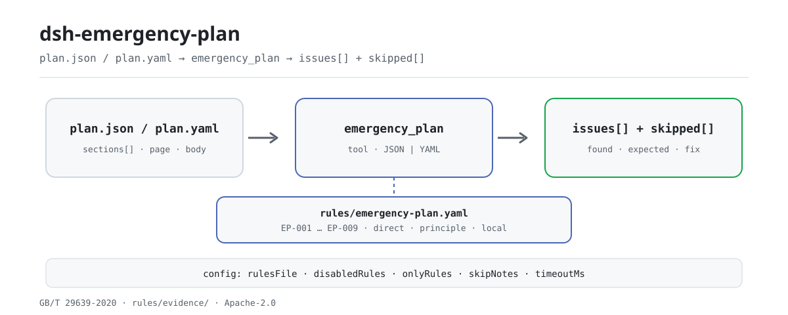

<div align="center">

<picture>
  <source media="(prefers-color-scheme: dark)" srcset="docs/assets/dsh-emergency-plan-flow-dark.svg">
  
</picture>

# dsh-emergency-plan

**Verifica elemento por elemento la completitud de un plan de emergencia y localiza cada diferencia por página o línea: la valoración queda en manos de quien revisa.**

Un verificador de DeepSeek Harness para responsables de seguridad y redactores de planes: lee el árbol de secciones, los títulos, las páginas y el cuerpo de un plan, aplica un paquete de reglas versionado al tipo de plan declarado y señala qué falta, qué está vacío y dónde está.

[Instalación](#instalación-en-tres-pasos) · [Configuración](#configuración) · [FAQ](#faq) · [简体中文](README.md) · [English](README.en.md) · [Español](README.es.md) · [Português](README.pt.md) · [हिन्दी](README.hi.md)

[](LICENSE)
[](#compatibilidad)
[](https://www.npmjs.com/package/dsh-emergency-plan)
[](https://github.com/PerryLink/dsh-emergency-plan/actions/workflows/ci.yml)
[](#compatibilidad)

[](https://github.com/PerryLink/dsh-emergency-plan/stargazers)
[](https://www.npmjs.com/package/dsh-emergency-plan)
[](https://dshfind.com/plugins/PerryLink/dsh-emergency-plan?ref=badge)
[](https://securityscorecards.dev/viewer/?uri=github.com/PerryLink/dsh-emergency-plan)
[](https://dsh.market/)
[](https://gitee.com/perrylink/dsh-emergency-plan)

```sh
dsh plugin --profile <name> add dsh-emergency-plan
```

</div>

<sub>Complemento de la comunidad, sin relación con DeepSeek. Repositorio canónico: <https://github.com/PerryLink/dsh-emergency-plan> (Gitee es un espejo).</sub>

## Qué es

`dsh-emergency-plan` lee un plan de emergencia —su árbol de secciones, títulos, números de página y texto— y aplica un paquete de reglas versionado al tipo de plan que declara el material (integral, especial o de actuación en el lugar), comprobando la completitud de sus elementos: qué elementos están presentes, cuáles faltan, cuáles aparecen solo como título sin texto debajo y dónde se sitúa cada uno —por página cuando el material trae números de página y por línea en caso contrario. Cada hallazgo indica la cláusula de la que procede y si esa cláusula es un requisito directo, un principio o una configuración local; una comprobación que no pudo ejecutarse lo dice en `skipped` en lugar de pasar en silencio. Solo enumera diferencias literales entre el material y las cláusulas citadas: no juzga la calidad del contenido, el cumplimiento ni la responsabilidad. Se ejecuta en local: sin red, sin llamadas al modelo y sin modificar el original.

## Instalación en tres pasos

1. **Instalar** (elige un canal):

   ```sh
   # canal git (última main)
   dsh plugin --profile web add github:PerryLink/dsh-emergency-plan
   # canal npm (versiones publicadas)
   dsh plugin --profile web add dsh-emergency-plan
   # canal tarball: tras pnpm pack en este repositorio
   dsh plugin --profile web add ./dsh-emergency-plan-<version>.tgz
   ```

2. **Configuración mínima** (los valores por defecto sirven; el paquete de reglas viaja en el paquete):

   ```yaml
   - insert:
       - id: dsh-emergency-plan
         name: dsh-emergency-plan
         config:
           rulesFile: rules/emergency-plan.yaml
           timeoutMs: 120000
   ```

3. **Comprobar que se monta**:

   ```sh
   dsh --profile web --dump-config | grep -A2 'id: dsh-emergency-plan'
   ```

   Después, llama a la herramienta `emergency_plan`. El ejemplo local necesita compilar antes (`pnpm run build` genera `lib/`):

   ```sh
   node samples/quickstart/run.mjs
   # emergency_plan: 1 issue(s) — error 0, warn 1, info 0
   # skipped: 8
   ```

   *Observado en `samples/quickstart/expected/result.json; samples/quickstart/run.mjs`*

**Desinstalar**: `dsh plugin --profile web remove dsh-emergency-plan` (o elimina la fila del patch del perfil).

## Capacidades principales

- **Listas de elementos por tipo de plan** — `EP-001` comprueba un plan especial contra 7.1–7.4, `EP-002` un plan integral contra 6.1–6.5 y `EP-003` un plan de actuación en el lugar contra 8.1–8.4. Un título que existe pero no tiene texto debajo se informa como vacío.
- **Localización por página o línea** — cada hallazgo lleva la `page` de la sección cuando existe, si no su `line`, y si no el propio título. `EP-006` avisa cuando hay poca información de localización.
- **El paquete de reglas es dato** — las listas de elementos, los alias y los umbrales viven en `rules/emergency-plan.yaml`. Cambia `rulesFile` a otro YAML para usar otra versión de la guía o una plantilla propia; no hay que tocar código.
- **Citas verificables** — cada regla lleva documento, número, cláusula, extracto literal, tipo de fundamento y URL de origen. Un extracto de menos de ocho caracteres, o una comprobación de principio declarada `error`, falla al cargar.
- **Nada pasa en silencio** — una lista de elementos sin configurar, un control de anexos desactivado y un `EP-005` sin posiciones acaban en `skipped`. El informe solo enumera diferencias y una guarda de redacción rechaza las valoraciones.
- **Anexos y marcas de versión son opcionales** — `EP-009` está desactivado por defecto (`requireAttachments: false`); `EP-008` solo se ejecuta con `versionPatterns` configurado.

### Reglas de un vistazo

| Regla | Comprobación | Severidad | Tipo de fundamento |
|---|---|---|---|
| `EP-001` | el plan especial contiene sus elementos 7.1–7.4 | warn | directa |
| `EP-002` | el plan integral contiene sus elementos 6.1–6.5 | warn | directa |
| `EP-003` | el plan de actuación contiene sus elementos 8.1–8.4 | warn | directa |
| `EP-004` | el material declara cuál de los tres tipos es | warn | directa |
| `EP-005` | los elementos aparecen en el orden de la guía | info | principio |
| `EP-006` | las secciones llevan página para poder localizar el hallazgo | info | principio |
| `EP-007` | ningún título de elemento aparece dos veces | warn | principio |
| `EP-008` | existe una marca de versión o revisión, según configuración | info | local |
| `EP-009` | el plan lleva la información de anexos (desactivado por defecto) | info | directa |

Las listas de elementos viven en el paquete de reglas, no en el código, porque cambian con la versión de la guía. Las severidades reflejan que GB/T 29639 es una norma nacional **recomendada**: una lista incompleta es un `warn`, no un `error`.

### Ejemplo (salida real)

**Herramienta** `emergency_plan`

**Entrada**

~~~json
{"name":"缺要素的专项预案","planType":"special","sections":[{"title":"适用范围"},{"title":"应急组织机构及职责"},{"title":"响应启动"}]}
~~~

**Salida**

~~~json
{
  "id": "dsh-emergency-plan.EP-001.811c9dc5",
  "ruleId": "EP-001",
  "severity": "warn",
  "locator": {},
  "found": "材料中未找到要素「处置措施」",
  "expected": "专项应急预案应当包含要素「处置措施」",
  "fix": "检查的别名：处置措施 / 应急处置措施 / 应急处置；如本机构使用其他表述，请在该要素的 aliases 中补充"
}
~~~

*Observado en `dsh-emergency-plan/tests/fixtures/EP-001/EP-001-unsafe.json; dsh-emergency-plan/tests/fixtures/EP-001/cases.json; dsh-emergency-plan/rules/emergency-plan.yaml; dsh-emergency-plan/tests/index.test.ts`*

El inicio rápido ejecuta el mismo fixture y devuelve un resumen: 1 `warn`, 0 `error` / `info` y 8 entradas en `skipped` (cada comprobación desactivada o sin configurar explica su motivo).

### Respuestas regla por regla

| Usted pregunta | Qué responde |
|---|---|
| El material no dice cuál de los tres tipos de plan es. ¿Qué ocurre? | `EP-004` informa de que el material no declara `planType`, porque cada uno de los tres tipos tiene su propia lista de elementos. Solo comprueba que la declaración exista, no que sea la correcta; mientras falte, `EP-002` y `EP-003` indican en `skipped` qué lista de elementos dieron por supuesta. |
| Un plan integral no tiene el capítulo de tratamiento posterior (6.4). ¿Se informa de ello? ¿Hace falta además un apartado de propósito de redacción? | `EP-002` busca uno a uno los cinco elementos de primer nivel del capítulo 6 de la guía vigente (6.1–6.5) e informa de cada uno que no encuentra, así que un capítulo de tratamiento posterior ausente sí se informa. El propósito de redacción no es uno de esos cinco: la edición vigente lo suprimió y el paquete solo lo admite como alias del elemento de disposiciones generales (6.1). El hallazgo es `warn`, porque la guía de redacción es una norma nacional recomendada, no obligatoria. |
| ¿Qué elementos son obligatorios en un plan especial y en un plan de actuación en el lugar? | `EP-001` exige los elementos 7.1–7.4 del plan especial y `EP-003` los 8.1–8.4 del plan de actuación, e informa de cada elemento que no encuentra en el árbol de secciones; si el título existe pero no hay texto debajo, se informa como vacío. Ambas listas son mínimos, no listas cerradas —la cláusula del plan de actuación dice «incluidos, entre otros»—, de modo que un elemento de más no genera hallazgo. En `EP-001` el elemento 7.5 de apoyo a la emergencia sigue siendo recomendado; en `EP-003` la lista más corta de las medidas de gestión se cita como base aparte y nunca se funde con la de la guía. |
| Tras fusionar dos planes, el mismo título de elemento aparece dos veces. ¿Se detecta? | `EP-007` informa de un elemento exigido que aparece más de una vez y enumera todos los títulos que coincidieron con él. Ninguna cláusula lo dice expresamente —el paquete lo deduce de la unicidad del orden del índice—, por lo que queda limitado a `warn`, y el paquete pide confirmación humana, porque el duplicado suele venir de fusionar varios planes. Compara la lista de elementos que aplica, no todos los títulos repetidos del material. |
| El informe muestra `EP-005` como `skipped`. ¿Por qué? ¿Es obligatorio numerar las páginas del plan? | `EP-005` solo puede comparar el orden de los elementos cuando al menos dos de ellos llevan `page` o `line`; si no, lo dice en `skipped` en lugar de suponer un orden. `EP-006` trata los números de página como información de localización: guarda silencio cuando la proporción de secciones con página alcanza `minPageRatio` (0,5 por defecto) y, por debajo de esa proporción, solo emite un aviso de nivel `info`. Ambas quedan limitadas a `info` —la expectativa de orden se deduce de un apéndice informativo, no del cuerpo de la norma— y un plan sin páginas nunca se informa como incumplimiento de una cláusula: el informe localiza por número de línea. |
| ¿Por qué `EP-008` y `EP-009` aparecen en `skipped` en lugar de pasar? | Las dos esperan configuración. `EP-009` solo se ejecuta con `requireAttachments` en `true`, porque quien llama suele entregar el cuerpo del plan sin sus anexos y dar los anexos ausentes por faltantes sería engañoso; activada, busca los ocho elementos de anexo e informa de los que no encuentra. `EP-008` solo se ejecuta si hay `versionPatterns` configurados: con la lista vacía no dicta cómo debe escribirse el identificador de versión y, una vez configurada, solo comprueba si el marcador aparece en algún título de sección, nunca si el contenido de la revisión es correcto. |

## Normas que sigue

| Documento | Número | Reglas que lo citan |
|---|---|---|
| Guía para la elaboración de planes de emergencia para accidentes de producción en unidades productivas | GB/T 29639-2020 | EP-001, EP-002, EP-003, EP-004, EP-005, EP-006, EP-007, EP-008, EP-009 |
| Medidas de gestión de los planes de emergencia para accidentes de producción | Orden n.º 88 de la Administración Estatal de Seguridad Laboral (modificada por la Orden n.º 2 del Ministerio de Gestión de Emergencias) | EP-001, EP-002, EP-003, EP-009 |

Títulos originales de los documentos citados:

```text
《生产经营单位生产安全事故应急预案编制导则》 GB/T 29639-2020
《生产安全事故应急预案管理办法》 国家安全生产监督管理总局令第88号（应急管理部令第2号修正）
```

**Límite:** este complemento comprueba la **completitud de los elementos de un plan de emergencia** frente a la guía de redacción y localiza cada elemento por página, informando de diferencias literales frente a las cláusulas citadas. No es `dsh-rulefile-check` (que audita la legalidad de un documento normativo) ni `dsh-hidden-risk-map` (que asigna un registro de peligros a cláusulas de determinación). Lee un plan e informa de qué elementos están presentes, ausentes o vacíos, y dónde.

> ### ⚠️ Dos correcciones sobre las que se construye este complemento — léalas
>
> **1. «Ocho elementos» no es un requisito vigente.** La lista familiar de nueve nombres pertenece a
> **GB/T 29639—2013**, que ha sido **completamente sustituida**; ese nombre no aparece en ningún
> documento nacional vigente. La norma en vigor, **GB/T 29639-2020**, da al plan integral **cinco**
> elementos de primer nivel en el capítulo 6 (6.1–6.5), y su prólogo registra que el elemento de
> propósito de redacción fue eliminado. Cualquier regla que cite números de cláusula de 2013 cita una
> norma retirada. Este paquete solo cita los números de 2020, y una prueba afirma que el número de
> 2013 nunca aparece.
>
> **2. Los números de página no tienen base obligatoria.** Ningún documento nacional exige que un plan
> lleve números de página; el apéndice que regula el índice es un **apéndice informativo** (no
> normativo) y no contiene la palabra «página». Por eso los números de página se tratan como
> **información de localización que ayuda a quien revisa**, se informan en `info` y nunca se formulan
> como «no cumple X». Cuando un plan no lleva páginas, el informe recurre a los números de línea.

Los nombres exactos de los elementos de 2013 y 2020 se conservan en la terminología del paquete:

```text
2013 list (withdrawn): 总则 · 事故风险描述 · 应急组织机构及职责 · 预警及信息报告 ·
                      应急响应 · 信息公开 · 后期处置 · 保障措施 · 应急预案管理
2020 comprehensive list (6.1–6.5): 总则 · 应急组织机构及职责 · 应急响应 ·
                                  后期处置 · 应急保障
Removed by the 2020 edition: 编制目的
```

El paquete registra una tercera corrección menor: la versión correcta de las medidas de gestión es la **Orden n.º 88 de la Administración Estatal de Seguridad Laboral (2016), modificada por la Orden n.º 2 del Ministerio de Gestión de Emergencias (2019)** —no una «Orden n.º 2» a secas—, y el documento del Consejo de Estado de 2013 (Guobanfa [2013] n.º 101) ha sido sustituido por el de 2024 (Guobanfa [2024] n.º 5).

## Configuración

Todos los parámetros ajustables son campos Schemastery `Config` (modificables desde `cordis.yml`). Una anulación dirigida por id reemplaza la fila entera: vuelve a declarar todas las claves necesarias. Los umbrales por regla están en el paquete de reglas bajo `rules/`.

| Clave | Tipo | Predeterminado | Descripción |
|---|---|---|---|
| `rulesFile` | string | `rules/emergency-plan.yaml` | Ruta del paquete de reglas, relativa a la raíz del paquete |
| `disabledRules` | string[] | `[]` | Ids de reglas que se dejan de ejecutar; cada una aparece en `skipped` |
| `onlyRules` | string[] | `[]` | Ejecutar solo estas reglas; vacío ejecuta todas |
| `skipNotes` | string | `""` | Nota añadida a cada motivo de `skipped` |
| `timeoutMs` | number | `120000` | Presupuesto de tiempo de espera cooperativo de la herramienta (ms) |

<details>
<summary>Tabla de configuración completa (5 claves)</summary>

| Clave | Tipo | Predeterminado | Descripción |
|---|---|---|---|
| `rulesFile` | string | `rules/emergency-plan.yaml` | Ruta del paquete de reglas, relativa a la raíz del paquete; apúntala a otra versión de la guía o a una plantilla propia |
| `disabledRules` | string[] | `[]` | Ids de reglas a desactivar; cada regla desactivada aparece una vez en el `skipped` del informe |
| `onlyRules` | string[] | `[]` | Ejecutar solo estas reglas; vacío ejecuta todas |
| `skipNotes` | string | `""` | Nota añadida a cada motivo de `skipped`, por ejemplo para citar una norma interna |
| `timeoutMs` | number | `120000` | Presupuesto de tiempo de espera cooperativo de la herramienta (ms) |

</details>

Parámetros por regla en `rules/emergency-plan.yaml`:

- `EP-001` / `EP-002` / `EP-003` `elements` — la lista de elementos por tipo de plan, como `[{ name, aliases }]`. Sustitúyela para comprobar otra versión de la guía o la plantilla de tu institución. Una lista vacía hace que la regla informe de que no pudo ejecutarse.
- `EP-006` `minPageRatio` — la proporción de secciones que deben llevar página para que la regla no informe; 0,5 por defecto.
- `EP-008` `versionPatterns` — las cadenas que cuentan como marca de versión en tus plantillas. Vacío significa que la regla no se ejecuta.
- `EP-009` `requireAttachments` — desactivado por defecto, porque quien llama suele entregar el cuerpo sin anexos; actívalo solo cuando los anexos estén realmente en el material.

## Formato del material

La herramienta acepta JSON o YAML, y también un plan en texto plano. Se prefiere la forma de árbol de secciones, porque quien extrajo el plan ya sabe dónde está cada título:

```yaml
name: 某公司生产安全事故综合应急预案
planType: comprehensive         # comprehensive | special | on-site
sections:
  - { title: 总则, page: 1, body: 本预案适用于…… }
  - { title: 应急组织机构及职责, page: 2, body: 明确应急组织形式…… }
  - { title: 应急响应, page: 3, body: 规定信息报告、预警与响应程序。 }
```

Los títulos se comparan con los alias de cada elemento en tres pasos cada vez más amplios: igualdad normalizada exacta, contención y una pequeña distancia de edición, de modo que tanto `五、保障措施` como `二、组织机构与职责` encuentran su elemento. Antes de comparar se quitan los prefijos de numeración (`一、`, `1.1`, `**…**`). Pegar Markdown (`# 总则`) también funciona y se divide por los títulos, sin números de página; el informe lo indica. Un esquema en texto plano también sirve: un título corto por línea.

## Origen de las reglas

Los datos de las reglas están en `rules/emergency-plan.yaml`. Cada regla lleva documento, número, cláusula en la numeración propia de la fuente, extracto literal y URL de origen. El cargador impone que el extracto sea una cita real de al menos ocho caracteres y que una comprobación basada solo en un principio general o en una política local nunca se declare `error`.

Las cláusulas citadas proceden de **GB/T 29639-2020**, cláusulas 5.1, 6, 7, 8 y apéndices C.1 y C.3, y de las medidas de gestión (Orden n.º 88 de la Administración Estatal de Seguridad Laboral, modificada), artículos 13, 14, 15 y 16.

Tres hallazgos dieron forma a este paquete y quedan registrados en su cabecera:

1. **«Ocho elementos» viene de una norma retirada.** La lista vigente del plan integral tiene cinco elementos de primer nivel y el propósito de redacción fue eliminado.
2. **Los números de página no tienen base obligatoria**, así que son una ayuda de localización de nivel `info`, nunca una no conformidad.
3. **El prefijo del código de norma cambió.** El Anuncio n.º 1 de 2025 del Ministerio de Gestión de Emergencias trasladó AQ/T 9011-2019 y otras diez normas al prefijo **YJ**, manteniendo número, año y contenido; por eso la guía de evaluación complementaria se escribe ahora **YJ/T 9011-2019 (antes AQ/T 9011-2019)**. La guía de evaluación es distinta de la guía de redacción: GB/T 29639 regula la **redacción** y YJ/T 9011 la **evaluación**.

## FAQ

<details>
<summary>¿Adónde van los datos del material? ¿El complemento usa la red?</summary>

Sin peticiones de red, sin llamadas al modelo y sin escritura de archivos. El material se lee de `file` o de `material` en línea, se comprueba en una función pura y se devuelve como resultado de la herramienta; el complemento no persiste ni sube nada. Cómo registre el host la salida de la herramienta es decisión del host.

</details>

<details>
<summary>¿Una lista de problemas vacía significa que el plan cumple?</summary>

No. Una lista vacía solo significa que las reglas ejecutadas no encontraron diferencias; cada entrada de `skipped` explica por qué no se ejecutó. Todas las reglas están limitadas a `warn` / `info`, el informe siempre lleva un descargo de responsabilidad y la guarda de redacción rechaza valoraciones de cumplimiento, responsabilidad o corrección.

</details>

<details>
<summary>¿Puede un plan omitir los números de página?</summary>

Ningún documento nacional exige números de página. `EP-006` los trata como ayuda de localización: guarda silencio cuando la proporción de secciones con página alcanza `minPageRatio` y, por debajo, solo emite un aviso `info`. Sin páginas, el informe localiza por número de línea y nunca formula la carencia como incumplimiento de una cláusula.

</details>

<details>
<summary>¿Choca con otros complementos por nombres?</summary>

Registra exactamente una herramienta, `emergency_plan`; no registra comandos, ni clave de servicio, ni slot de cliente, ni prefijo `webServer`, y no escucha eventos compartidos. Su patch de bundle solo `insert`a su propia fila. El argumento punto por punto está en «Interoperabilidad con otros plugins de DSH».

</details>

<details>
<summary>¿Cuánto tarda una comprobación?</summary>

Una función pura sobre un solo recorrido del árbol de secciones; el paquete tiene 9 reglas, sin red ni llamadas al modelo. El tiempo depende del tamaño del material y del número de secciones; el repositorio no publica datos de referencia, así que aquí no se cita ninguna cifra.

</details>

## Solución de problemas

- **Todas las comprobaciones de elementos se muestran como `skipped`.** La lista `elements` del paquete está vacía para ese tipo de plan, o el material no declaró `planType` y la comprobación se negó a suponer uno.
- **Un título que existe se informa como ausente.** Añádelo a los `aliases` de ese elemento. La coincidencia es literal (con los tres pasos anteriores), no semántica, por diseño.
- **`EP-005` no informa de orden.** Las secciones no llevan ni `page` ni `line`, así que no hay nada por lo que ordenar; la regla lo dice en `skipped`.
- **`EP-006` se queja de páginas en un plan que no las tiene.** Esa es la función de la regla, y es `info`: te está diciendo que el informe solo puede citar números de línea. Baja `minPageRatio` o ignóralo.
- **El complemento se instala pero la herramienta no aparece.** Comprueba que `main` resuelve a `lib/index.mjs` y que `pnpm run build` lo generó; un `main` incorrecto hace que el cargador omita la entrada en silencio.
- **`dsh plugin add` rechaza el paquete como incompatible.** El rango de peers cubre `0.1.x` y `0.2.x`; si tu runtime queda fuera, concede una exención explícita: `dsh plugin --profile <name> allow-version dsh-emergency-plan@0.1.0 --dsh-version <runtime> --accept-risk`
- **`check` informa `manifest-peers` como fallo.** El comprobador estático compara con un rango de peers codificado que es anterior a la línea 0.2. El runtime aplica la compatibilidad al instalar, así que el rango declarado es el correcto; es un problema conocido de `dsh-plugin-dev`.

## Límites de seguridad y limitaciones conocidas

- **Solo lectura y local.** El complemento lee `file` o `material` en línea, no escribe nada, no hace peticiones de red y no llama a ningún modelo; la demo de `package.json` declara `network: false` y `writes: []`.
- **Sin valoraciones.** Solo enumera diferencias literales entre el material y las cláusulas citadas; el cumplimiento, la responsabilidad y la calidad del contenido quedan en manos de quien revisa. La capa de renderizado pasa una guarda de redacción y siempre lleva descargo.
- **La severidad sigue a la evidencia.** `derived-from-principle` está limitada a `warn` e `institutional-configuration` a `info`; un paquete que declare `error` una comprobación de principio falla al cargar.
- **Un resultado vacío no es un aprobado.** Una lista de elementos sin configurar, un control de anexos desactivado y un elemento no ordenable aparecen en `skipped`.
- **Los números de página no son obligatorios.** Ver FAQ y la corrección 2; `EP-006` es solo una pista `info`.
- **La coincidencia es literal, no semántica.** Los títulos pasan por igualdad normalizada, contención y distancia de edición; añade sinónimos a los `aliases` del elemento. El complemento no juzga si el cuerpo está bien redactado.
- **`planType` ausente o no reconocido.** `EP-004` informa de la ausencia; `EP-002` / `EP-003` indican en `skipped` qué lista asumieron; un valor no reconocido añade un aviso.
- **Anexos y marcas de versión están desactivados por defecto.** `EP-009` vale `false`; los `versionPatterns` de `EP-008` están vacíos. Ambos lo dicen en `skipped`.
- **Sustituir el paquete de reglas tiene un límite.** Otra versión de la guía o una plantilla propia siguen verificando los extractos contra el `rules/evidence/` incluido; las citas nuevas necesitan su propio registro de verificación.

## Interoperabilidad con otros plugins de DSH

- **Nombre de herramienta con espacio de nombres.** Solo registra `emergency_plan`, nunca un nombre desnudo de una herramienta incluida u otro complemento.
- **Sin colisión de clave de servicio.** No ofrece ninguna clave de servicio.
- **Sin colisión de slot ni de ruta.** No registra slot de cliente ni prefijo `webServer`.
- **Sin escuchas de eventos compartidos.** No hay suscripción `ctx.on`, así que ninguna cadena de eventos puede quedar cortocircuitada.
- **No se monta sin su dependencia.** Declara `inject: ['tools']`; sin el servicio `tools` no se registra la herramienta.
- **La capa de patch no pisa nada.** El patch del bundle solo `insert`a su propia fila; nunca reescribe el `config` de una fila incorporada.
- **Sin mutaciones globales.** No modifica prototipos, no reescribe `process.env` ni sustituye el despachador global de fetch.

## Compatibilidad

| Superficie | Estado |
|---|---|
| Harness | Rango de peers `>=0.1.2-rc.1 <0.2.0 \|\| >=0.2.0-0 <0.3.0` — verificado para aceptar tanto `0.2.0-rc.2` como `0.2.1-rc.2`. `engines.dsh` se declara como `>=0.2.1-0 <0.3.0` y el host lo aplica desde 0.2.1 |
| Node | `^22.19.0 \|\| >=24.0.0` |
| Plataformas | Todas (ESM puro; sin código nativo, sin red, sin llamada al modelo) |
| Modo de herramienta | Funciona en `native` y `ptc`; para un lote de planes use `ptc`, así el coste del esquema se paga una vez |

## Ecosistema y calidad

- [Espejo en Gitee](https://gitee.com/perrylink/dsh-emergency-plan) (espejo sincronizado; GitHub es el canónico)
- [Página en dshfind](https://dshfind.com/plugins/PerryLink/dsh-emergency-plan) (instalaciones y ranking)
- [Informe OpenSSF Scorecard](https://securityscorecards.dev/viewer/?uri=github.com/PerryLink/dsh-emergency-plan) (impulsado por [.github/workflows/scorecard.yml](.github/workflows/scorecard.yml))
- [DSH Market](https://dsh.market/) (publicado)
- [Elegir un verificador por material](https://perrylink.github.io/zh/checkers/choose/) — la familia tiene otros verificadores; elija por tipo de material
- [Base de conocimiento del ecosistema](https://perrylink.github.io/dsh-plugin-guide/): guía de desarrollo · datos de selección · criterios de mantenimiento

## Desarrollo

```sh
pnpm install
pnpm run typecheck        # tsc --noEmit
pnpm test                 # vitest, un fixture compliant/violating por regla
pnpm run build            # tsdown -> lib/index.mjs + lib/index.d.mts
pnpm run verify:self-contained
pnpm run check:lockfile
pnpm run check:readmes
pnpm run check:citations
pnpm pack
```

`prepublishOnly` vuelve a ejecutar toda la puerta, de modo que un árbol sin compilar o desviado no se publica.

Estructura del directorio:

| Ruta | Función |
|---|---|
| `src/index.ts` | contrato del complemento (`name` / `inject` / `Config` / `apply`); registra `emergency_plan` y resuelve el paquete de reglas |
| `src/config.ts` | esquema Schemastery; todos los parámetros ajustables |
| `src/check.ts` | núcleo de comprobación puro `(input, ruleset, options) => Report`; sin I/O, sin reloj, sin acceso al modelo |
| `src/parse.ts` | lector de planes JSON / YAML / texto plano |
| `src/view.ts` | proyección del informe para el modelo; `output.schema` la refleja |
| `src/shared/` | kit compartido (cargador de reglas, forma del informe, subconjunto YAML, guarda de redacción) copiado para que el paquete sea autocontenido |
| `rules/emergency-plan.yaml` | el paquete de reglas, 9 reglas |
| `rules/evidence/` | registro de verificación de cada cita |
| `tests/` | vitest; cada regla tiene un fixture compliant / violating |
| `samples/quickstart/` | muestra de inicio rápido y su salida esperada |
| `cordis.patch.yml` | declaración de la fila del bundle |

Las imágenes del README las genera programáticamente [`scripts/gen-readme-assets.py`](scripts/gen-readme-assets.py) (Python + Pillow) y se pueden volver a ejecutar:

```sh
python scripts/gen-readme-assets.py
```

Solo escribe `docs/assets/dsh-emergency-plan-flow-{light,dark}.svg`. El diagrama de flujo antiguo de un solo tema y las imágenes de demostración se quedan en `docs/assets/` para enlaces externos; el README solo referencia el nuevo par claro/oscuro.

Topics: `deepseek-harness`, `dsh`, `dsh-plugin`, `cordis`, `emergency`, `plan`

## Familia y agradecimientos

Este proyecto forma parte de la familia de complementos de DeepSeek Harness mantenida por [PerryLink](https://github.com/PerryLink) (todos Apache-2.0). Índice completo: [elegir un verificador por material](https://perrylink.github.io/zh/checkers/choose/) y [todos los complementos](https://github.com/PerryLink). Si te resulta útil, **una estrella ayuda a que la siguiente persona lo encuentre**; no desbloquea nada.

- [@PerryLink](https://github.com/PerryLink) — creador y mantenedor: el paquete de reglas (EP-001..EP-009), la herramienta `emergency_plan`, el registro de verificación de citas y la documentación en cinco idiomas.

<details>
<summary>Mostrar todos los complementos</summary>

| Plugin | Estado |
|---|---|
| **[dsh-aqua-input-check](https://github.com/PerryLink/dsh-aqua-input-check)** |  |
| **[dsh-archive-check](https://github.com/PerryLink/dsh-archive-check)** |  |
| **[dsh-auto-review](https://github.com/PerryLink/dsh-auto-review)** |  |
| **[dsh-autotier](https://github.com/PerryLink/dsh-autotier)** | 🧊 CONGELADO — ver el README del repo |
| **[dsh-bid-ca-precheck](https://github.com/PerryLink/dsh-bid-ca-precheck)** |  |
| **[dsh-bid-qual-check](https://github.com/PerryLink/dsh-bid-qual-check)** |  |
| **[dsh-cert-mcp](https://github.com/PerryLink/dsh-cert-mcp)** | 🧊 CONGELADO — ver el README del repo |
| **[dsh-checkpoint-rewind](https://github.com/PerryLink/dsh-checkpoint-rewind)** |  |
| **[dsh-click](https://github.com/PerryLink/dsh-click)** |  |
| **[dsh-composer-history](https://github.com/PerryLink/dsh-composer-history)** |  |
| **[dsh-contract-stance](https://github.com/PerryLink/dsh-contract-stance)** |  |
| **[dsh-customs-doc-check](https://github.com/PerryLink/dsh-customs-doc-check)** |  |
| **[dsh-data-quality](https://github.com/PerryLink/dsh-data-quality)** | 🧊 CONGELADO — ver el README del repo |
| **[dsh-demurrage-ledger](https://github.com/PerryLink/dsh-demurrage-ledger)** |  |
| **[dsh-doublecheck](https://github.com/PerryLink/dsh-doublecheck)** |  |
| **[dsh-drill-script-check](https://github.com/PerryLink/dsh-drill-script-check)** |  |
| **[dsh-eia-guide-check](https://github.com/PerryLink/dsh-eia-guide-check)** |  |
| **[dsh-emergency-plan](https://github.com/PerryLink/dsh-emergency-plan)** |  |
| **[dsh-essay-rubric-check](https://github.com/PerryLink/dsh-essay-rubric-check)** |  |
| **[dsh-evidence-check](https://github.com/PerryLink/dsh-evidence-check)** |  |
| **[dsh-export-ctl-check](https://github.com/PerryLink/dsh-export-ctl-check)** |  |
| **[dsh-fast](https://github.com/PerryLink/dsh-fast)** |  |
| **[dsh-fmea-table-check](https://github.com/PerryLink/dsh-fmea-table-check)** |  |
| **[dsh-forecast-penalty](https://github.com/PerryLink/dsh-forecast-penalty)** |  |
| **[dsh-fund-research](https://github.com/PerryLink/dsh-fund-research)** |  |
| **[dsh-github](https://github.com/PerryLink/dsh-github)** |  |
| **[dsh-gongwen-flow-check](https://github.com/PerryLink/dsh-gongwen-flow-check)** |  |
| **[dsh-gongwen-word-check](https://github.com/PerryLink/dsh-gongwen-word-check)** |  |
| **[dsh-guard-plan-qc](https://github.com/PerryLink/dsh-guard-plan-qc)** |  |
| **[dsh-hazchem-check](https://github.com/PerryLink/dsh-hazchem-check)** |  |
| **[dsh-hazplan-check](https://github.com/PerryLink/dsh-hazplan-check)** |  |
| **[dsh-hidden-risk-map](https://github.com/PerryLink/dsh-hidden-risk-map)** |  |
| **[dsh-hs-classify](https://github.com/PerryLink/dsh-hs-classify)** |  |
| **[dsh-icd-rule-check](https://github.com/PerryLink/dsh-icd-rule-check)** |  |
| **[dsh-industry-research](https://github.com/PerryLink/dsh-industry-research)** |  |
| **[dsh-lawcite-adapter](https://github.com/PerryLink/dsh-lawcite-adapter)** |  |
| **[dsh-laya](https://github.com/PerryLink/dsh-laya)** |  |
| **[dsh-lc-doc-check](https://github.com/PerryLink/dsh-lc-doc-check)** |  |
| **[dsh-learning-gap-check](https://github.com/PerryLink/dsh-learning-gap-check)** |  |
| **[dsh-library](https://github.com/PerryLink/dsh-library)** |  |
| **[dsh-local-ai](https://github.com/PerryLink/dsh-local-ai)** |  |
| **[dsh-lsp-actions](https://github.com/PerryLink/dsh-lsp-actions)** |  |
| **[dsh-mask](https://github.com/PerryLink/dsh-mask)** |  |
| **[dsh-mcp-panel](https://github.com/PerryLink/dsh-mcp-panel)** |  |
| **[dsh-medrec-qc](https://github.com/PerryLink/dsh-medrec-qc)** |  |
| **[dsh-memento](https://github.com/PerryLink/dsh-memento)** | 🧊 CONGELADO — ver el README del repo |
| **[dsh-nsfc-form-check](https://github.com/PerryLink/dsh-nsfc-form-check)** |  |
| **[dsh-nurse-record-check](https://github.com/PerryLink/dsh-nurse-record-check)** |  |
| **[dsh-observe](https://github.com/PerryLink/dsh-observe)** |  |
| **[dsh-origin-rvc-check](https://github.com/PerryLink/dsh-origin-rvc-check)** |  |
| **[dsh-ota-review-check](https://github.com/PerryLink/dsh-ota-review-check)** |  |
| **[dsh-output-styles](https://github.com/PerryLink/dsh-output-styles)** |  |
| **[dsh-paper-doc-adapter](https://github.com/PerryLink/dsh-paper-doc-adapter)** |  |
| **[dsh-permission-rules](https://github.com/PerryLink/dsh-permission-rules)** |  |
| **[dsh-permit-report-check](https://github.com/PerryLink/dsh-permit-report-check)** |  |
| **[dsh-pipeline-check](https://github.com/PerryLink/dsh-pipeline-check)** |  |
| **[dsh-pleading-draft](https://github.com/PerryLink/dsh-pleading-draft)** |  |
| **[dsh-plugin-doctor](https://github.com/PerryLink/dsh-plugin-doctor)** | 🚫 RETIRADO (repo archivado) |
| **[dsh-plugin-guide](https://github.com/PerryLink/dsh-plugin-guide)** |  |
| **[dsh-plugin-kit](https://github.com/PerryLink/dsh-plugin-kit)** | 🚫 RETIRADO (repo archivado) |
| **[dsh-plugin-upgrade](https://github.com/PerryLink/dsh-plugin-upgrade)** | 🚫 RETIRADO (repo archivado) |
| **[dsh-policy-brief-draft](https://github.com/PerryLink/dsh-policy-brief-draft)** |  |
| **[dsh-power-loss-split](https://github.com/PerryLink/dsh-power-loss-split)** |  |
| **[dsh-power-ticket-check](https://github.com/PerryLink/dsh-power-ticket-check)** |  |
| **[dsh-ppap-check](https://github.com/PerryLink/dsh-ppap-check)** |  |
| **[dsh-protest-deadline](https://github.com/PerryLink/dsh-protest-deadline)** |  |
| **[dsh-railway-window](https://github.com/PerryLink/dsh-railway-window)** |  |
| **[dsh-repair-order-qc](https://github.com/PerryLink/dsh-repair-order-qc)** |  |
| **[dsh-research-report](https://github.com/PerryLink/dsh-research-report)** |  |
| **[dsh-review-reply-check](https://github.com/PerryLink/dsh-review-reply-check)** |  |
| **[dsh-rulefile-check](https://github.com/PerryLink/dsh-rulefile-check)** |  |
| **[dsh-safety-brief-check](https://github.com/PerryLink/dsh-safety-brief-check)** |  |
| **[dsh-score](https://github.com/PerryLink/dsh-score)** | 🧊 CONGELADO — ver el README del repo |
| **[dsh-session-sync](https://github.com/PerryLink/dsh-session-sync)** |  |
| **[dsh-site-log-check](https://github.com/PerryLink/dsh-site-log-check)** |  |
| **[dsh-skill-pack-security](https://github.com/PerryLink/dsh-skill-pack-security)** |  |
| **[dsh-soe-decision-check](https://github.com/PerryLink/dsh-soe-decision-check)** |  |
| **[dsh-soilwater-check](https://github.com/PerryLink/dsh-soilwater-check)** |  |
| **[dsh-sop-sync-check](https://github.com/PerryLink/dsh-sop-sync-check)** |  |
| **[dsh-spc-gbt-adapter](https://github.com/PerryLink/dsh-spc-gbt-adapter)** |  |
| **[dsh-talk](https://github.com/PerryLink/dsh-talk)** |  |
| **[dsh-tender-extract](https://github.com/PerryLink/dsh-tender-extract)** |  |
| **[dsh-tender-matrix](https://github.com/PerryLink/dsh-tender-matrix)** |  |
| **[dsh-test-drive](https://github.com/PerryLink/dsh-test-drive)** |  |
| **[dsh-ticktick](https://github.com/PerryLink/dsh-ticktick)** | 🚫 RETIRADO (repo archivado) |
| **[dsh-translate](https://github.com/PerryLink/dsh-translate)** |  |
| **[dsh-warranty-calc](https://github.com/PerryLink/dsh-warranty-calc)** |  |
| **[dsh-budget](https://github.com/PerryLink/dsh-budget)** | 🧊 CONGELADO — ver el README del repo |
| **[dsh-claude-move](https://github.com/PerryLink/dsh-claude-move)** | 🧊 CONGELADO — ver el README del repo |
| **[dsh-defend](https://github.com/PerryLink/dsh-defend)** | 🧊 CONGELADO — ver el README del repo |
| **[dsh-draw](https://github.com/PerryLink/dsh-draw)** | 🧊 CONGELADO — ver el README del repo |
| **[dsh-reach](https://github.com/PerryLink/dsh-reach)** | 🧊 CONGELADO — ver el README del repo |
| **[dsh-background-agents](https://github.com/PerryLink/dsh-background-agents)** | 🚫 RETIRADO (repo archivado) |
| **[dsh-session-pin](https://github.com/PerryLink/dsh-session-pin)** | 🚫 RETIRADO (repo archivado) |
| **[dsh-team-rooms](https://github.com/PerryLink/dsh-team-rooms)** | 🚫 RETIRADO (repo archivado) |

</details>

## License

[LICENSE](LICENSE) (Apache License 2.0) © 2026 dsh-emergency-plan contributors

<p align="center"><sub>Apache-2.0 · Complemento de la comunidad, sin relación con DeepSeek.</sub></p>
