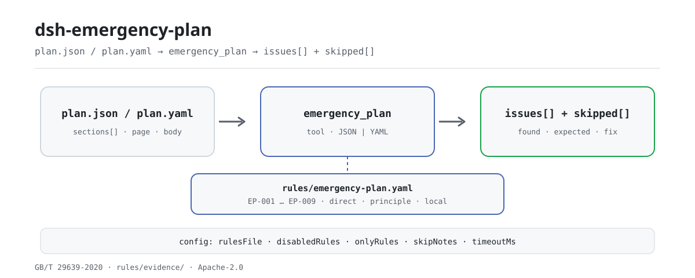

<div align="center">

<picture>
  <source media="(prefers-color-scheme: dark)" srcset="docs/assets/dsh-emergency-plan-flow-dark.svg">
  
</picture>

# dsh-emergency-plan

**आपातकालीन योजना की तत्व-पूर्णता की एक-एक करके जाँच करें और हर अंतर को पृष्ठ या पंक्ति तक पहुँचाएँ — अंतिम निर्णय समीक्षक का।**

सुरक्षा प्रबंधकों और योजना लेखकों के लिए DeepSeek Harness जाँच प्लगइन: एक योजना का अनुच्छेद-वृक्ष, शीर्षक, पृष्ठ-संख्याएँ और मूल पाठ पढ़ता है, सामग्री में घोषित योजना-प्रकार पर संस्करणबद्ध नियम-पैक लागू करता है, और बताता है कि क्या अनुपस्थित है, कहाँ खाली है और वह कहाँ स्थित है।

[इंस्टॉल](#तीन-चरणों-में-शुरुआत) · [कॉन्फ़िगरेशन](#कॉन्फ़िगरेशन) · [FAQ](#faq) · [简体中文](README.md) · [English](README.en.md) · [Español](README.es.md) · [Português](README.pt.md) · [हिन्दी](README.hi.md)

[](LICENSE)
[](#संगतता)
[](https://www.npmjs.com/package/dsh-emergency-plan)
[](https://github.com/PerryLink/dsh-emergency-plan/actions/workflows/ci.yml)
[](#संगतता)

[](https://github.com/PerryLink/dsh-emergency-plan/stargazers)
[](https://www.npmjs.com/package/dsh-emergency-plan)
[](https://dshfind.com/plugins/PerryLink/dsh-emergency-plan?ref=badge)
[](https://securityscorecards.dev/viewer/?uri=github.com/PerryLink/dsh-emergency-plan)
[](https://dsh.market/)
[](https://gitee.com/perrylink/dsh-emergency-plan)

```sh
dsh plugin --profile <name> add dsh-emergency-plan
```

</div>

<sub>समुदाय प्लगइन, DeepSeek से संबद्ध नहीं। आधिकारिक रेपो: <https://github.com/PerryLink/dsh-emergency-plan> (Gitee एक मिरर है)।</sub>

## यह क्या है

`dsh-emergency-plan` एक आपातकालीन योजना —उसका अनुच्छेद-वृक्ष, शीर्षक, पृष्ठ-संख्याएँ और मूल पाठ— पढ़ता है और सामग्री में घोषित योजना-प्रकार (समग्र, विशेष या स्थल-प्रबंधन) पर संस्करणबद्ध नियम-पैक लागू करके उसकी तत्व-पूर्णता जाँचता है: कौन-से तत्व मौजूद हैं, कौन-से अनुपस्थित हैं, कौन-से केवल शीर्षक के रूप में हैं और उनके नीचे कोई पाठ नहीं है, और हर एक कहाँ स्थित है — जहाँ सामग्री में पृष्ठ-संख्याएँ हैं वहाँ पृष्ठ से, अन्यथा पंक्ति से। हर निष्कर्ष उस खंड का उल्लेख करता है जिससे वह आया और बताता है कि वह खंड सीधा अनिवार्यता है, सिद्धांत है या स्थानीय विन्यास; जो जाँच चल नहीं सकी वह चुपचाप पास होने के बजाय `skipped` में बताती है। यह केवल सामग्री और उद्धृत खंडों के बीच शाब्दिक अंतर गिनाता है: सामग्री की गुणवत्ता, अनुपालन या उत्तरदायित्व पर निर्णय नहीं देता। पूरी तरह स्थानीय चलता है: कोई नेटवर्क नहीं, कोई मॉडल कॉल नहीं, और मूल सामग्री कभी नहीं बदलती।

## तीन चरणों में शुरुआत

1. **इंस्टॉल** (कोई एक चैनल चुनें):

   ```sh
   # git चैनल (नवीनतम main)
   dsh plugin --profile web add github:PerryLink/dsh-emergency-plan
   # npm चैनल (प्रकाशित संस्करण)
   dsh plugin --profile web add dsh-emergency-plan
   # tarball चैनल: इस रेपो में pnpm pack के बाद
   dsh plugin --profile web add ./dsh-emergency-plan-<version>.tgz
   ```

2. **न्यूनतम कॉन्फ़िगरेशन** (डिफ़ॉल्ट काम करते हैं; नियम-पैक पैकेज के साथ आता है):

   ```yaml
   - insert:
       - id: dsh-emergency-plan
         name: dsh-emergency-plan
         config:
           rulesFile: rules/emergency-plan.yaml
           timeoutMs: 120000
   ```

3. **जाँचें कि माउंट होता है**:

   ```sh
   dsh --profile web --dump-config | grep -A2 'id: dsh-emergency-plan'
   ```

   इसके बाद `emergency_plan` उपकरण कॉल करें। स्थानीय नमूने के लिए पहले बिल्ड चाहिए (`pnpm run build` से `lib/` बनता है):

   ```sh
   node samples/quickstart/run.mjs
   # emergency_plan: 1 issue(s) — error 0, warn 1, info 0
   # skipped: 8
   ```

   *स्रोत `samples/quickstart/expected/result.json; samples/quickstart/run.mjs`*

**अनइंस्टॉल**: `dsh plugin --profile web remove dsh-emergency-plan` (या प्रोफ़ाइल पैच से पंक्ति हटाएँ)।

## मुख्य क्षमताएँ

- **प्रकार के अनुसार तत्व-सूची** — `EP-001` विशेष योजना को 7.1–7.4 के सामने, `EP-002` समग्र योजना को 6.1–6.5 के सामने और `EP-003` स्थल-प्रबंधन योजना को 8.1–8.4 के सामने जाँचता है। शीर्षक मौजूद हो पर उसके नीचे पाठ न हो तो उसे खाली बताया जाता है।
- **पृष्ठ या पंक्ति तक स्थान** — निष्कर्ष के साथ अनुच्छेद का `page` आता है जब हो, अन्यथा `line`, और वह भी न हो तो शीर्षक। `EP-006` स्थान-सूचना कम होने पर चेतावनी देता है।
- **नियम-पैक डेटा है** — तत्व-सूचियाँ, उपनाम और सीमाएँ `rules/emergency-plan.yaml` में हैं। दिशानिर्देश का दूसरा संस्करण या अपना संस्थागत टेम्पलेट चाहिए तो `rulesFile` को दूसरी YAML पर लगाएँ; कोड बदलने की ज़रूरत नहीं।
- **सत्यापन-योग्य उद्धरण** — हर नियम में दस्तावेज़, संख्या, खंड, शब्दशः उद्धरण, आधार-प्रकार और स्रोत URL होता है। आठ अक्षरों से छोटा उद्धरण, या सिद्धांत-आधारित जाँच को `error` घोषित करना, लोड पर विफल होता है।
- **कुछ भी चुपचाप पास नहीं होता** — बिना कॉन्फ़िगर तत्व-सूची, बंद अनुलग्नक जाँच और क्रम-रहित `EP-005` सब `skipped` में जाते हैं। रिपोर्ट केवल अंतर गिनाती है और शब्द-रक्षक निर्णायक भाषा रोकता है।
- **अनुलग्नक और संस्करण-चिह्न वैकल्पिक** — `EP-009` डिफ़ॉल्ट रूप से बंद है (`requireAttachments: false`); `EP-008` केवल तब चलता है जब `versionPatterns` विन्यस्त हों।

### एक नज़र में नियम

| नियम | जाँच | गंभीरता | आधार-प्रकार |
|---|---|---|---|
| `EP-001` | विशेष योजना में 7.1–7.4 तत्व हैं | warn | सीधा |
| `EP-002` | समग्र योजना में 6.1–6.5 तत्व हैं | warn | सीधा |
| `EP-003` | स्थल-प्रबंधन योजना में 8.1–8.4 तत्व हैं | warn | सीधा |
| `EP-004` | सामग्री तीन में से कौन-सा प्रकार है, यह घोषित करती है | warn | सीधा |
| `EP-005` | तत्व दिशानिर्देश की सूची के क्रम में हैं | info | सिद्धांत |
| `EP-006` | अनुच्छेदों पर पृष्ठ हैं, ताकि निष्कर्ष खोजा जा सके | info | सिद्धांत |
| `EP-007` | कोई तत्व-शीर्षक दो बार नहीं आता | warn | सिद्धांत |
| `EP-008` | संस्करण या संशोधन चिह्न मौजूद है, विन्यास के अनुसार | info | स्थानीय |
| `EP-009` | योजना में निर्धारित अनुलग्नक जानकारी है (डिफ़ॉल्ट बंद) | info | सीधा |

तत्व-सूचियाँ नियम-पैक में रहती हैं, कोड में नहीं, क्योंकि वे दिशानिर्देश के संस्करण के साथ बदलती हैं। गंभीरता दर्शाती है कि GB/T 29639 एक **अनुशंसित** राष्ट्रीय मानक है: अधूरी तत्व-सूची `warn` है, `error` नहीं।

### उदाहरण (वास्तविक आउटपुट)

**उपकरण** `emergency_plan`

**इनपुट**

~~~json
{"name":"缺要素的专项预案","planType":"special","sections":[{"title":"适用范围"},{"title":"应急组织机构及职责"},{"title":"响应启动"}]}
~~~

**आउटपुट**

~~~json
{
  "id": "dsh-emergency-plan.EP-001.811c9dc5",
  "ruleId": "EP-001",
  "severity": "warn",
  "locator": {},
  "found": "材料中未找到要素「处置措施」",
  "expected": "专项应急预案应当包含要素「处置措施」",
  "fix": "检查的别名：处置措施 / 应急处置措施 / 应急处置；如本机构使用其他表述，请在该要素的 aliases 中补充"
}
~~~

*स्रोत `dsh-emergency-plan/tests/fixtures/EP-001/EP-001-unsafe.json; dsh-emergency-plan/tests/fixtures/EP-001/cases.json; dsh-emergency-plan/rules/emergency-plan.yaml; dsh-emergency-plan/tests/index.test.ts`*

क्विकस्टार्ट वही फ़िक्स्चर चलाकर सारांश देता है: 1 `warn`, 0 `error` / `info`, और `skipped` में 8 प्रविष्टियाँ (हर बंद या बिना-कॉन्फ़िगर जाँच अपना कारण बताती है)।

### नियम-दर-नियम उत्तर

| आपका सवाल | इसका जवाब |
|---|---|
| सामग्री में नहीं लिखा है कि यह तीन योजना-प्रकारों में से कौन-सा है। तब क्या होता है? | `EP-004` दर्ज करता है कि सामग्री में `planType` घोषित नहीं है, क्योंकि तीनों प्रकारों की तत्व-सूची अलग-अलग है। यह केवल यह देखता है कि घोषणा मौजूद है, यह नहीं कि वह सही है; घोषणा अनुपस्थित रहने तक `EP-002` और `EP-003` `skipped` में लिख देते हैं कि उन्होंने कौन-सी तत्व-सूची मान ली। |
| एक समग्र योजना में परवर्ती-प्रबंधन (6.4) अनुभाग नहीं है। क्या यह दर्ज होता है — और क्या प्रारूपण-उद्देश्य भी ज़रूरी है? | `EP-002` वर्तमान दिशानिर्देश के अध्याय 6 के पाँच प्रथम-स्तरीय तत्वों (6.1–6.5) को एक-एक करके खोजता है और जो न मिले उसे दर्ज करता है, इसलिए अनुपस्थित परवर्ती-प्रबंधन दर्ज होता है। प्रारूपण-उद्देश्य उन पाँच में नहीं है: वर्तमान संस्करण ने उसे हटा दिया और पैक उसे केवल सामान्य-उपबंध तत्व (6.1) के उपनाम के रूप में स्वीकार करता है। यह निष्कर्ष `warn` है, क्योंकि प्रारूपण दिशानिर्देश अनुशंसित राष्ट्रीय मानक है, अनिवार्य नहीं। |
| विशेष योजना और स्थल-प्रबंधन योजना में कौन-से तत्व अनिवार्य हैं? | `EP-001` विशेष योजना के 7.1–7.4 तत्वों की अपेक्षा करता है और `EP-003` स्थल-प्रबंधन योजना के 8.1–8.4 तत्वों की; जो तत्व अनुच्छेद-वृक्ष में न मिले उसे दर्ज किया जाता है, और यदि शीर्षक है पर उसके नीचे पाठ नहीं है तो उसे खाली बताया जाता है। दोनों सूचियाँ न्यूनतम हैं, बंद सूचियाँ नहीं — स्थल-प्रबंधन का खंड «इनमें सीमित नहीं» कहता है — इसलिए अतिरिक्त तत्व दर्ज नहीं होता। `EP-001` में 7.5 आपात-सहायता अनुशंसित ही रहता है; `EP-003` में प्रबंधन उपायों की छोटी सूची अलग आधार के रूप में दर्ज है और दिशानिर्देश की सूची के साथ कभी मिलाई नहीं जाती। |
| दो योजनाएँ मिलाने के बाद वही तत्व-शीर्षक दो बार आ गया है। क्या यह पकड़ में आता है? | `EP-007` ऐसे अनिवार्य तत्व को दर्ज करता है जो एक से अधिक बार आया हो, और उससे मेल खाने वाले सभी शीर्षक गिनाता है। इसके पीछे कोई स्पष्ट खंड नहीं है — पैक इसे विषय-सूची के क्रम की अद्वितीयता से निकालता है — इसलिए यह `warn` तक सीमित है, और पैक मानवीय पुष्टि माँगता है, क्योंकि दोहराव प्रायः कई योजनाएँ मिलाने से आता है। यह केवल उसी तत्व-सूची की तुलना करता है जिसे वह लागू करता है, सामग्री के सभी दोहराए शीर्षकों की नहीं। |
| रिपोर्ट में `EP-005` `skipped` दिखता है। क्यों — और क्या योजना पर पृष्ठ-संख्याएँ लगाना अनिवार्य है? | `EP-005` तत्वों का क्रम तभी मिला सकता है जब कम से कम दो तत्वों पर `page` या `line` हो; अन्यथा वह कोई क्रम मान लेने के बजाय `skipped` में कारण बता देता है। `EP-006` पृष्ठ-संख्याओं को स्थान-निर्धारण की सहायक सूचना मानता है: पृष्ठ वाले अनुच्छेदों का अनुपात `minPageRatio` (डिफ़ॉल्ट 0.5) तक पहुँचने पर वह चुप रहता है और उससे कम होने पर केवल `info` स्तर की सूचना देता है। दोनों `info` तक सीमित हैं — क्रम की अपेक्षा सूचनात्मक परिशिष्ट से निकाली गई है, मानक के मूल पाठ से नहीं — और पृष्ठ न होने पर इसे किसी खंड का उल्लंघन नहीं कहा जाता: रिपोर्ट पंक्ति-संख्या से स्थान बताती है। |
| `EP-008` और `EP-009` पास होने के बजाय `skipped` में क्यों दिखते हैं? | दोनों विन्यास की प्रतीक्षा में हैं। `EP-009` केवल तब चलता है जब `requireAttachments` `true` हो, क्योंकि कॉल करने वाला प्रायः योजना का मूल पाठ देता है, अनुलग्नक नहीं, और अनुपस्थित अनुलग्नकों को कमी बताना भ्रामक होगा; सक्रिय होने पर यह आठ अनुलग्नक मदों को खोजता है और जो न मिलें उन्हें दर्ज करता है। `EP-008` केवल तब चलता है जब `versionPatterns` विन्यस्त हों: सूची खाली रहने पर यह तय नहीं करता कि संस्करण-चिह्न कैसा लिखा जाए, और विन्यस्त होने पर यह केवल देखता है कि चिह्न किसी अनुच्छेद-शीर्षक में आता है या नहीं — संशोधन की विषय-वस्तु सही है या नहीं, यह कभी नहीं। |

## यह किन मानकों पर आधारित है

| दस्तावेज़ | संख्यांक | इन्हें उद्धृत करने वाले नियम |
|---|---|---|
| उत्पादन इकाइयों के उत्पादन सुरक्षा दुर्घटना आपातकालीन योजनाओं के निर्माण के लिए दिशानिर्देश | GB/T 29639-2020 | EP-001, EP-002, EP-003, EP-004, EP-005, EP-006, EP-007, EP-008, EP-009 |
| उत्पादन सुरक्षा दुर्घटना आपातकालीन योजना प्रबंधन उपाय | राज्य कार्य-सुरक्षा प्रशासन आदेश संख्या 88 (आपातकालीन प्रबंधन मंत्रालय आदेश संख्या 2 द्वारा संशोधित) | EP-001, EP-002, EP-003, EP-009 |

उद्धृत दस्तावेज़ों के मूल शीर्षक:

```text
《生产经营单位生产安全事故应急预案编制导则》 GB/T 29639-2020
《生产安全事故应急预案管理办法》 国家安全生产监督管理总局令第88号（应急管理部令第2号修正）
```

**सीमा:** यह प्लगइन प्रारूपण दिशानिर्देश के सामने **आपातकालीन योजना की तत्व-पूर्णता** जाँचता है और हर तत्व को पृष्ठ से स्थान देता है, उद्धृत खंडों के सामने शाब्दिक अंतर बताता है। यह `dsh-rulefile-check` नहीं है (जो नियामक दस्तावेज़ की वैधता की जाँच करता है) और `dsh-hidden-risk-map` भी नहीं (जो जोखिम-बही को निर्धारण खंडों से जोड़ता है)। यह एक योजना पढ़ता है और बताता है कि कौन-से तत्व मौजूद, अनुपस्थित या खाली हैं, और कहाँ हैं।

> ### ⚠️ इस प्लगइन के आधार में दो सुधार हैं — कृपया पढ़ें
>
> **1. «आठ तत्व» वर्तमान आवश्यकता नहीं है।** परिचित नौ-नाम सूची **GB/T 29639—2013** की है, जिसे
> **पूरी तरह बदल दिया गया** है; वह नाम किसी भी वर्तमान राष्ट्रीय दस्तावेज़ में नहीं मिलता। वर्तमान
> मानक **GB/T 29639-2020** समग्र योजना को अनुच्छेद 6 में **पाँच** प्रथम-स्तरीय तत्व देता है
> (6.1–6.5), और उसकी प्रस्तावना दर्ज करती है कि प्रारूपण-उद्देश्य तत्व हटा दिया गया। 2013 के खंड
> संख्याएँ उद्धृत करने वाला कोई भी नियम एक वापस लिए गए मानक को उद्धृत करता है। यह पैक केवल 2020
> की खंड संख्याएँ उद्धृत करता है, और एक परीक्षण पुष्टि करता है कि 2013 की संख्या कभी नहीं आती।
>
> **2. पृष्ठ-संख्याओं का कोई अनिवार्य आधार नहीं है।** कोई राष्ट्रीय दस्तावेज़ योजना पर पृष्ठ-संख्याएँ
> अनिवार्य नहीं करता; विषय-सूची को नियंत्रित करने वाला परिशिष्ट एक **सूचनात्मक परिशिष्ट** (informative,
> non-normative) है और उसमें «पृष्ठ» शब्द नहीं है। इसलिए पृष्ठ-संख्याएँ **समीक्षक को स्थान बताने वाली
> सहायक सूचना** मानी जाती हैं, `info` में दर्ज होती हैं, और कभी «X का उल्लंघन» के रूप में नहीं कही जातीं।
> योजना में पृष्ठ न होने पर रिपोर्ट पंक्ति-संख्या का सहारा लेती है।

2013 और 2020 के तत्वों के सटीक नाम पैक की अपनी शब्दावली में सुरक्षित हैं:

```text
2013 list (withdrawn): 总则 · 事故风险描述 · 应急组织机构及职责 · 预警及信息报告 ·
                      应急响应 · 信息公开 · 后期处置 · 保障措施 · 应急预案管理
2020 comprehensive list (6.1–6.5): 总则 · 应急组织机构及职责 · 应急响应 ·
                                  后期处置 · 应急保障
Removed by the 2020 edition: 编制目的
```

पैक एक तीसरा, छोटा सुधार भी दर्ज करता है: प्रबंधन उपायों का सही संस्करण **राज्य कार्य-सुरक्षा प्रशासन आदेश संख्या 88 (2016), आपातकालीन प्रबंधन मंत्रालय आदेश संख्या 2 (2019) द्वारा संशोधित** है — केवल «आदेश संख्या 2» नहीं — और 2013 का राज्य परिषद दस्तावेज़ (Guobanfa [2013] संख्या 101) 2024 के दस्तावेज़ (Guobanfa [2024] संख्या 5) से बदल दिया गया है।

## कॉन्फ़िगरेशन

सभी समायोज्य पैरामीटर Schemastery `Config` फ़ील्ड हैं (कॉर्डिस.yml से बदले जा सकते हैं)। आईडी-आधारित ओवरराइड पूरी पंक्ति बदल देता है — ज़रूरी सभी कुंजियाँ दोबारा लिखें। प्रति-नियम सीमाएँ `rules/` के नियम-पैक में हैं।

| कुंजी | प्रकार | डिफ़ॉल्ट | विवरण |
|---|---|---|---|
| `rulesFile` | string | `rules/emergency-plan.yaml` | नियम-पैक का पथ, पैकेज रूट के सापेक्ष |
| `disabledRules` | string[] | `[]` | बंद करने वाले नियम id; प्रत्येक `skipped` में दिखता है |
| `onlyRules` | string[] | `[]` | केवल ये नियम चलाएँ; खाली होने पर सभी नियम चलते हैं |
| `skipNotes` | string | `""` | हर `skipped` कारण के आगे जोड़ी जाने वाली टिप्पणी |
| `timeoutMs` | number | `120000` | उपकरण का सहकारी समय-सीमा बजट (मि.से.) |

<details>
<summary>पूरी कॉन्फ़िगरेशन तालिका (5 कुंजियाँ)</summary>

| कुंजी | प्रकार | डिफ़ॉल्ट | विवरण |
|---|---|---|---|
| `rulesFile` | string | `rules/emergency-plan.yaml` | नियम-पैक का पथ, पैकेज रूट के सापेक्ष; दिशानिर्देश के दूसरे संस्करण या संस्थागत टेम्पलेट के लिए इसे बदलें |
| `disabledRules` | string[] | `[]` | बंद करने वाले नियम id; हर बंद नियम रिपोर्ट के `skipped` में एक बार दिखता है |
| `onlyRules` | string[] | `[]` | केवल ये नियम चलाएँ; खाली होने पर सभी नियम चलते हैं |
| `skipNotes` | string | `""` | हर `skipped` कारण के आगे जोड़ी जाने वाली टिप्पणी, जैसे संस्थागत कार्यान्वयन नियम का उल्लेख |
| `timeoutMs` | number | `120000` | उपकरण का सहकारी समय-सीमा बजट (मि.से.) |

</details>

प्रति-नियम पैरामीटर `rules/emergency-plan.yaml` में:

- `EP-001` / `EP-002` / `EP-003` `elements` — प्रति योजना-प्रकार तत्व-सूची, `[{ name, aliases }]` के रूप में। दिशानिर्देश का दूसरा संस्करण या अपना संस्थागत टेम्पलेट जाँचने के लिए इसे बदलें। खाली सूची पर नियम बताता है कि वह चल नहीं सका।
- `EP-006` `minPageRatio` — पृष्ठ वाले अनुच्छेदों का वह अनुपात जिस तक पहुँचने पर नियम चुप रहता है; डिफ़ॉल्ट 0.5।
- `EP-008` `versionPatterns` — वे स्ट्रिंग जो आपके टेम्पलेट में संस्करण-चिह्न गिनी जाती हैं। खाली का अर्थ है नियम नहीं चलेगा।
- `EP-009` `requireAttachments` — डिफ़ॉल्ट बंद, क्योंकि कॉल करने वाला प्रायः बिना अनुलग्नकों के मूल पाठ देता है; इसे केवल तब सक्षम करें जब अनुलग्नक वास्तव में सामग्री में हों।

## सामग्री का प्रारूप

उपकरण JSON या YAML स्वीकार करता है, और सादा-पाठ योजना भी। अनुच्छेद-वृक्ष रूप पसंदीदा है, क्योंकि योजना निकालने वाला पहले से जानता है कि हर शीर्षक कहाँ है:

```yaml
name: 某公司生产安全事故综合应急预案
planType: comprehensive         # comprehensive | special | on-site
sections:
  - { title: 总则, page: 1, body: 本预案适用于…… }
  - { title: 应急组织机构及职责, page: 2, body: 明确应急组织形式…… }
  - { title: 应急响应, page: 3, body: 规定信息报告、预警与响应程序。 }
```

शीर्षक हर तत्व के उपनामों से तीन चौड़े होते चरणों में मिलाए जाते हैं: सामान्यीकृत पूर्ण समानता, समावेशन, फिर छोटी संपादन-दूरी, इसलिए `五、保障措施` और `二、组织机构与职责` दोनों अपने तत्व तक पहुँचते हैं। तुलना से पहले क्रमांकन उपसर्ग (`一、`, `1.1`, `**…**`) हटाए जाते हैं। Markdown चिपकाना (`# 总则`) भी चलता है और शीर्षकों पर विभाजित होता है, बिना पृष्ठ-संख्याओं के — रिपोर्ट यह बता देती है। सादा-पाठ रूपरेखा भी चलती है: प्रति पंक्ति एक छोटा शीर्षक।

## नियमों के स्रोत

नियम-डेटा `rules/emergency-plan.yaml` में है। हर नियम में दस्तावेज़, संख्या, स्रोत की अपनी क्रमांकन-प्रणाली के अनुसार खंड, शब्दशः उद्धरण और स्रोत URL होता है। लोडर लागू करता है कि उद्धरण कम से कम आठ अक्षरों का वास्तविक उद्धरण हो, और जिस जाँच का आधार केवल सामान्य सिद्धांत या स्थानीय नीति हो, उसे कभी `error` घोषित न किया जाए।

उद्धृत खंड **GB/T 29639-2020** के खंड 5.1, 6, 7, 8, परिशिष्ट C.1 और C.3 से, और प्रबंधन उपायों (राज्य कार्य-सुरक्षा प्रशासन आदेश संख्या 88, संशोधित) के अनुच्छेद 13, 14, 15 और 16 से आते हैं।

तीन निष्कर्षों ने इस पैक को आकार दिया और उसके शीर्ष में दर्ज हैं:

1. **«आठ तत्व» एक वापस लिए गए मानक से आते हैं।** वर्तमान समग्र-योजना सूची में पाँच प्रथम-स्तरीय तत्व हैं, और प्रारूपण-उद्देश्य तत्व हटा दिया गया था।
2. **पृष्ठ-संख्याओं का कोई अनिवार्य आधार नहीं है**, इसलिए वे `info` स्तर की स्थान-सहायता हैं, कभी अनुरूपता-हीनता नहीं।
3. **मानक कोड का उपसर्ग बदल गया।** आपातकालीन प्रबंधन मंत्रालय की 2025 की अधिसूचना संख्या 1 ने AQ/T 9011-2019 और दस अन्य मानकों को **YJ** उपसर्ग में डाल दिया, संख्या, वर्ष और विषय-वस्तु वही रखते हुए — इसलिए सहयोगी मूल्यांकन दिशानिर्देश अब **YJ/T 9011-2019 (पूर्व AQ/T 9011-2019)** लिखा जाता है। मूल्यांकन दिशानिर्देश प्रारूपण दिशानिर्देश से अलग है: GB/T 29639 **प्रारूपण** नियंत्रित करता है, YJ/T 9011 **मूल्यांकन**।

## FAQ

<details>
<summary>सामग्री का डेटा कहाँ जाता है? प्लगइन नेटवर्क का उपयोग करता है?</summary>

कोई नेटवर्क अनुरोध नहीं, कोई मॉडल कॉल नहीं, कोई फ़ाइल-लेखन नहीं। सामग्री `file` या इनलाइन `material` से पढ़ी जाती है, शुद्ध फ़ंक्शन में जाँची जाती है और उपकरण-परिणाम के रूप में लौटाई जाती है; प्लगइन स्वयं कुछ सहेजता या अपलोड नहीं करता। होस्ट उपकरण-आउटपुट कैसे दर्ज करता है, यह होस्ट का निर्णय है।

</details>

<details>
<summary>खाली समस्या-सूची का अर्थ «अनुपालन» है?</summary>

नहीं। खाली सूची का अर्थ केवल यह है कि चले नियमों को कोई अंतर नहीं मिला; `skipped` की हर प्रविष्टि बताती है कि वह क्यों नहीं चली। सभी नियम `warn` / `info` तक सीमित हैं, रिपोर्ट में हमेशा अस्वीकरण रहता है, और शब्द-रक्षक अनुपालन, उत्तरदायित्व या शुद्धता के निर्णय रोकता है।

</details>

<details>
<summary>क्या योजना में पृष्ठ-संख्याएँ न होना ठीक है?</summary>

कोई राष्ट्रीय दस्तावेज़ पृष्ठ-संख्याएँ अनिवार्य नहीं करता। `EP-006` उन्हें स्थान-सहायता मानता है: पृष्ठ वाले अनुच्छेदों का अनुपात `minPageRatio` तक पहुँचने पर चुप रहता है और उससे कम पर केवल `info` सूचना देता है। पृष्ठ न होने पर रिपोर्ट पंक्ति-संख्या से स्थान बताती है और इस कमी को कभी किसी खंड का उल्लंघन नहीं कहती।

</details>

<details>
<summary>क्या यह अन्य प्लगइन के नामों से टकराता है?</summary>

यह ठीक एक उपकरण, `emergency_plan`, पंजीकृत करता है; कोई कमांड, सेवा-कुंजी, क्लाइंट स्लॉट या `webServer` उपसर्ग नहीं, और कोई साझा-इवेंट श्रोता नहीं। इसका बंडल पैच केवल अपनी पंक्ति `insert` करता है। बिंदु-दर-बिंदु तर्क «अन्य DSH प्लगइन के साथ अंतर-संचालनीयता» में है।

</details>

<details>
<summary>एक जाँच में कितना समय लगता है?</summary>

अनुच्छेद-वृक्ष के एक ही पास पर शुद्ध फ़ंक्शन; पैक में 9 नियम हैं, कोई नेटवर्क या मॉडल कॉल नहीं। समय सामग्री के आकार और अनुच्छेदों की संख्या पर निर्भर है; रेपो कोई सार्वजनिक बेंचमार्क नहीं देता, इसलिए यहाँ कोई संख्या नहीं दी गई।

</details>

## समस्या-निवारण

- **हर तत्व-जाँच `skipped` दिखती है।** उस योजना-प्रकार के लिए नियम-पैक की `elements` सूची खाली है, या सामग्री ने `planType` घोषित नहीं किया और जाँच ने कोई मान लेने से इनकार किया।
- **ज्ञात शीर्षक अनुपस्थित बताया जाता है।** उसे उस तत्व के `aliases` में जोड़ें। मिलान शाब्दिक है (ऊपर के तीन चरणों के साथ), अर्थ-आधारित नहीं, यह जानबूझकर है।
- **`EP-005` क्रम के बारे में कुछ नहीं बताता।** अनुच्छेदों पर न `page` है न `line`, इसलिए क्रम बनाने का आधार नहीं; नियम `skipped` में यह बता देता है।
- **`EP-006` बिना पृष्ठ वाली योजना पर शिकायत करता है।** यही उस नियम का काम है, और वह `info` है: वह बता रहा है कि रिपोर्ट केवल पंक्ति-संख्याएँ उद्धृत कर सकती है। `minPageRatio` घटाएँ या इसे छोड़ दें।
- **प्लगइन इंस्टॉल हो गया पर टूल दिखता नहीं।** जाँचें कि `main` `lib/index.mjs` पर जाता है और `pnpm run build` ने उसे बनाया है; गलत `main` पर लोडर प्रविष्टि चुपचाप छोड़ देता है।
- **`dsh plugin add` पैकेज को असंगत बताकर मना करता है।** peer रेंज `0.1.x` और `0.2.x` को कवर करती है; यदि आपका रनटाइम उससे बाहर है तो स्पष्ट छूट दें: `dsh plugin --profile <name> allow-version dsh-emergency-plan@0.1.0 --dsh-version <runtime> --accept-risk`
- **`check` में `manifest-peers` विफल दिखता है।** स्थिर जाँचकर्ता 0.2 श्रृंखला से पहले की हार्डकोडेड peer रेंज से तुलना करता है। रनटाइम इंस्टॉल के समय अनुकूलता लागू करता है, इसलिए घोषित रेंज सही है; यह `dsh-plugin-dev` की ज्ञात अपस्ट्रीम समस्या है।

## सुरक्षा सीमाएँ और ज्ञात सीमाएँ

- **केवल-पठन और स्थानीय।** प्लगइन `file` या इनलाइन `material` पढ़ता है, कुछ वापस नहीं लिखता, कोई नेटवर्क अनुरोध नहीं करता और किसी मॉडल को नहीं बुलाता; `package.json` की डेमो `network: false` और `writes: []` घोषित करती है।
- **कोई निर्णायक निष्कर्ष नहीं।** केवल सामग्री और उद्धृत खंडों के बीच शाब्दिक अंतर गिनाता है; अनुपालन, उत्तरदायित्व और सामग्री की गुणवत्ता समीक्षक के पास रहती है। रेंडरिंग परत शब्द-रक्षक चलाती है और हमेशा अस्वीकरण रखती है।
- **गंभीरता साक्ष्य का अनुसरण करती है।** `derived-from-principle` अधिकतम `warn` और `institutional-configuration` अधिकतम `info`; सिद्धांत-आधारित जाँच को `error` घोषित करने वाला पैक लोड पर विफल होता है।
- **खाली परिणाम «पास» नहीं है।** बिना कॉन्फ़िगर तत्व-सूची, बंद अनुलग्नक जाँच और क्रम-रहित मद सब `skipped` में आते हैं।
- **पृष्ठ-संख्याएँ अनिवार्य नहीं।** FAQ और सुधार 2 देखें; `EP-006` केवल `info` संकेत है।
- **मिलान शाब्दिक है, अर्थ-आधारित नहीं।** शीर्षक सामान्यीकृत समानता, समावेशन और संपादन-दूरी से गुज़रते हैं; पर्यायवाची उस तत्व के `aliases` में जोड़ें। प्लगइन यह नहीं आँकता कि मूल पाठ अच्छा लिखा है या नहीं।
- **`planType` अनुपस्थित या अपरिचित।** `EP-004` अनुपस्थिति दर्ज करता है; `EP-002` / `EP-003` `skipped` में बताते हैं कि कौन-सी सूची मानी; अपरिचित मान एक चेतावनी जोड़ता है।
- **अनुलग्नक और संस्करण-चिह्न डिफ़ॉल्ट रूप से बंद।** `EP-009` का मान `false`; `EP-008` के `versionPatterns` खाली। दोनों `skipped` में यह बताते हैं।
- **नियम-पैक बदलने की एक सीमा है।** दिशानिर्देश का दूसरा संस्करण या संस्थागत टेम्पलेट अभी भी उद्धरणों को साथ आए `rules/evidence/` के सामने सत्यापित करता है; नए उद्धरणों के लिए अपना सत्यापन-रिकॉर्ड चाहिए।

## अन्य DSH प्लगइन के साथ अंतर-संचालनीयता

- **नेमस्पेस वाला उपकरण-नाम।** केवल `emergency_plan` पंजीकृत करता है, किसी अंतर्निहित उपकरण या अन्य प्लगइन के नंगे नाम पर कब्ज़ा नहीं करता।
- **सेवा-कुंजी टकराव नहीं।** कोई सेवा-कुंजी प्रदान नहीं करता।
- **स्लॉट या रूट टकराव नहीं।** कोई क्लाइंट स्लॉट और कोई `webServer` उपसर्ग पंजीकृत नहीं करता।
- **साझा-इवेंट श्रोता नहीं।** कोई `ctx.on` सदस्यता नहीं, इसलिए कोई इवेंट-श्रृंखला छोटी नहीं की जा सकती।
- **निर्भरता के बिना माउंट नहीं होता।** यह `inject: ['tools']` घोषित करता है; `tools` सेवा के बिना उपकरण पंजीकृत नहीं होता।
- **पैच परत कुछ नहीं ढकती।** बंडल पैच केवल अपनी पंक्ति `insert` करता है; अंतर्निहित पंक्ति का `config` कभी नहीं लिखता।
- **कोई वैश्विक परिवर्तन नहीं।** प्रोटोटाइप नहीं बदलता, `process.env` नहीं लिखता, वैश्विक fetch डिस्पैचर नहीं बदलता।

## संगतता

| सतह | स्थिति |
|---|---|
| Harness | peer रेंज `>=0.1.2-rc.1 <0.2.0 \|\| >=0.2.0-0 <0.3.0` — `0.2.0-rc.2` और `0.2.1-rc.2` दोनों को स्वीकार करने के लिए सत्यापित। `engines.dsh` `>=0.2.1-0 <0.3.0` के रूप में घोषित है और 0.2.1 से होस्ट इसे लागू करता है |
| Node | `^22.19.0 \|\| >=24.0.0` |
| प्लेटफ़ॉर्म | सभी (शुद्ध ESM; कोई नेटिव कोड नहीं, कोई नेटवर्क नहीं, कोई मॉडल कॉल नहीं) |
| टूल मोड | `native` और `ptc` में काम करता है; कई योजनाओं के बैच के लिए `ptc` चुनें, जिससे स्कीमा लागत एक बार चुकाई जाए |

## पारिस्थितिकी और गुणवत्ता

- [Gitee मिरर](https://gitee.com/perrylink/dsh-emergency-plan) (सिंक मिरर; GitHub आधिकारिक है)
- [dshfind प्लगइन पृष्ठ](https://dshfind.com/plugins/PerryLink/dsh-emergency-plan) (इंस्टॉल और रैंकिंग)
- [OpenSSF Scorecard रिपोर्ट](https://securityscorecards.dev/viewer/?uri=github.com/PerryLink/dsh-emergency-plan) ([.github/workflows/scorecard.yml](.github/workflows/scorecard.yml) द्वारा संचालित)
- [DSH Market](https://dsh.market/) (सूचीबद्ध)
- [सामग्री के अनुसार जाँचकर्ता चुनें](https://perrylink.github.io/zh/checkers/choose/) — परिवार में अन्य जाँचकर्ता भी हैं; सामग्री-प्रकार से चुनें
- [पारिस्थितिकी ज्ञान-कोश](https://perrylink.github.io/dsh-plugin-guide/): प्लगइन विकास गाइड · चयन डेटा · रखरखाव मानदंड

## विकास

```sh
pnpm install
pnpm run typecheck        # tsc --noEmit
pnpm test                 # vitest, प्रति नियम compliant/violating फ़िक्स्चर
pnpm run build            # tsdown -> lib/index.mjs + lib/index.d.mts
pnpm run verify:self-contained
pnpm run check:lockfile
pnpm run check:readmes
pnpm run check:citations
pnpm pack
```

`prepublishOnly` पूरा गेट दोबारा चलाता है, इसलिए बिना बिल्ड या ड्रिफ्ट वाला ट्री प्रकाशित नहीं होता।

डायरेक्टरी लेआउट:

| पथ | भूमिका |
|---|---|
| `src/index.ts` | प्लगइन अनुबंध (`name` / `inject` / `Config` / `apply`); `emergency_plan` पंजीकृत करता है और नियम-पैक हल करता है |
| `src/config.ts` | Schemastery स्कीमा; सभी समायोज्य पैरामीटर |
| `src/check.ts` | शुद्ध जाँच-कोर `(input, ruleset, options) => Report`; कोई I/O नहीं, कोई घड़ी नहीं, कोई मॉडल पहुँच नहीं |
| `src/parse.ts` | JSON / YAML / सादा-पाठ योजना रीडर |
| `src/view.ts` | रिपोर्ट का मॉडल-उन्मुख प्रक्षेपण; `output.schema` उसे दर्शाता है |
| `src/shared/` | साझा किट (नियम-लोडर, रिपोर्ट आकार, YAML उपसमुच्चय, शब्द-रक्षक) प्रतिलिपि के रूप में अंदर, ताकि पैकेज स्वयंपूर्ण रहे |
| `rules/emergency-plan.yaml` | नियम-पैक, 9 नियम |
| `rules/evidence/` | हर उद्धरण का सत्यापन-रिकॉर्ड |
| `tests/` | vitest; हर नियम के लिए compliant / violating फ़िक्स्चर |
| `samples/quickstart/` | क्विकस्टार्ट नमूना और अपेक्षित आउटपुट |
| `cordis.patch.yml` | बंडल पंक्ति घोषणा |

README की छवियाँ [`scripts/gen-readme-assets.py`](scripts/gen-readme-assets.py) (Python + Pillow) से प्रोग्रामेटिक रूप से बनती हैं और दोबारा चलाई जा सकती हैं:

```sh
python scripts/gen-readme-assets.py
```

यह केवल `docs/assets/dsh-emergency-plan-flow-{light,dark}.svg` लिखता है। पुराना एक-थीम प्रवाह आरेख और डेमो छवियाँ बाहरी लिंक के लिए `docs/assets/` में रहती हैं; README केवल नए हल्के/गहरे जोड़े का संदर्भ देता है।

Topics: `deepseek-harness`, `dsh`, `dsh-plugin`, `cordis`, `emergency`, `plan`

## परिवार और आभार

यह परियोजना [PerryLink](https://github.com/PerryLink) द्वारा रखरखाव किए जाने वाले DeepSeek Harness प्लगइन परिवार का हिस्सा है (सभी Apache-2.0)। पूरा सूचकांक: [सामग्री के अनुसार जाँचकर्ता चुनें](https://perrylink.github.io/zh/checkers/choose/) और [सभी प्लगइन](https://github.com/PerryLink)। अगर यह मदद करे, तो **एक स्टार अगले व्यक्ति को इसे खोजने में मदद करता है**; इससे कोई सुविधा अनलॉक नहीं होती।

- [@PerryLink](https://github.com/PerryLink) — निर्माता और रखरखावकर्ता: नियम-पैक (EP-001..EP-009), `emergency_plan` उपकरण, उद्धरण-सत्यापन रिकॉर्ड और पाँच-भाषी दस्तावेज़।

<details>
<summary>सभी प्लगइन दिखाएँ</summary>

| प्लगइन | स्थिति |
|---|---|
| **[dsh-aqua-input-check](https://github.com/PerryLink/dsh-aqua-input-check)** |  |
| **[dsh-archive-check](https://github.com/PerryLink/dsh-archive-check)** |  |
| **[dsh-auto-review](https://github.com/PerryLink/dsh-auto-review)** |  |
| **[dsh-autotier](https://github.com/PerryLink/dsh-autotier)** | 🧊 फ़्रोज़न — रेपो README देखें |
| **[dsh-bid-ca-precheck](https://github.com/PerryLink/dsh-bid-ca-precheck)** |  |
| **[dsh-bid-qual-check](https://github.com/PerryLink/dsh-bid-qual-check)** |  |
| **[dsh-cert-mcp](https://github.com/PerryLink/dsh-cert-mcp)** | 🧊 फ़्रोज़न — रेपो README देखें |
| **[dsh-checkpoint-rewind](https://github.com/PerryLink/dsh-checkpoint-rewind)** |  |
| **[dsh-click](https://github.com/PerryLink/dsh-click)** |  |
| **[dsh-composer-history](https://github.com/PerryLink/dsh-composer-history)** |  |
| **[dsh-contract-stance](https://github.com/PerryLink/dsh-contract-stance)** |  |
| **[dsh-customs-doc-check](https://github.com/PerryLink/dsh-customs-doc-check)** |  |
| **[dsh-data-quality](https://github.com/PerryLink/dsh-data-quality)** | 🧊 फ़्रोज़न — रेपो README देखें |
| **[dsh-demurrage-ledger](https://github.com/PerryLink/dsh-demurrage-ledger)** |  |
| **[dsh-doublecheck](https://github.com/PerryLink/dsh-doublecheck)** |  |
| **[dsh-drill-script-check](https://github.com/PerryLink/dsh-drill-script-check)** |  |
| **[dsh-eia-guide-check](https://github.com/PerryLink/dsh-eia-guide-check)** |  |
| **[dsh-emergency-plan](https://github.com/PerryLink/dsh-emergency-plan)** |  |
| **[dsh-essay-rubric-check](https://github.com/PerryLink/dsh-essay-rubric-check)** |  |
| **[dsh-evidence-check](https://github.com/PerryLink/dsh-evidence-check)** |  |
| **[dsh-export-ctl-check](https://github.com/PerryLink/dsh-export-ctl-check)** |  |
| **[dsh-fast](https://github.com/PerryLink/dsh-fast)** |  |
| **[dsh-fmea-table-check](https://github.com/PerryLink/dsh-fmea-table-check)** |  |
| **[dsh-forecast-penalty](https://github.com/PerryLink/dsh-forecast-penalty)** |  |
| **[dsh-fund-research](https://github.com/PerryLink/dsh-fund-research)** |  |
| **[dsh-github](https://github.com/PerryLink/dsh-github)** |  |
| **[dsh-gongwen-flow-check](https://github.com/PerryLink/dsh-gongwen-flow-check)** |  |
| **[dsh-gongwen-word-check](https://github.com/PerryLink/dsh-gongwen-word-check)** |  |
| **[dsh-guard-plan-qc](https://github.com/PerryLink/dsh-guard-plan-qc)** |  |
| **[dsh-hazchem-check](https://github.com/PerryLink/dsh-hazchem-check)** |  |
| **[dsh-hazplan-check](https://github.com/PerryLink/dsh-hazplan-check)** |  |
| **[dsh-hidden-risk-map](https://github.com/PerryLink/dsh-hidden-risk-map)** |  |
| **[dsh-hs-classify](https://github.com/PerryLink/dsh-hs-classify)** |  |
| **[dsh-icd-rule-check](https://github.com/PerryLink/dsh-icd-rule-check)** |  |
| **[dsh-industry-research](https://github.com/PerryLink/dsh-industry-research)** |  |
| **[dsh-lawcite-adapter](https://github.com/PerryLink/dsh-lawcite-adapter)** |  |
| **[dsh-laya](https://github.com/PerryLink/dsh-laya)** |  |
| **[dsh-lc-doc-check](https://github.com/PerryLink/dsh-lc-doc-check)** |  |
| **[dsh-learning-gap-check](https://github.com/PerryLink/dsh-learning-gap-check)** |  |
| **[dsh-library](https://github.com/PerryLink/dsh-library)** |  |
| **[dsh-local-ai](https://github.com/PerryLink/dsh-local-ai)** |  |
| **[dsh-lsp-actions](https://github.com/PerryLink/dsh-lsp-actions)** |  |
| **[dsh-mask](https://github.com/PerryLink/dsh-mask)** |  |
| **[dsh-mcp-panel](https://github.com/PerryLink/dsh-mcp-panel)** |  |
| **[dsh-medrec-qc](https://github.com/PerryLink/dsh-medrec-qc)** |  |
| **[dsh-memento](https://github.com/PerryLink/dsh-memento)** | 🧊 फ़्रोज़न — रेपो README देखें |
| **[dsh-nsfc-form-check](https://github.com/PerryLink/dsh-nsfc-form-check)** |  |
| **[dsh-nurse-record-check](https://github.com/PerryLink/dsh-nurse-record-check)** |  |
| **[dsh-observe](https://github.com/PerryLink/dsh-observe)** |  |
| **[dsh-origin-rvc-check](https://github.com/PerryLink/dsh-origin-rvc-check)** |  |
| **[dsh-ota-review-check](https://github.com/PerryLink/dsh-ota-review-check)** |  |
| **[dsh-output-styles](https://github.com/PerryLink/dsh-output-styles)** |  |
| **[dsh-paper-doc-adapter](https://github.com/PerryLink/dsh-paper-doc-adapter)** |  |
| **[dsh-permission-rules](https://github.com/PerryLink/dsh-permission-rules)** |  |
| **[dsh-permit-report-check](https://github.com/PerryLink/dsh-permit-report-check)** |  |
| **[dsh-pipeline-check](https://github.com/PerryLink/dsh-pipeline-check)** |  |
| **[dsh-pleading-draft](https://github.com/PerryLink/dsh-pleading-draft)** |  |
| **[dsh-plugin-doctor](https://github.com/PerryLink/dsh-plugin-doctor)** | 🚫 रिटायर्ड (रेपो संग्रहीत) |
| **[dsh-plugin-guide](https://github.com/PerryLink/dsh-plugin-guide)** |  |
| **[dsh-plugin-kit](https://github.com/PerryLink/dsh-plugin-kit)** | 🚫 रिटायर्ड (रेपो संग्रहीत) |
| **[dsh-plugin-upgrade](https://github.com/PerryLink/dsh-plugin-upgrade)** | 🚫 रिटायर्ड (रेपो संग्रहीत) |
| **[dsh-policy-brief-draft](https://github.com/PerryLink/dsh-policy-brief-draft)** |  |
| **[dsh-power-loss-split](https://github.com/PerryLink/dsh-power-loss-split)** |  |
| **[dsh-power-ticket-check](https://github.com/PerryLink/dsh-power-ticket-check)** |  |
| **[dsh-ppap-check](https://github.com/PerryLink/dsh-ppap-check)** |  |
| **[dsh-protest-deadline](https://github.com/PerryLink/dsh-protest-deadline)** |  |
| **[dsh-railway-window](https://github.com/PerryLink/dsh-railway-window)** |  |
| **[dsh-repair-order-qc](https://github.com/PerryLink/dsh-repair-order-qc)** |  |
| **[dsh-research-report](https://github.com/PerryLink/dsh-research-report)** |  |
| **[dsh-review-reply-check](https://github.com/PerryLink/dsh-review-reply-check)** |  |
| **[dsh-rulefile-check](https://github.com/PerryLink/dsh-rulefile-check)** |  |
| **[dsh-safety-brief-check](https://github.com/PerryLink/dsh-safety-brief-check)** |  |
| **[dsh-score](https://github.com/PerryLink/dsh-score)** | 🧊 फ़्रोज़न — रेपो README देखें |
| **[dsh-session-sync](https://github.com/PerryLink/dsh-session-sync)** |  |
| **[dsh-site-log-check](https://github.com/PerryLink/dsh-site-log-check)** |  |
| **[dsh-skill-pack-security](https://github.com/PerryLink/dsh-skill-pack-security)** |  |
| **[dsh-soe-decision-check](https://github.com/PerryLink/dsh-soe-decision-check)** |  |
| **[dsh-soilwater-check](https://github.com/PerryLink/dsh-soilwater-check)** |  |
| **[dsh-sop-sync-check](https://github.com/PerryLink/dsh-sop-sync-check)** |  |
| **[dsh-spc-gbt-adapter](https://github.com/PerryLink/dsh-spc-gbt-adapter)** |  |
| **[dsh-talk](https://github.com/PerryLink/dsh-talk)** |  |
| **[dsh-tender-extract](https://github.com/PerryLink/dsh-tender-extract)** |  |
| **[dsh-tender-matrix](https://github.com/PerryLink/dsh-tender-matrix)** |  |
| **[dsh-test-drive](https://github.com/PerryLink/dsh-test-drive)** |  |
| **[dsh-ticktick](https://github.com/PerryLink/dsh-ticktick)** | 🚫 रिटायर्ड (रेपो संग्रहीत) |
| **[dsh-translate](https://github.com/PerryLink/dsh-translate)** |  |
| **[dsh-warranty-calc](https://github.com/PerryLink/dsh-warranty-calc)** |  |
| **[dsh-budget](https://github.com/PerryLink/dsh-budget)** | 🧊 फ़्रोज़न — रेपो README देखें |
| **[dsh-claude-move](https://github.com/PerryLink/dsh-claude-move)** | 🧊 फ़्रोज़न — रेपो README देखें |
| **[dsh-defend](https://github.com/PerryLink/dsh-defend)** | 🧊 फ़्रोज़न — रेपो README देखें |
| **[dsh-draw](https://github.com/PerryLink/dsh-draw)** | 🧊 फ़्रोज़न — रेपो README देखें |
| **[dsh-reach](https://github.com/PerryLink/dsh-reach)** | 🧊 फ़्रोज़न — रेपो README देखें |
| **[dsh-background-agents](https://github.com/PerryLink/dsh-background-agents)** | 🚫 रिटायर्ड (रेपो संग्रहीत) |
| **[dsh-session-pin](https://github.com/PerryLink/dsh-session-pin)** | 🚫 रिटायर्ड (रेपो संग्रहीत) |
| **[dsh-team-rooms](https://github.com/PerryLink/dsh-team-rooms)** | 🚫 रिटायर्ड (रेपो संग्रहीत) |

</details>

## License

[LICENSE](LICENSE) (Apache License 2.0) © 2026 dsh-emergency-plan contributors

<p align="center"><sub>Apache-2.0 · समुदाय प्लगइन, DeepSeek से संबद्ध नहीं।</sub></p>
