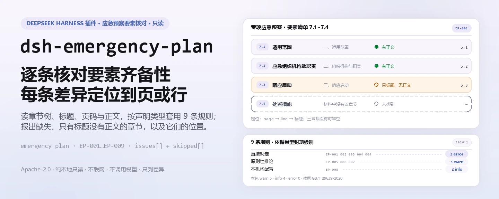
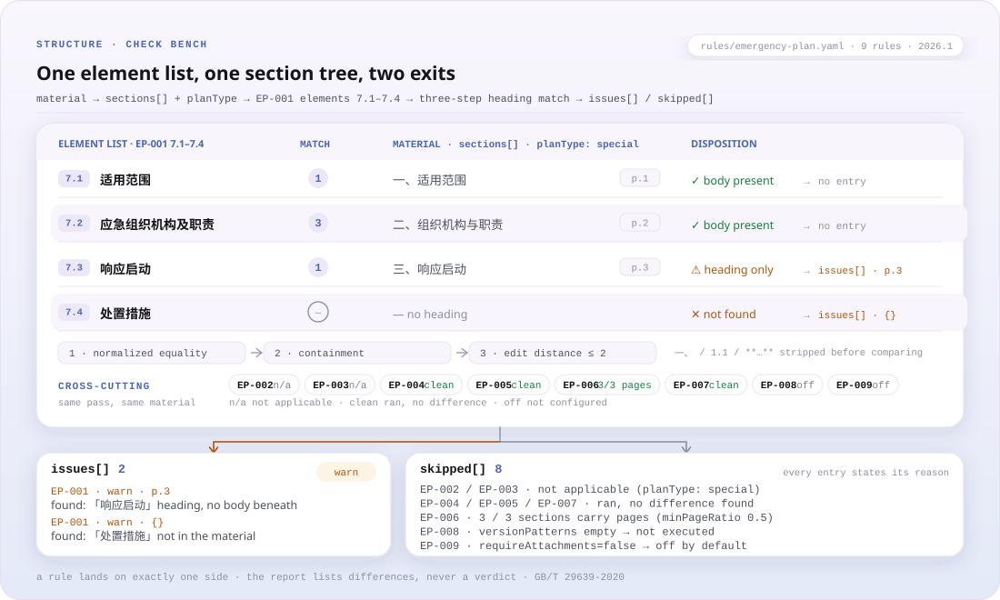

<div align="center">

<picture>
  <source media="(prefers-color-scheme: dark)" srcset="docs/assets/dsh-emergency-plan-hero-zh-dark.webp">
  
</picture>

# dsh-emergency-plan

**逐条核对应急预案的要素齐备性，把每条差异定位到页或行——结论留给审核人。**

面向安全管理员与预案编制人的 DeepSeek Harness 检查插件：读入一份预案的章节树、标题、页码与正文，按材料声明的预案类型套用版本化规则库，报出缺什么、哪里空、在哪儿。

[安装](#三步上手) · [配置](#配置) · [FAQ](#faq) · [简体中文](README.md) · [English](README.en.md)

[](LICENSE)
[](#兼容性)
[](https://www.npmjs.com/package/dsh-emergency-plan)
[](https://github.com/PerryLink/dsh-emergency-plan/actions/workflows/ci.yml)
[](#兼容性)

[](https://github.com/PerryLink/dsh-emergency-plan/stargazers)
[](https://www.npmjs.com/package/dsh-emergency-plan)
[](https://dshfind.com/plugins/PerryLink/dsh-emergency-plan?ref=badge)
[](https://securityscorecards.dev/viewer/?uri=github.com/PerryLink/dsh-emergency-plan)
[](https://dsh.market/)
[](https://gitee.com/perrylink/dsh-emergency-plan)

```sh
dsh plugin --profile <name> add dsh-emergency-plan
```

</div>

<sub>社区插件，与 DeepSeek 官方无关。唯一仓库：<https://github.com/PerryLink/dsh-emergency-plan>（Gitee 为镜像）。</sub>

## 它是什么

`dsh-emergency-plan` 读取一份应急预案——章节树、标题、页码与正文——按材料声明的预案类型（综合应急预案 / 专项应急预案 / 现场处置方案）套用版本化规则库，核对这份预案的要素齐备性：哪些要素已出现、哪些缺失、哪些只有标题而标题之下没有正文，以及各要素在材料里的位置——材料带页码时按页定位，否则按行号定位。每条差异都写出所依据的条款，并标明该条款是直接规定、原则性推论还是本机构配置；无法执行的检查会在 `skipped` 中说明，而不是静默通过。它只列材料与所引条款之间的字面差异，不判断内容写得好不好，也不作出合规、责任或安全定性。纯本地运行：不联网、不调用模型、不改原件。

<picture>
  <source media="(prefers-color-scheme: dark)" srcset="docs/assets/dsh-emergency-plan-flow-v5-dark.svg">
  
</picture>

## 三步上手

1. **安装**（三选一）：

   ```sh
   # git 通道（最新 main）
   dsh plugin --profile web add github:PerryLink/dsh-emergency-plan
   # npm 通道（已发布版本）
   dsh plugin --profile web add dsh-emergency-plan
   # tarball 通道：本仓库 pnpm pack 后
   dsh plugin --profile web add ./dsh-emergency-plan-<version>.tgz
   ```

2. **最小配置**（默认即可用；规则库随包发布）：

   ```yaml
   - insert:
       - id: dsh-emergency-plan
         name: dsh-emergency-plan
         config:
           rulesFile: rules/emergency-plan.yaml
           timeoutMs: 120000
   ```

3. **验证已生效**：

   ```sh
   dsh --profile web --dump-config | grep -A2 'id: dsh-emergency-plan'
   ```

   装上后调用 `emergency_plan` 工具即可。本地样例需要先 `pnpm run build` 产出 `lib/`：

   ```sh
   node samples/quickstart/run.mjs
   # emergency_plan: 1 issue(s) — error 0, warn 1, info 0
   # skipped: 8
   ```

   *Observed from `samples/quickstart/expected/result.json; samples/quickstart/run.mjs`*

**卸载**：`dsh plugin --profile web remove dsh-emergency-plan`（或从 profile patch 删掉该行）。

## 核心能力

- **按类型核对要素清单** —— `EP-001` 专项应急预案 7.1~7.4，`EP-002` 综合应急预案 6.1~6.5，`EP-003` 现场处置方案 8.1~8.4。标题在但标题之下没有正文的，也按“空”报出。
- **按页/行定位每条差异** —— 材料带 `page` 时按页，否则按 `line`；两者都没有时用标题定位。`EP-006` 在带页码的章节占比低于阈值时提示定位信息不足。
- **规则库是数据** —— 要素清单、别名与阈值都在 `rules/emergency-plan.yaml`。换一份 YAML 就能切换导则版本或本机构模板，不必改代码。
- **引文可核验** —— 每条规则都带文件、文号、条款号、逐字摘录、依据类型与来源地址；摘录不足八个字符、或把原则性检查标成 `error`，都会在加载期失败。
- **不静默通过** —— 未配置的要素清单、未启用的附件检查、无法排序的 `EP-005` 都会进 `skipped`。报告只列差异，措辞守卫拦截“合规/违法”一类定性词。
- **附件与版本标识按需开启** —— `EP-009` 默认关闭（`requireAttachments: false`）；`EP-008` 只有配置了 `versionPatterns` 才执行。

### 规则一览

| 规则 | 检查内容 | 级别 | 依据类型 |
|---|---|---|---|
| `EP-001` | 专项应急预案包含 7.1~7.4 要素 | warn | 直接规定 |
| `EP-002` | 综合应急预案包含 6.1~6.5 要素 | warn | 直接规定 |
| `EP-003` | 现场处置方案包含 8.1~8.4 要素 | warn | 直接规定 |
| `EP-004` | 材料声明三类预案中的哪一类 | warn | 直接规定 |
| `EP-005` | 要素按导则清单的顺序出现 | info | 原则性推论 |
| `EP-006` | 章节带页码，便于定位差异 | info | 原则性推论 |
| `EP-007` | 同一要素标题不重复出现 | warn | 原则性推论 |
| `EP-008` | 版本或修订标识存在（按配置） | info | 本机构配置 |
| `EP-009` | 预案带规定的附件信息（默认关闭） | info | 直接规定 |

要素清单在规则库而不在代码里，因为清单随导则版本变化。级别反映 GB/T 29639 是**推荐性**国家标准：要素不齐是 `warn`，不是 `error`。

### 示例（真实输出）

**工具** `emergency_plan`

**输入**

~~~json
{"name":"缺要素的专项预案","planType":"special","sections":[{"title":"适用范围"},{"title":"应急组织机构及职责"},{"title":"响应启动"}]}
~~~

**输出**

~~~json
{
  "id": "dsh-emergency-plan.EP-001.811c9dc5",
  "ruleId": "EP-001",
  "severity": "warn",
  "locator": {},
  "found": "材料中未找到要素「处置措施」",
  "expected": "专项应急预案应当包含要素「处置措施」",
  "fix": "检查的别名：处置措施 / 应急处置措施 / 应急处置；如本机构使用其他表述，请在该要素的 aliases 中补充"
}
~~~

*Observed from `dsh-emergency-plan/tests/fixtures/EP-001/EP-001-unsafe.json; dsh-emergency-plan/tests/fixtures/EP-001/cases.json; dsh-emergency-plan/rules/emergency-plan.yaml; dsh-emergency-plan/tests/index.test.ts`*

快速试跑同一份样例的汇总：1 条 `warn`、0 条 `error` / `info`，另有 8 条 `skipped`（未启用或未配置的检查逐条说明原因）。

### 按规则的详细回答

| 你会问 | 它怎么答 |
|---|---|
| 材料里没写这是三类预案中的哪一类，会怎么样？ | `EP-004` 会报出材料未声明 `planType`，因为三类预案的要素清单各不相同。它只核对是否声明，不判断该声明是否正确；声明缺失期间，`EP-002` 与 `EP-003` 会在 `skipped` 中写明自己假定按哪一份要素清单检查。 |
| 一份综合应急预案没有「后期处置」一章，会被报出吗？还需要写「编制目的」吗？ | `EP-002` 按现行导则第 6 章的五个一级要素（6.1~6.5）逐项查找，找不到「后期处置」就报出该缺项。「编制目的」不是这五个要素之一：现行版本已将其去掉，规则库只在「总则」的别名里兼容它。该条报出的是 `warn`，因为编制导则是推荐性国家标准，不是强制要求。 |
| 专项应急预案和现场处置方案分别必须有哪些要素？ | `EP-001` 要求专项应急预案具备 7.1~7.4 要素，`EP-003` 要求现场处置方案具备 8.1~8.4 要素，各自报出在章节树里找不到的要素；标题在、标题之下没有正文的，按「空」报出。两份清单都是下限而非封闭清单——现场处置那一条的原文写着「包括但不限于」——多写要素不会被报出。7.5 应急保障在 `EP-001` 中仍属推荐项；《生产安全事故应急预案管理办法》里较短的那份清单在 `EP-003` 中单独标注为依据，不与导则的清单合并表述。 |
| 合并两份预案后，同一个要素标题出现了两次，会被查出来吗？ | `EP-007` 会报出出现不止一次的必备要素，并列出匹配到它的各个标题。这件事没有明文条款可援引——规则库依据的是目次次序的唯一性，因而封顶 `warn`——且规则库要求人工确认，因为重复通常来自合并多份预案。它比对的只是它所适用的那份要素清单，不是材料里所有重复的标题。 |
| 报告里 `EP-005` 显示 `skipped`，为什么？预案一定要标页码吗？ | `EP-005` 只有在至少两个要素带 `page` 或 `line` 时才能核对顺序，否则在 `skipped` 中说明原因，而不是凭空假定一个顺序。`EP-006` 把页码当作辅助定位信息：带页码的章节占比达到 `minPageRatio`（默认 0.5）时它不报差异，低于该比例时只作 `info` 级提示。两条都封顶 `info`——顺序要求由资料性附录推论而来，标准正文并无此规定——没有页码时也不会被表述为「不符合某条规定」，报告改按行号定位。 |
| 为什么 `EP-008` 和 `EP-009` 出现在 `skipped` 里，而不是通过？ | 两条都在等配置。`EP-009` 只有把 `requireAttachments` 设为 `true` 才执行，因为调用方通常只给正文、不给附件，把「没给附件」当成缺项会误导；启用后它按八项附件条目查找，报出找不到的条目。`EP-008` 只有配置了 `versionPatterns` 才执行：列表为空时它不替使用方规定版本标识该写成什么样，配置后也只核对章节标题里是否出现配置的标识词，不判断修订内容是否正确。 |

## 依据的标准

| 文件 | 文号 | 引用它的规则 |
|---|---|---|
| 《生产经营单位生产安全事故应急预案编制导则》 | GB/T 29639-2020 | EP-001, EP-002, EP-003, EP-004, EP-005, EP-006, EP-007, EP-008, EP-009 |
| 《生产安全事故应急预案管理办法》 | 国家安全生产监督管理总局令第88号（应急管理部令第2号修正） | EP-001, EP-002, EP-003, EP-009 |

**边界**：本插件依据编制导则核对**应急预案的要素齐备性**，并按页定位每个要素，报出与所引条款之间的字面差异。它不是 `dsh-rulefile-check`（后者审查规范性文件的合法性），也不是 `dsh-hidden-risk-map`（后者把隐患台账映射到判定条款）。它读取一份预案，报出哪些要素存在、缺失或为空，以及它们位于何处。

> ### ⚠️ 本插件建立在两处更正之上——请阅读
>
> **1. “八要素”不是现行要求。** 那份熟悉的清单——总则、事故风险描述、应急组织机构及职责、
> 预警及信息报告、应急响应、信息公开、后期处置、保障措施、应急预案管理——属于
> **GB/T 29639—2013**，而该标准已被**完全替代**。这一名称在任何现行国家文件中都找不到。现行标准
> **GB/T 29639-2020** 在第 6 条中为综合预案规定了**五个**一级要素（6.1 总则 / 6.2 应急组织机构及职责 /
> 6.3 应急响应 / 6.4 后期处置 / 6.5 应急保障），其前言记载**编制目的已被删除**。任何援引 2013 版条号的
> 规则都是在援引一项已废止的标准。本规则包只援引 2020 版的条号，并有测试断言 2013 版编号从不出现。
>
> **2. 页码没有强制性依据。** 没有任何国家文件要求预案标注页码；规范目次的附录是一份**资料性附录**
> （informative，非规范性），其中不含“页码”一词。因此，页码被视为**有助于评审者定位的信息**，
> 以 `info` 级别报告，且从不用“不符合 X”的措辞。当预案未标注页码时，报告回退到行号。

规则库还记录了第三处较小的更正：《生产安全事故应急预案管理办法》的准确版本是**国家安全生产监督管理总局令第88号（2016），根据应急管理部令第2号（2019）修正**——不是裸的“应急管理部令第2号”——且国办发〔2013〕101号已由国办发〔2024〕5号替代。

## 配置

全部可调参数都在 `src/config.ts` 的 Schemastery schema 中，改 `cordis.yml` 即可生效，无需改代码。按 id 覆盖会替换整行——请重述所有需要的键。逐条阈值在 `rules/` 下的规则库文件里。

| 键 | 类型 | 默认值 | 说明 |
|---|---|---|---|
| `rulesFile` | string | `rules/emergency-plan.yaml` | 规则库文件路径，相对插件包根目录 |
| `disabledRules` | string[] | `[]` | 要停用的规则 id 列表；每条都会出现在 `skipped` 中 |
| `onlyRules` | string[] | `[]` | 只执行这些规则 id；留空表示执行全部规则 |
| `skipNotes` | string | `""` | 附加到每条 `skipped` 说明后的备注 |
| `timeoutMs` | number | `120000` | 工具协作式超时预算（毫秒） |

<details>
<summary>完整配置表（5 个键）</summary>

| 键 | 类型 | 默认值 | 说明 |
|---|---|---|---|
| `rulesFile` | string | `rules/emergency-plan.yaml` | 规则库文件路径，相对插件包根目录；换成别的版本或本机构模板时改这里 |
| `disabledRules` | string[] | `[]` | 要停用的规则 id 列表；停用的规则会在报告的 `skipped` 中逐条出现 |
| `onlyRules` | string[] | `[]` | 只执行这些规则 id；留空表示执行全部规则 |
| `skipNotes` | string | `""` | 附加到每条 `skipped` 说明后的备注，例如标注本机构实施细则 |
| `timeoutMs` | number | `120000` | 工具协作式超时预算（毫秒） |

</details>

规则级参数在 `rules/emergency-plan.yaml` 里：

- `EP-001` / `EP-002` / `EP-003` 的 `elements` —— 每种预案类型的要素清单，写成 `[{ name, aliases }]`。换导则版本或本机构模板就改这里；空列表会让该条规则报告“未配置”并进 `skipped`。
- `EP-006` 的 `minPageRatio` —— 带页码章节占比达到该值即不报差异，默认 `0.5`。
- `EP-008` 的 `versionPatterns` —— 算作版本标识的字符串；留空表示本条不执行。
- `EP-009` 的 `requireAttachments` —— 默认 `false`，因为调用方通常只给正文；只有附件真的在材料里时才设为 `true`。

## 材料格式

工具接受 JSON 或 YAML，也接受纯文本预案。推荐使用章节树形式，因为抽取预案的调用方已经知道每个标题的位置：

```yaml
name: 某公司生产安全事故综合应急预案
planType: comprehensive         # comprehensive | special | on-site
sections:
  - { title: 总则, page: 1, body: 本预案适用于…… }
  - { title: 应急组织机构及职责, page: 2, body: 明确应急组织形式…… }
  - { title: 应急响应, page: 3, body: 规定信息报告、预警与响应程序。 }
```

标题按每个要素的别名分三步放宽匹配：归一化后完全相等，其次包含，最后是较小的编辑距离，因此 `五、保障措施` 与 `二、组织机构与职责` 都能归到对应要素。比较前会剥掉编号前缀（`一、`、`1.1`、`**…**`）。直接粘贴 Markdown（`# 总则`）也能用，会按标题切分，但没有页码——报告会说明这一点。纯文本大纲也可以：每行一个短标题。

## 规则来源

规则数据在 `rules/emergency-plan.yaml`。每条规则都带文件、文号、按来源自身编号体系的条款号、逐字摘录与来源地址。加载器强制：摘录必须是真实引文且不少于八个字符；只依据一般原则或本机构配置的检查，永远不得标为 `error`。

所引条款来自 **GB/T 29639-2020** 的 5.1、6、7、8、附录 C.1 与 C.3，以及 **国家安全生产监督管理总局令第88号（应急管理部令第2号修正）** 第十三、十四、十五、十六条。

有三项发现塑造了这个规则包，并记录在它的文件头里：

1. **“八要素”来自已废止的标准。** 现行综合预案清单是五个一级要素，且「编制目的」已被删除。
2. **页码没有强制性依据**，所以它只是 `info` 级的定位辅助，从不表述为不符合。
3. **标准代号前缀变了。** 应急管理部公告 2025 年第 1 号把 AQ/T 9011-2019 等十一项标准移到 **YJ** 前缀，顺序号、年代号与内容不变——所以配套评估导则现在写作 **YJ/T 9011-2019（原 AQ/T 9011-2019）**。评估导则与编制导则是两份文件：GB/T 29639 管**编制**，YJ/T 9011 管**评估**。

## FAQ

<details>
<summary>材料里的数据会去哪？插件联网吗？</summary>

不联网、不调用模型、不写文件。材料只从 `file` 或内联 `material` 读入，检查在纯函数里完成，结果作为工具返回值交给宿主；插件本身不落盘、不上传。宿主如何记录工具输出由宿主决定。

</details>

<details>
<summary>报告没有问题是“合规”吗？</summary>

不是。空的问题列表只说明本次执行的规则没发现差异；`skipped` 里列出的每一条都写明了没执行的原因。所有规则封顶 `warn` / `info`，报告带免责声明，措辞守卫禁止“合规 / 违法 / 责任”一类定性。

</details>

<details>
<summary>预案不标页码行不行？</summary>

没有国家文件要求预案标页码。`EP-006` 只把页码当定位辅助：带页码章节占比达到 `minPageRatio` 时不报；低于时只给 `info`。没有页码时报告按行号定位，从不表述为“不符合某条”。

</details>

<details>
<summary>会和别的插件抢名字吗？</summary>

只注册 `emergency_plan` 一个工具，不注册命令、服务键、客户端 slot 或 `webServer` 前缀，不监听共享事件，bundle patch 只 `insert` 自己一行。逐条说明见“与其他 DSH 插件的互操作性”。

</details>

<details>
<summary>一次检查要多久？</summary>

纯函数、单遍遍历章节树；规则库 9 条规则，无网络、无模型调用。耗时主要取决于材料大小与章节数；仓库里没有可公开的基准数据，所以这里不给出数字。

</details>

## 排障

- **每个要素检查都显示为 `skipped`。** 该预案类型的 `elements` 清单为空，或材料没有声明 `planType`、检查拒绝擅自假定一种。
- **明明存在的标题被报成缺失。** 把它补进该要素的 `aliases`。匹配是字面的（上述三步放宽），不是语义识别，这是有意设计。
- **`EP-005` 不报顺序问题。** 章节既没有 `page` 也没有 `line`，没有可排序的依据，规则会在 `skipped` 里说明。
- **`EP-006` 对没有页码的预案提意见。** 这正是该规则的作用，且它是 `info`：它在告诉你报告只能引用行号。调低 `minPageRatio` 或忽略即可。
- **插件装上了但工具不出现。** 确认 `main` 指向 `lib/index.mjs` 且 `pnpm run build` 已生成该文件；`main` 写错会让加载器静默跳过该条目。
- **`dsh plugin add` 报版本不兼容。** 对等范围覆盖 `0.1.x` 与 `0.2.x`；若运行时在其之外，可显式豁免：`dsh plugin --profile <name> allow-version dsh-emergency-plan@0.1.0 --dsh-version <runtime> --accept-risk`。
- **`check` 报 `manifest-peers` 失败。** 静态检查器比对的是一份早于 0.2 世代的硬编码对等范围；安装期的对等校验以运行时为准，声明的范围才是正确的。这是 `dsh-plugin-dev` 的已知上游问题。

## 安全边界与已知限制

- **只读且本地。** 插件读取 `file` 或内联 `material`，不写回、不联网、不调用模型；`package.json` 的 demo 声明 `network: false`、`writes: []`。
- **不做定性结论。** 只列材料与所引条款之间的字面差异；是否合规、是否追责、内容写得好不好，留给审核人。渲染层有措辞守卫，并始终带免责声明。
- **严重级受依据约束。** `derived-from-principle` 封顶 `warn`，`institutional-configuration` 封顶 `info`；把原则性检查标成 `error` 的规则库会在加载期失败。
- **空结果不等于通过。** 未配置的要素清单、未启用的附件检查、无法排序的条目都进 `skipped`。
- **页码不是强制要求。** 见 FAQ 与“依据的标准”第 2 条；`EP-006` 只作 `info` 提示。
- **匹配是字面的，不是语义的。** 标题按别名做归一化相等、包含与编辑距离三步匹配；同义改写需补进该要素的 `aliases`。它不判断要素正文写得对不对。
- **`planType` 未声明或无法识别。** `EP-004` 报出未声明；`EP-002` / `EP-003` 会在 `skipped` 里写明按哪份清单检查；无法识别的值会带一条警告。
- **附件与版本标识默认不查。** `EP-009` 默认 `false`；`EP-008` 的 `versionPatterns` 默认空。两者未配置时都在 `skipped` 说明。
- **规则库替换有边界。** 换成别的版本或本机构模板时，引文核验仍只对照随包的 `rules/evidence/`；新引文需要自行补核验记录。

## 与其他 DSH 插件的互操作性

- **工具名带命名空间。** 只注册 `emergency_plan`，不占用内置工具或其他插件的裸名。
- **无服务键冲突。** 不提供任何 service key。
- **无 slot 与路由冲突。** 不注册客户端 slot，也不注册 `webServer` 前缀。
- **不监听共享事件。** 没有 `ctx.on` 订阅，因此不存在事件链被短路的问题。
- **依赖缺失时不挂载。** 只 `inject: ['tools']`；没有 `tools` 服务时不会注册工具。
- **patch 层不覆盖别人。** bundle patch 只 `insert` 自己那一行，从不覆写内置行的 `config`。
- **不改全局。** 不改原型、不改写 `process.env`、不替换全局 fetch dispatch。

## 兼容性

| 项目 | 状态 |
|---|---|
| Harness | 对等范围 `>=0.1.2-rc.1 <0.2.0 \|\| >=0.2.0-0 <0.3.0` —— 已实测同时接受 `0.2.0-rc.2` 与 `0.2.1-rc.2`。`engines.dsh` 声明为 `>=0.2.1-0 <0.3.0`，自 0.2.1 起由宿主单独裁决 |
| Node | `^22.19.0 \|\| >=24.0.0` |
| 平台 | 全平台（纯 ESM；无原生代码、无联网、不调用模型） |
| 工具模式 | `native` / `ptc` 均可；批量校验多份预案时建议 `ptc`，schema 成本只付一次 |

## 生态与质量

- [Gitee 镜像](https://gitee.com/perrylink/dsh-emergency-plan)（同步镜像，以 GitHub 为准）
- [dshfind 插件页](https://dshfind.com/plugins/PerryLink/dsh-emergency-plan)（安装量与排名）
- [OpenSSF Scorecard 报告](https://securityscorecards.dev/viewer/?uri=github.com/PerryLink/dsh-emergency-plan)（由 [.github/workflows/scorecard.yml](.github/workflows/scorecard.yml) 驱动）
- [DSH Market](https://dsh.market/)（已上架）
- [按材料选核查器](https://perrylink.github.io/zh/checkers/choose/) —— 家族里还有别的检查器，按材料类型选择
- [生态知识库](https://perrylink.github.io/dsh-plugin-guide/)：插件开发指南 · 选型实测数据 · 维护取舍判据

## 开发

```sh
pnpm install
pnpm run typecheck        # tsc --noEmit
pnpm test                 # vitest，每条规则一对 compliant/violating fixture
pnpm run build            # tsdown -> lib/index.mjs + lib/index.d.mts
pnpm run verify:self-contained
pnpm run check:lockfile
pnpm run check:readmes
pnpm run check:citations
pnpm pack
```

`prepublishOnly` 会重跑整条门禁链，因此未构建或漂移的树不会被发布。

目录布局：

| 路径 | 作用 |
|---|---|
| `src/index.ts` | 插件契约（`name` / `inject` / `Config` / `apply`），注册 `emergency_plan` 工具并解析规则库路径 |
| `src/config.ts` | Schemastery schema，全部可调参数 |
| `src/check.ts` | 纯检查核心 `(input, ruleset, options) => Report`，无 I/O、无时钟、不调模型 |
| `src/parse.ts` | JSON / YAML / 纯文本预案读取器 |
| `src/view.ts` | 报告面向模型的投影；`output.schema` 与之对应 |
| `src/shared/` | 共享套件（规则库加载、报告形状、YAML 子集、措辞守卫等），以复制方式内置，保证包自包含 |
| `rules/emergency-plan.yaml` | 规则库，9 条规则 |
| `rules/evidence/` | 每条引文的核验记录 |
| `tests/` | vitest；每条规则一对 compliant / violating fixture |
| `samples/quickstart/` | 试跑样例与期望输出 |
| `cordis.patch.yml` | bundle 行声明 |

README 配图由 [`scripts/gen-readme-assets.py`](scripts/gen-readme-assets.py) 程序化生成（Pillow 画本地化 hero、手写 SVG 画结构图），可重复执行：

```sh
python scripts/gen-readme-assets.py
```

它写出 `docs/assets/dsh-emergency-plan-hero-{zh,en}-{light,dark}.webp` 与 `docs/assets/dsh-emergency-plan-flow-v5-{light,dark}.svg` 两组文件。旧的单版流程图与演示图保留在 `docs/assets/` 供外链使用，README 只引用新生成的这两组。

Topics：`deepseek-harness`, `dsh`, `dsh-plugin`, `cordis`, `emergency`, `plan`

## 家族与致谢

本项目是 [PerryLink](https://github.com/PerryLink) 维护的 DeepSeek Harness 插件家族成员（全部 Apache-2.0）。完整家族索引见[按材料选核查器](https://perrylink.github.io/zh/checkers/choose/)与[全部插件](https://github.com/PerryLink)。如果这个插件帮到了你，**给个 star**——它不解锁任何功能，但会让下一个人更容易找到它。

- [@PerryLink](https://github.com/PerryLink) —— 创建者与维护者：规则库（EP-001..EP-009）、`emergency_plan` 工具、引文核验记录与五语文档。

<details>
<summary>展开全部插件</summary>

| 插件 | 状态 |
|---|---|
| **[dsh-aqua-input-check](https://github.com/PerryLink/dsh-aqua-input-check)** |  |
| **[dsh-archive-check](https://github.com/PerryLink/dsh-archive-check)** |  |
| **[dsh-auto-review](https://github.com/PerryLink/dsh-auto-review)** |  |
| **[dsh-autotier](https://github.com/PerryLink/dsh-autotier)** | 🧊 已冻结 — 见仓库 README |
| **[dsh-bid-ca-precheck](https://github.com/PerryLink/dsh-bid-ca-precheck)** |  |
| **[dsh-bid-qual-check](https://github.com/PerryLink/dsh-bid-qual-check)** |  |
| **[dsh-cert-mcp](https://github.com/PerryLink/dsh-cert-mcp)** | 🧊 已冻结 — 见仓库 README |
| **[dsh-checkpoint-rewind](https://github.com/PerryLink/dsh-checkpoint-rewind)** |  |
| **[dsh-click](https://github.com/PerryLink/dsh-click)** |  |
| **[dsh-composer-history](https://github.com/PerryLink/dsh-composer-history)** |  |
| **[dsh-contract-stance](https://github.com/PerryLink/dsh-contract-stance)** |  |
| **[dsh-customs-doc-check](https://github.com/PerryLink/dsh-customs-doc-check)** |  |
| **[dsh-data-quality](https://github.com/PerryLink/dsh-data-quality)** | 🧊 已冻结 — 见仓库 README |
| **[dsh-demurrage-ledger](https://github.com/PerryLink/dsh-demurrage-ledger)** |  |
| **[dsh-doublecheck](https://github.com/PerryLink/dsh-doublecheck)** |  |
| **[dsh-drill-script-check](https://github.com/PerryLink/dsh-drill-script-check)** |  |
| **[dsh-eia-guide-check](https://github.com/PerryLink/dsh-eia-guide-check)** |  |
| **[dsh-emergency-plan](https://github.com/PerryLink/dsh-emergency-plan)** |  |
| **[dsh-essay-rubric-check](https://github.com/PerryLink/dsh-essay-rubric-check)** |  |
| **[dsh-evidence-check](https://github.com/PerryLink/dsh-evidence-check)** |  |
| **[dsh-export-ctl-check](https://github.com/PerryLink/dsh-export-ctl-check)** |  |
| **[dsh-fast](https://github.com/PerryLink/dsh-fast)** |  |
| **[dsh-fmea-table-check](https://github.com/PerryLink/dsh-fmea-table-check)** |  |
| **[dsh-forecast-penalty](https://github.com/PerryLink/dsh-forecast-penalty)** |  |
| **[dsh-fund-research](https://github.com/PerryLink/dsh-fund-research)** |  |
| **[dsh-github](https://github.com/PerryLink/dsh-github)** |  |
| **[dsh-gongwen-flow-check](https://github.com/PerryLink/dsh-gongwen-flow-check)** |  |
| **[dsh-gongwen-word-check](https://github.com/PerryLink/dsh-gongwen-word-check)** |  |
| **[dsh-guard-plan-qc](https://github.com/PerryLink/dsh-guard-plan-qc)** |  |
| **[dsh-hazchem-check](https://github.com/PerryLink/dsh-hazchem-check)** |  |
| **[dsh-hazplan-check](https://github.com/PerryLink/dsh-hazplan-check)** |  |
| **[dsh-hidden-risk-map](https://github.com/PerryLink/dsh-hidden-risk-map)** |  |
| **[dsh-hs-classify](https://github.com/PerryLink/dsh-hs-classify)** |  |
| **[dsh-icd-rule-check](https://github.com/PerryLink/dsh-icd-rule-check)** |  |
| **[dsh-industry-research](https://github.com/PerryLink/dsh-industry-research)** |  |
| **[dsh-lawcite-adapter](https://github.com/PerryLink/dsh-lawcite-adapter)** |  |
| **[dsh-laya](https://github.com/PerryLink/dsh-laya)** |  |
| **[dsh-lc-doc-check](https://github.com/PerryLink/dsh-lc-doc-check)** |  |
| **[dsh-learning-gap-check](https://github.com/PerryLink/dsh-learning-gap-check)** |  |
| **[dsh-library](https://github.com/PerryLink/dsh-library)** |  |
| **[dsh-local-ai](https://github.com/PerryLink/dsh-local-ai)** |  |
| **[dsh-lsp-actions](https://github.com/PerryLink/dsh-lsp-actions)** |  |
| **[dsh-mask](https://github.com/PerryLink/dsh-mask)** |  |
| **[dsh-mcp-panel](https://github.com/PerryLink/dsh-mcp-panel)** |  |
| **[dsh-medrec-qc](https://github.com/PerryLink/dsh-medrec-qc)** |  |
| **[dsh-memento](https://github.com/PerryLink/dsh-memento)** | 🧊 已冻结 — 见仓库 README |
| **[dsh-nsfc-form-check](https://github.com/PerryLink/dsh-nsfc-form-check)** |  |
| **[dsh-nurse-record-check](https://github.com/PerryLink/dsh-nurse-record-check)** |  |
| **[dsh-observe](https://github.com/PerryLink/dsh-observe)** |  |
| **[dsh-origin-rvc-check](https://github.com/PerryLink/dsh-origin-rvc-check)** |  |
| **[dsh-ota-review-check](https://github.com/PerryLink/dsh-ota-review-check)** |  |
| **[dsh-output-styles](https://github.com/PerryLink/dsh-output-styles)** |  |
| **[dsh-paper-doc-adapter](https://github.com/PerryLink/dsh-paper-doc-adapter)** |  |
| **[dsh-permission-rules](https://github.com/PerryLink/dsh-permission-rules)** |  |
| **[dsh-permit-report-check](https://github.com/PerryLink/dsh-permit-report-check)** |  |
| **[dsh-pipeline-check](https://github.com/PerryLink/dsh-pipeline-check)** |  |
| **[dsh-pleading-draft](https://github.com/PerryLink/dsh-pleading-draft)** |  |
| **[dsh-plugin-doctor](https://github.com/PerryLink/dsh-plugin-doctor)** | 🚫 已退役（仓库已归档） |
| **[dsh-plugin-guide](https://github.com/PerryLink/dsh-plugin-guide)** |  |
| **[dsh-plugin-kit](https://github.com/PerryLink/dsh-plugin-kit)** | 🚫 已退役（仓库已归档） |
| **[dsh-plugin-upgrade](https://github.com/PerryLink/dsh-plugin-upgrade)** | 🚫 已退役（仓库已归档） |
| **[dsh-policy-brief-draft](https://github.com/PerryLink/dsh-policy-brief-draft)** |  |
| **[dsh-power-loss-split](https://github.com/PerryLink/dsh-power-loss-split)** |  |
| **[dsh-power-ticket-check](https://github.com/PerryLink/dsh-power-ticket-check)** |  |
| **[dsh-ppap-check](https://github.com/PerryLink/dsh-ppap-check)** |  |
| **[dsh-protest-deadline](https://github.com/PerryLink/dsh-protest-deadline)** |  |
| **[dsh-railway-window](https://github.com/PerryLink/dsh-railway-window)** |  |
| **[dsh-repair-order-qc](https://github.com/PerryLink/dsh-repair-order-qc)** |  |
| **[dsh-research-report](https://github.com/PerryLink/dsh-research-report)** |  |
| **[dsh-review-reply-check](https://github.com/PerryLink/dsh-review-reply-check)** |  |
| **[dsh-rulefile-check](https://github.com/PerryLink/dsh-rulefile-check)** |  |
| **[dsh-safety-brief-check](https://github.com/PerryLink/dsh-safety-brief-check)** |  |
| **[dsh-score](https://github.com/PerryLink/dsh-score)** | 🧊 已冻结 — 见仓库 README |
| **[dsh-session-sync](https://github.com/PerryLink/dsh-session-sync)** |  |
| **[dsh-site-log-check](https://github.com/PerryLink/dsh-site-log-check)** |  |
| **[dsh-skill-pack-security](https://github.com/PerryLink/dsh-skill-pack-security)** |  |
| **[dsh-soe-decision-check](https://github.com/PerryLink/dsh-soe-decision-check)** |  |
| **[dsh-soilwater-check](https://github.com/PerryLink/dsh-soilwater-check)** |  |
| **[dsh-sop-sync-check](https://github.com/PerryLink/dsh-sop-sync-check)** |  |
| **[dsh-spc-gbt-adapter](https://github.com/PerryLink/dsh-spc-gbt-adapter)** |  |
| **[dsh-talk](https://github.com/PerryLink/dsh-talk)** |  |
| **[dsh-tender-extract](https://github.com/PerryLink/dsh-tender-extract)** |  |
| **[dsh-tender-matrix](https://github.com/PerryLink/dsh-tender-matrix)** |  |
| **[dsh-test-drive](https://github.com/PerryLink/dsh-test-drive)** |  |
| **[dsh-ticktick](https://github.com/PerryLink/dsh-ticktick)** | 🚫 已退役（仓库已归档） |
| **[dsh-translate](https://github.com/PerryLink/dsh-translate)** |  |
| **[dsh-warranty-calc](https://github.com/PerryLink/dsh-warranty-calc)** |  |
| **[dsh-budget](https://github.com/PerryLink/dsh-budget)** | 🧊 已冻结 — 见仓库 README |
| **[dsh-claude-move](https://github.com/PerryLink/dsh-claude-move)** | 🧊 已冻结 — 见仓库 README |
| **[dsh-defend](https://github.com/PerryLink/dsh-defend)** | 🧊 已冻结 — 见仓库 README |
| **[dsh-draw](https://github.com/PerryLink/dsh-draw)** | 🧊 已冻结 — 见仓库 README |
| **[dsh-reach](https://github.com/PerryLink/dsh-reach)** | 🧊 已冻结 — 见仓库 README |
| **[dsh-background-agents](https://github.com/PerryLink/dsh-background-agents)** | 🚫 已退役（仓库已归档） |
| **[dsh-session-pin](https://github.com/PerryLink/dsh-session-pin)** | 🚫 已退役（仓库已归档） |
| **[dsh-team-rooms](https://github.com/PerryLink/dsh-team-rooms)** | 🚫 已退役（仓库已归档） |

</details>

## License

[LICENSE](LICENSE)（Apache License 2.0）© 2026 dsh-emergency-plan contributors

<p align="center"><sub>Apache-2.0 · 社区插件，与 DeepSeek 无关。</sub></p>
