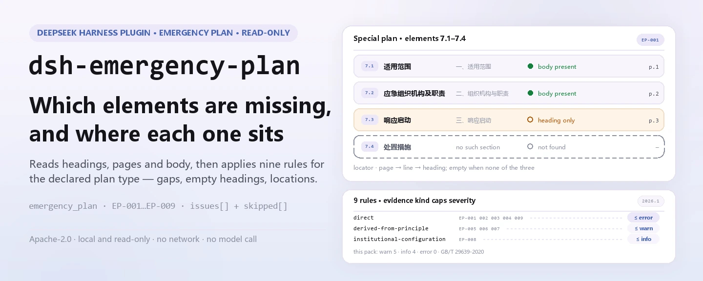
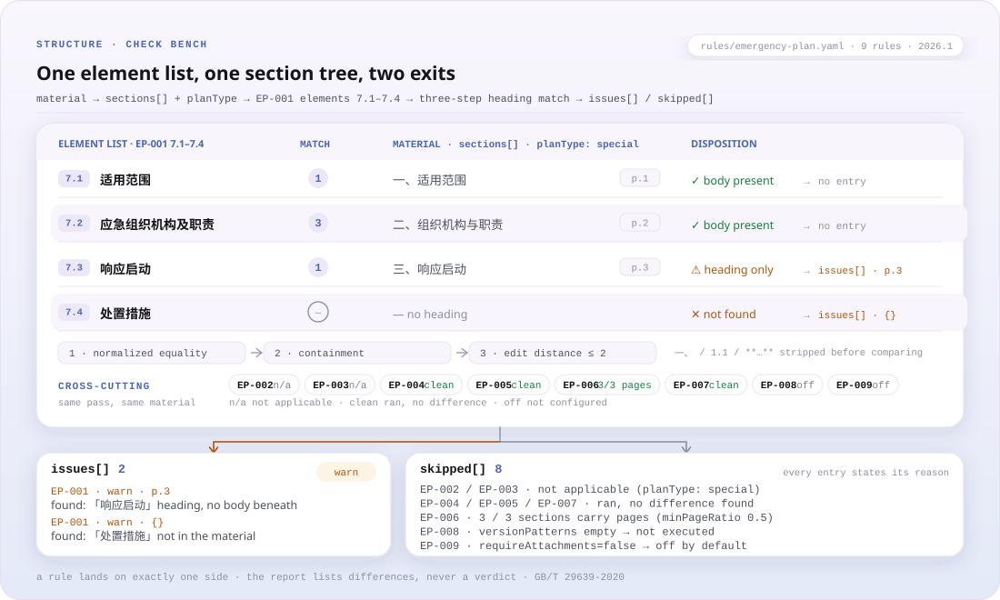

<div align="center">

<picture>
  <source media="(prefers-color-scheme: dark)" srcset="docs/assets/dsh-emergency-plan-hero-en-dark.webp">
  
</picture>

# dsh-emergency-plan

**Verifica elemento a elemento a completude de um plano de emergência e localiza cada diferença por página ou linha — a decisão fica com quem revisa.**

Um verificador do DeepSeek Harness para responsáveis de segurança e redatores de planos: lê a árvore de secções, os títulos, as páginas e o corpo de um plano, aplica um pacote de regras versionado ao tipo de plano declarado e mostra o que falta, o que está vazio e onde está.

[Instalação](#instalação-em-três-passos) · [Configuração](#configuração) · [FAQ](#faq) · [简体中文](README.md) · [English](README.en.md) · [Español](README.es.md) · [Português](README.pt.md) · [हिन्दी](README.hi.md)

[](LICENSE)
[](#compatibilidade)
[](https://www.npmjs.com/package/dsh-emergency-plan)
[](https://github.com/PerryLink/dsh-emergency-plan/actions/workflows/ci.yml)
[](#compatibilidade)

[](https://github.com/PerryLink/dsh-emergency-plan/stargazers)
[](https://www.npmjs.com/package/dsh-emergency-plan)
[](https://dshfind.com/plugins/PerryLink/dsh-emergency-plan?ref=badge)
[](https://securityscorecards.dev/viewer/?uri=github.com/PerryLink/dsh-emergency-plan)
[](https://dsh.market/)
[](https://gitee.com/perrylink/dsh-emergency-plan)

```sh
dsh plugin --profile <name> add dsh-emergency-plan
```

</div>

<sub>Plugin da comunidade, sem afiliação com a DeepSeek. Repositório canônico: <https://github.com/PerryLink/dsh-emergency-plan> (o Gitee é um espelho).</sub>

## O que é

`dsh-emergency-plan` lê um plano de emergência —a sua árvore de secções, títulos, números de página e texto— e aplica um pacote de regras versionado ao tipo de plano declarado pelo material (abrangente, especial ou de atuação no local), verificando a completude dos elementos: quais estão presentes, quais faltam, quais aparecem apenas como título sem texto por baixo e onde se situa cada um —por página quando o material traz números de página e por linha caso contrário. Cada achado indica a cláusula de onde vem e se essa cláusula é um requisito direto, um princípio ou uma configuração local; uma verificação que não pôde correr di-lo em `skipped` em vez de passar em silêncio. Apenas enumera diferenças literais entre o material e as cláusulas citadas: não julga a qualidade do conteúdo, o cumprimento nem a responsabilidade. Corre localmente: sem rede, sem chamadas ao modelo e sem alterar o original.

<picture>
  <source media="(prefers-color-scheme: dark)" srcset="docs/assets/dsh-emergency-plan-flow-v5-dark.svg">
  
</picture>

## Instalação em três passos

1. **Instalar** (escolha um canal):

   ```sh
   # canal git (main mais recente)
   dsh plugin --profile web add github:PerryLink/dsh-emergency-plan
   # canal npm (versões publicadas)
   dsh plugin --profile web add dsh-emergency-plan
   # canal tarball: após pnpm pack neste repositório
   dsh plugin --profile web add ./dsh-emergency-plan-<version>.tgz
   ```

2. **Configuração mínima** (os padrões funcionam; o pacote de regras vem no pacote):

   ```yaml
   - insert:
       - id: dsh-emergency-plan
         name: dsh-emergency-plan
         config:
           rulesFile: rules/emergency-plan.yaml
           timeoutMs: 120000
   ```

3. **Confirmar que monta**:

   ```sh
   dsh --profile web --dump-config | grep -A2 'id: dsh-emergency-plan'
   ```

   Depois, chame a ferramenta `emergency_plan`. O exemplo local precisa de compilação antes (`pnpm run build` gera `lib/`):

   ```sh
   node samples/quickstart/run.mjs
   # emergency_plan: 1 issue(s) — error 0, warn 1, info 0
   # skipped: 8
   ```

   *Observado em `samples/quickstart/expected/result.json; samples/quickstart/run.mjs`*

**Desinstalar**: `dsh plugin --profile web remove dsh-emergency-plan` (ou remova a linha do patch do perfil).

## Capacidades principais

- **Listas de elementos por tipo de plano** — `EP-001` verifica um plano especial contra 7.1–7.4, `EP-002` um plano abrangente contra 6.1–6.5 e `EP-003` um plano de atuação no local contra 8.1–8.4. Um título que existe mas não tem texto por baixo é reportado como vazio.
- **Localização por página ou linha** — cada achado leva a `page` da secção quando existe, senão a `line`, e senão o próprio título. `EP-006` avisa quando há pouca informação de localização.
- **O pacote de regras é dado** — listas de elementos, aliases e limites vivem em `rules/emergency-plan.yaml`. Aponte `rulesFile` para outro YAML para usar outra versão do guia ou um modelo institucional; sem alterar código.
- **Citações verificáveis** — cada regra leva documento, número, cláusula, trecho literal, tipo de fundamento e URL de origem. Um trecho com menos de oito caracteres, ou uma verificação de princípio declarada `error`, falha ao carregar.
- **Nada passa em silêncio** — uma lista de elementos não configurada, um controlo de anexos desativado e um `EP-005` sem posições vão para `skipped`. O relatório só enumera diferenças e uma guarda de redação rejeita valorações.
- **Anexos e marcas de versão são opcionais** — `EP-009` está desativado por padrão (`requireAttachments: false`); `EP-008` só corre com `versionPatterns` configurado.

### Regras de relance

| Regra | Verificação | Severidade | Tipo de fundamento |
|---|---|---|---|
| `EP-001` | o plano especial contém os elementos 7.1–7.4 | warn | direta |
| `EP-002` | o plano abrangente contém os elementos 6.1–6.5 | warn | direta |
| `EP-003` | o plano de atuação contém os elementos 8.1–8.4 | warn | direta |
| `EP-004` | o material declara qual dos três tipos é | warn | direta |
| `EP-005` | os elementos aparecem na ordem do guia | info | princípio |
| `EP-006` | as secções levam página para localizar o achado | info | princípio |
| `EP-007` | nenhum título de elemento aparece duas vezes | warn | princípio |
| `EP-008` | existe uma marca de versão ou revisão, conforme configuração | info | local |
| `EP-009` | o plano leva a informação de anexos (desativado por padrão) | info | direta |

As listas de elementos vivem no pacote de regras, não no código, porque mudam com a versão do guia. As severidades refletem que a GB/T 29639 é uma norma nacional **recomendada**: uma lista incompleta é um `warn`, não um `error`.

### Exemplo (saída real)

**Ferramenta** `emergency_plan`

**Entrada**

~~~json
{"name":"缺要素的专项预案","planType":"special","sections":[{"title":"适用范围"},{"title":"应急组织机构及职责"},{"title":"响应启动"}]}
~~~

**Saída**

~~~json
{
  "id": "dsh-emergency-plan.EP-001.811c9dc5",
  "ruleId": "EP-001",
  "severity": "warn",
  "locator": {},
  "found": "材料中未找到要素「处置措施」",
  "expected": "专项应急预案应当包含要素「处置措施」",
  "fix": "检查的别名：处置措施 / 应急处置措施 / 应急处置；如本机构使用其他表述，请在该要素的 aliases 中补充"
}
~~~

*Observado em `dsh-emergency-plan/tests/fixtures/EP-001/EP-001-unsafe.json; dsh-emergency-plan/tests/fixtures/EP-001/cases.json; dsh-emergency-plan/rules/emergency-plan.yaml; dsh-emergency-plan/tests/index.test.ts`*

O início rápido corre o mesmo fixture e devolve um resumo: 1 `warn`, 0 `error` / `info` e 8 entradas em `skipped` (cada verificação desativada ou não configurada explica o motivo).

### Respostas regra a regra

| Você pergunta | O que ele responde |
|---|---|
| O material não diz qual dos três tipos de plano é. O que acontece? | `EP-004` reporta que o material não declara `planType`, porque cada um dos três tipos tem a sua própria lista de elementos. Verifica apenas que a declaração existe, não que esteja correta; enquanto faltar, `EP-002` e `EP-003` indicam em `skipped` que lista de elementos assumiram. |
| Um plano abrangente não tem o capítulo de tratamento posterior (6.4). Isso é reportado? É também obrigatório um ponto de propósito de redação? | `EP-002` procura um a um os cinco elementos de primeiro nível do capítulo 6 do guia em vigor (6.1–6.5) e reporta cada um que não encontra, portanto um capítulo de tratamento posterior em falta é reportado. O propósito de redação não é um desses cinco: a edição em vigor removeu-o e o pacote só o aceita como alias do elemento de disposições gerais (6.1). O achado é `warn`, porque o guia de redação é uma norma nacional recomendada, não obrigatória. |
| Que elementos são obrigatórios num plano especial e num plano de atuação no local? | `EP-001` exige os elementos 7.1–7.4 do plano especial e `EP-003` os 8.1–8.4 do plano de atuação, e reporta cada elemento que não encontra na árvore de secções; se o título existe mas não há texto por baixo, é reportado como vazio. Ambas as listas são mínimos, não listas fechadas —a cláusula do plano de atuação diz «incluindo, mas não limitado a»—, pelo que um elemento a mais não gera achado. Em `EP-001` o elemento 7.5 de apoio à emergência continua a ser recomendado; em `EP-003` a lista mais curta das medidas de gestão é citada como base separada e nunca é fundida com a do guia. |
| Depois de fundir dois planos, o mesmo título de elemento aparece duas vezes. Isso é detetado? | `EP-007` reporta um elemento exigido que aparece mais de uma vez e enumera todos os títulos que com ele coincidiram. Nenhuma cláusula o diz expressamente —o pacote deduz-o da unicidade da ordem do índice—, por isso fica limitado a `warn`, e o pacote pede confirmação humana, porque a duplicação costuma vir da fusão de vários planos. Compara a lista de elementos que aplica, não todos os títulos repetidos do material. |
| O relatório mostra `EP-005` como `skipped`. Porquê? Numerar as páginas do plano é obrigatório? | `EP-005` só consegue comparar a ordem dos elementos quando pelo menos dois deles têm `page` ou `line`; caso contrário, di-lo em `skipped` em vez de presumir uma ordem. `EP-006` trata os números de página como informação de localização: fica em silêncio quando a proporção de secções com página atinge `minPageRatio` (0,5 por omissão) e, abaixo dessa proporção, emite apenas um aviso de nível `info`. Ambas ficam limitadas a `info` —a expectativa de ordem é deduzida de um anexo informativo, não do corpo da norma— e um plano sem páginas nunca é reportado como incumprimento de uma cláusula: o relatório localiza por número de linha. |
| Porque é que `EP-008` e `EP-009` aparecem em `skipped` em vez de passar? | Ambas esperam configuração. `EP-009` só corre com `requireAttachments` em `true`, porque quem chama costuma entregar o corpo do plano sem os anexos e dar os anexos ausentes como faltas seria enganador; ativada, procura os oito elementos de anexo e reporta os que não encontra. `EP-008` só corre se houver `versionPatterns` configurados: com a lista vazia não dita como deve ser escrito o identificador de versão e, uma vez configurada, verifica apenas se o marcador aparece em algum título de secção, nunca se o conteúdo da revisão está correto. |

## Normas que segue

| Documento | Número | Regras que o citam |
|---|---|---|
| Guia para a elaboração de planos de emergência para acidentes de produção em unidades produtivas | GB/T 29639-2020 | EP-001, EP-002, EP-003, EP-004, EP-005, EP-006, EP-007, EP-008, EP-009 |
| Medidas de gestão dos planos de emergência para acidentes de produção | Ordem n.º 88 da Administração Estatal de Segurança Laboral (alterada pela Ordem n.º 2 do Ministério da Gestão de Emergências) | EP-001, EP-002, EP-003, EP-009 |

Títulos originais dos documentos citados:

```text
《生产经营单位生产安全事故应急预案编制导则》 GB/T 29639-2020
《生产安全事故应急预案管理办法》 国家安全生产监督管理总局令第88号（应急管理部令第2号修正）
```

**Limite:** este plugin verifica a **completude dos elementos de um plano de emergência** face ao guia de redação e localiza cada elemento por página, reportando diferenças literais face às cláusulas citadas. Não é o `dsh-rulefile-check` (que audita a legalidade de um documento normativo) nem o `dsh-hidden-risk-map` (que mapeia um registo de perigos para cláusulas de determinação). Lê um plano e reporta que elementos estão presentes, ausentes ou vazios, e onde.

> ### ⚠️ Duas correções em que este plugin se baseia — leia
>
> **1. «Oito elementos» não é um requisito vigente.** A lista familiar de nove nomes pertence à
> **GB/T 29639—2013**, que foi **completamente substituída**; esse nome não aparece em nenhum
> documento nacional vigente. A norma em vigor, **GB/T 29639-2020**, dá ao plano abrangente **cinco**
> elementos de primeiro nível no capítulo 6 (6.1–6.5), e o seu prólogo regista que o elemento de
> propósito de redação foi eliminado. Qualquer regra que cite números de cláusula de 2013 cita uma
> norma retirada. Este pacote só cita os números de 2020, e um teste afirma que o número de 2013
> nunca aparece.
>
> **2. Os números de página não têm base obrigatória.** Nenhum documento nacional exige que um plano
> leve números de página; o anexo que regula o índice é um **anexo informativo** (não normativo) e não
> contém a palavra «página». Por isso os números de página são tratados como **informação de
> localização que ajuda quem revisa**, reportados em `info` e nunca formulados como «não cumpre X».
> Quando um plano não leva páginas, o relatório recorre aos números de linha.

Os nomes exatos dos elementos de 2013 e 2020 são mantidos na terminologia do pacote:

```text
2013 list (withdrawn): 总则 · 事故风险描述 · 应急组织机构及职责 · 预警及信息报告 ·
                      应急响应 · 信息公开 · 后期处置 · 保障措施 · 应急预案管理
2020 comprehensive list (6.1–6.5): 总则 · 应急组织机构及职责 · 应急响应 ·
                                  后期处置 · 应急保障
Removed by the 2020 edition: 编制目的
```

O pacote registra uma terceira correção menor: a versão correta das medidas de gestão é a **Ordem n.º 88 da Administração Estatal de Segurança Laboral (2016), alterada pela Ordem n.º 2 do Ministério da Gestão de Emergências (2019)** —não uma «Ordem n.º 2» isolada—, e o documento do Conselho de Estado de 2013 (Guobanfa [2013] n.º 101) foi substituído pelo de 2024 (Guobanfa [2024] n.º 5).

## Configuração

Todos os parâmetros ajustáveis são campos Schemastery `Config` (alteráveis a partir de `cordis.yml`). Uma sobreposição por id substitui a linha inteira — redefina todas as chaves necessárias. Os limites por regra estão no pacote de regras em `rules/`.

| Chave | Tipo | Padrão | Descrição |
|---|---|---|---|
| `rulesFile` | string | `rules/emergency-plan.yaml` | Caminho do pacote de regras, relativo à raiz do pacote |
| `disabledRules` | string[] | `[]` | Ids de regras a desativar; cada uma aparece em `skipped` |
| `onlyRules` | string[] | `[]` | Executar apenas estas regras; vazio executa todas |
| `skipNotes` | string | `""` | Nota acrescentada a cada motivo de `skipped` |
| `timeoutMs` | number | `120000` | Orçamento de tempo limite cooperativo da ferramenta (ms) |

<details>
<summary>Tabela de configuração completa (5 chaves)</summary>

| Chave | Tipo | Padrão | Descrição |
|---|---|---|---|
| `rulesFile` | string | `rules/emergency-plan.yaml` | Caminho do pacote de regras, relativo à raiz do pacote; aponte para outra versão do guia ou um modelo institucional |
| `disabledRules` | string[] | `[]` | Ids de regras a desativar; cada regra desativada aparece uma vez no `skipped` do relatório |
| `onlyRules` | string[] | `[]` | Executar apenas estas regras; vazio executa todas |
| `skipNotes` | string | `""` | Nota acrescentada a cada motivo de `skipped`, por exemplo para citar uma norma interna |
| `timeoutMs` | number | `120000` | Orçamento de tempo limite cooperativo da ferramenta (ms) |

</details>

Parâmetros por regra em `rules/emergency-plan.yaml`:

- `EP-001` / `EP-002` / `EP-003` `elements` — a lista de elementos por tipo de plano, como `[{ name, aliases }]`. Substitua-a para verificar outra versão do guia ou o modelo da sua instituição. Uma lista vazia faz a regra reportar que não pôde correr.
- `EP-006` `minPageRatio` — a proporção de secções que devem levar página para a regra ficar em silêncio; 0,5 por omissão.
- `EP-008` `versionPatterns` — as cadeias que contam como marca de versão nos seus modelos. Vazio significa que a regra não corre.
- `EP-009` `requireAttachments` — desativado por omissão, porque quem chama costuma entregar o corpo sem anexos; ative apenas quando os anexos estiverem realmente no material.

## Formato do material

A ferramenta aceita JSON ou YAML, e também um plano em texto simples. A forma de árvore de secções é preferida, porque quem extraiu o plano já sabe onde está cada título:

```yaml
name: 某公司生产安全事故综合应急预案
planType: comprehensive         # comprehensive | special | on-site
sections:
  - { title: 总则, page: 1, body: 本预案适用于…… }
  - { title: 应急组织机构及职责, page: 2, body: 明确应急组织形式…… }
  - { title: 应急响应, page: 3, body: 规定信息报告、预警与响应程序。 }
```

Os títulos são comparados com os aliases de cada elemento em três passos cada vez mais amplos: igualdade normalizada exata, contenção e uma pequena distância de edição, de modo que tanto `五、保障措施` como `二、组织机构与职责` encontram o seu elemento. Antes da comparação são removidos os prefixos de numeração (`一、`, `1.1`, `**…**`). Colar Markdown (`# 总则`) também funciona e é dividido pelos títulos, sem números de página; o relatório di-lo. Um esboço em texto simples também serve: um título curto por linha.

## Origem das regras

Os dados das regras ficam em `rules/emergency-plan.yaml`. Cada regra traz documento, número, cláusula na numeração própria da fonte, trecho literal e URL de origem. O carregador impõe que o trecho seja uma citação real de pelo menos oito caracteres e que uma verificação baseada apenas num princípio geral ou numa política local nunca seja declarada `error`.

As cláusulas citadas vêm da **GB/T 29639-2020**, cláusulas 5.1, 6, 7, 8 e anexos C.1 e C.3, e das medidas de gestão (Ordem n.º 88 da Administração Estatal de Segurança Laboral, alterada), artigos 13, 14, 15 e 16.

Três achados moldaram este pacote e ficam registados no seu cabeçalho:

1. **«Oito elementos» vem de uma norma retirada.** A lista vigente do plano abrangente tem cinco elementos de primeiro nível e o propósito de redação foi eliminado.
2. **Os números de página não têm base obrigatória**, pelo que são uma ajuda de localização de nível `info`, nunca uma não conformidade.
3. **O prefixo do código da norma mudou.** O Aviso n.º 1 de 2025 do Ministério da Gestão de Emergências transferiu a AQ/T 9011-2019 e outras dez normas para o prefixo **YJ**, mantendo número, ano e conteúdo; por isso o guia de avaliação complementar escreve-se agora **YJ/T 9011-2019 (antes AQ/T 9011-2019)**. O guia de avaliação é distinto do guia de redação: a GB/T 29639 regula a **redação** e a YJ/T 9011 a **avaliação**.

## FAQ

<details>
<summary>Para onde vão os dados do material? O plugin usa a rede?</summary>

Sem pedidos de rede, sem chamadas ao modelo e sem escrita de ficheiros. O material é lido de `file` ou de `material` em linha, verificado numa função pura e devolvido como resultado da ferramenta; o plugin não persiste nem envia nada. Como o host regista a saída da ferramenta é decisão do host.

</details>

<details>
<summary>Uma lista de problemas vazia significa que o plano cumpre?</summary>

Não. Uma lista vazia só significa que as regras executadas não encontraram diferenças; cada entrada de `skipped` explica porque não correu. Todas as regras estão limitadas a `warn` / `info`, o relatório leva sempre um aviso de responsabilidade e a guarda de redação rejeita valorações de cumprimento, responsabilidade ou correção.

</details>

<details>
<summary>Um plano pode omitir os números de página?</summary>

Nenhum documento nacional exige números de página. `EP-006` trata-os como ajuda de localização: fica em silêncio quando a proporção de secções com página atinge `minPageRatio` e, abaixo disso, apenas emite um aviso `info`. Sem páginas, o relatório localiza por número de linha e nunca formula a falta como incumprimento de uma cláusula.

</details>

<details>
<summary>Choca com outros plugins por nomes?</summary>

Regista exatamente uma ferramenta, `emergency_plan`; não regista comandos, nem chave de serviço, nem slot de cliente, nem prefixo `webServer`, e não escuta eventos partilhados. O patch do bundle apenas `insert`a a sua própria linha. O argumento ponto por ponto está em «Interoperabilidade com outros plugins do DSH».

</details>

<details>
<summary>Quanto tempo demora uma verificação?</summary>

Uma função pura sobre uma única passagem da árvore de secções; o pacote tem 9 regras, sem rede nem chamadas ao modelo. O tempo depende do tamanho do material e do número de secções; o repositório não publica dados de referência, por isso aqui não se cita nenhum número.

</details>

## Resolução de problemas

- **Todas as verificações de elementos aparecem como `skipped`.** A lista `elements` do pacote está vazia para esse tipo de plano, ou o material não declarou `planType` e a verificação recusou assumir um.
- **Um título que existe é reportado como ausente.** Acrescente-o aos `aliases` desse elemento. A correspondência é literal (com os três passos acima), não semântica, por desenho.
- **`EP-005` não reporta ordem.** As secções não levam `page` nem `line`, por isso não há nada por onde ordenar; a regra di-lo em `skipped`.
- **`EP-006` queixa-se de páginas num plano que não as tem.** É a função da regra, e é `info`: está a dizer que o relatório só pode citar números de linha. Baixe `minPageRatio` ou ignore.
- **O plugin instala mas a ferramenta não aparece.** Confirme que `main` resolve para `lib/index.mjs` e que `pnpm run build` o gerou; um `main` errado faz o carregador ignorar a entrada em silêncio.
- **`dsh plugin add` recusa o pacote como incompatível.** O intervalo de peers cobre `0.1.x` e `0.2.x`; se o seu runtime ficar fora, conceda uma isenção explícita: `dsh plugin --profile <name> allow-version dsh-emergency-plan@0.1.0 --dsh-version <runtime> --accept-risk`
- **`check` reporta `manifest-peers` como falha.** O verificador estático compara com um intervalo de peers codificado anterior à linha 0.2. O runtime aplica a compatibilidade na instalação, por isso o intervalo declarado é o correto; é um problema conhecido do `dsh-plugin-dev`.

## Limites de segurança e limitações conhecidas

- **Só leitura e local.** O plugin lê `file` ou `material` em linha, não escreve nada, não faz pedidos de rede e não chama nenhum modelo; a demo do `package.json` declara `network: false` e `writes: []`.
- **Sem valorações.** Apenas enumera diferenças literais entre o material e as cláusulas citadas; o cumprimento, a responsabilidade e a qualidade do conteúdo ficam com quem revisa. A camada de renderização passa uma guarda de redação e leva sempre aviso de responsabilidade.
- **A severidade segue a evidência.** `derived-from-principle` está limitada a `warn` e `institutional-configuration` a `info`; um pacote que declare `error` uma verificação de princípio falha ao carregar.
- **Um resultado vazio não é uma aprovação.** Uma lista de elementos não configurada, um controlo de anexos desativado e um elemento não ordenável aparecem em `skipped`.
- **Os números de página não são obrigatórios.** Ver FAQ e a correção 2; `EP-006` é apenas uma pista `info`.
- **A correspondência é literal, não semântica.** Os títulos passam por igualdade normalizada, contenção e distância de edição; acrescente sinónimos aos `aliases` do elemento. O plugin não julga se o corpo está bem redigido.
- **`planType` ausente ou não reconhecido.** `EP-004` reporta a ausência; `EP-002` / `EP-003` indicam em `skipped` que lista assumiram; um valor não reconhecido acrescenta um aviso.
- **Anexos e marcas de versão estão desativados por omissão.** `EP-009` vale `false`; os `versionPatterns` de `EP-008` estão vazios. Ambos o dizem em `skipped`.
- **Substituir o pacote de regras tem um limite.** Outra versão do guia ou um modelo institucional continuam a verificar os trechos contra o `rules/evidence/` incluído; citações novas precisam do seu próprio registo de verificação.

## Interoperabilidade com outros plugins do DSH

- **Nome de ferramenta com espaço de nomes.** Só regista `emergency_plan`, nunca um nome nu de uma ferramenta incluída ou de outro plugin.
- **Sem colisão de chave de serviço.** Não oferece qualquer chave de serviço.
- **Sem colisão de slot nem de rota.** Não regista slot de cliente nem prefixo `webServer`.
- **Sem escutas de eventos partilhados.** Não há subscrição `ctx.on`, pelo que nenhuma cadeia de eventos pode ser curto-circuitada.
- **Não monta sem a sua dependência.** Declara `inject: ['tools']`; sem o serviço `tools` a ferramenta não é registada.
- **A camada de patch não pisa nada.** O patch do bundle apenas `insert`a a sua própria linha; nunca reescreve o `config` de uma linha incorporada.
- **Sem mutações globais.** Não altera protótipos, não reescreve `process.env` nem substitui o despachante global de fetch.

## Compatibilidade

| Superfície | Estado |
|---|---|
| Harness | Intervalo de peers `>=0.1.2-rc.1 <0.2.0 \|\| >=0.2.0-0 <0.3.0` — verificado para aceitar tanto `0.2.0-rc.2` como `0.2.1-rc.2`. `engines.dsh` é declarado como `>=0.2.1-0 <0.3.0` e o host aplica-o desde 0.2.1 |
| Node | `^22.19.0 \|\| >=24.0.0` |
| Plataformas | Todas (ESM puro; sem código nativo, sem rede, sem chamada ao modelo) |
| Modo de ferramenta | Funciona em `native` e `ptc`; para um lote de planos use `ptc`, assim o custo do esquema é pago uma vez |

## Ecossistema e qualidade

- [Espelho no Gitee](https://gitee.com/perrylink/dsh-emergency-plan) (espelho sincronizado; o GitHub é o canónico)
- [Página no dshfind](https://dshfind.com/plugins/PerryLink/dsh-emergency-plan) (instalações e ranking)
- [Relatório OpenSSF Scorecard](https://securityscorecards.dev/viewer/?uri=github.com/PerryLink/dsh-emergency-plan) (impulsionado por [.github/workflows/scorecard.yml](.github/workflows/scorecard.yml))
- [DSH Market](https://dsh.market/) (publicado)
- [Escolher um verificador por material](https://perrylink.github.io/zh/checkers/choose/) — a família tem outros verificadores; escolha pelo tipo de material
- [Base de conhecimento do ecossistema](https://perrylink.github.io/dsh-plugin-guide/): guia de desenvolvimento · dados de seleção · critérios de manutenção

## Desenvolvimento

```sh
pnpm install
pnpm run typecheck        # tsc --noEmit
pnpm test                 # vitest, um fixture compliant/violating por regra
pnpm run build            # tsdown -> lib/index.mjs + lib/index.d.mts
pnpm run verify:self-contained
pnpm run check:lockfile
pnpm run check:readmes
pnpm run check:citations
pnpm pack
```

O `prepublishOnly` volta a correr toda a porta, por isso uma árvore sem compilação ou desviada não é publicada.

Estrutura do diretório:

| Caminho | Papel |
|---|---|
| `src/index.ts` | contrato do plugin (`name` / `inject` / `Config` / `apply`); registra `emergency_plan` e resolve o pacote de regras |
| `src/config.ts` | esquema Schemastery; todos os parâmetros ajustáveis |
| `src/check.ts` | núcleo de verificação puro `(input, ruleset, options) => Report`; sem I/O, sem relógio, sem acesso ao modelo |
| `src/parse.ts` | leitor de planos JSON / YAML / texto simples |
| `src/view.ts` | projeção do relatório para o modelo; `output.schema` reflete-a |
| `src/shared/` | kit partilhado (carregador de regras, forma do relatório, subconjunto YAML, guarda de redação) copiado para o pacote ser autónomo |
| `rules/emergency-plan.yaml` | o pacote de regras, 9 regras |
| `rules/evidence/` | registo de verificação de cada citação |
| `tests/` | vitest; cada regra tem um fixture compliant / violating |
| `samples/quickstart/` | amostra de início rápido e saída esperada |
| `cordis.patch.yml` | declaração da linha do bundle |

As imagens do README são geradas programaticamente por [`scripts/gen-readme-assets.py`](scripts/gen-readme-assets.py) (Pillow para o hero localizado e um SVG escrito à mão para a figura de estrutura) e podem ser repetidas:

```sh
python scripts/gen-readme-assets.py
```

Escreve dois conjuntos: `docs/assets/dsh-emergency-plan-hero-{zh,en}-{light,dark}.webp` e `docs/assets/dsh-emergency-plan-flow-v5-{light,dark}.svg`. O diagrama de fluxo antigo de tema único e as imagens de demonstração ficam em `docs/assets/` para links externos; o README só referencia estes dois conjuntos novos.

Topics: `deepseek-harness`, `dsh`, `dsh-plugin`, `cordis`, `emergency`, `plan`

## Família e agradecimentos

Este projeto faz parte da família de plugins do DeepSeek Harness mantida pela [PerryLink](https://github.com/PerryLink) (todos Apache-2.0). Índice completo: [escolher um verificador por material](https://perrylink.github.io/zh/checkers/choose/) e [todos os plugins](https://github.com/PerryLink). Se ajudar, **uma estrela faz com que a próxima pessoa o encontre**; não desbloqueia nada.

- [@PerryLink](https://github.com/PerryLink) — criador e mantenedor: o pacote de regras (EP-001..EP-009), a ferramenta `emergency_plan`, o registo de verificação de citações e a documentação em cinco idiomas.

<details>
<summary>Mostrar todos os plugins</summary>

| Plugin | Estado |
|---|---|
| **[dsh-aqua-input-check](https://github.com/PerryLink/dsh-aqua-input-check)** |  |
| **[dsh-archive-check](https://github.com/PerryLink/dsh-archive-check)** |  |
| **[dsh-auto-review](https://github.com/PerryLink/dsh-auto-review)** |  |
| **[dsh-autotier](https://github.com/PerryLink/dsh-autotier)** | 🧊 CONGELADO — ver o README do repo |
| **[dsh-bid-ca-precheck](https://github.com/PerryLink/dsh-bid-ca-precheck)** |  |
| **[dsh-bid-qual-check](https://github.com/PerryLink/dsh-bid-qual-check)** |  |
| **[dsh-cert-mcp](https://github.com/PerryLink/dsh-cert-mcp)** | 🧊 CONGELADO — ver o README do repo |
| **[dsh-checkpoint-rewind](https://github.com/PerryLink/dsh-checkpoint-rewind)** |  |
| **[dsh-click](https://github.com/PerryLink/dsh-click)** |  |
| **[dsh-composer-history](https://github.com/PerryLink/dsh-composer-history)** |  |
| **[dsh-contract-stance](https://github.com/PerryLink/dsh-contract-stance)** |  |
| **[dsh-customs-doc-check](https://github.com/PerryLink/dsh-customs-doc-check)** |  |
| **[dsh-data-quality](https://github.com/PerryLink/dsh-data-quality)** | 🧊 CONGELADO — ver o README do repo |
| **[dsh-demurrage-ledger](https://github.com/PerryLink/dsh-demurrage-ledger)** |  |
| **[dsh-doublecheck](https://github.com/PerryLink/dsh-doublecheck)** |  |
| **[dsh-drill-script-check](https://github.com/PerryLink/dsh-drill-script-check)** |  |
| **[dsh-eia-guide-check](https://github.com/PerryLink/dsh-eia-guide-check)** |  |
| **[dsh-emergency-plan](https://github.com/PerryLink/dsh-emergency-plan)** |  |
| **[dsh-essay-rubric-check](https://github.com/PerryLink/dsh-essay-rubric-check)** |  |
| **[dsh-evidence-check](https://github.com/PerryLink/dsh-evidence-check)** |  |
| **[dsh-export-ctl-check](https://github.com/PerryLink/dsh-export-ctl-check)** |  |
| **[dsh-fast](https://github.com/PerryLink/dsh-fast)** |  |
| **[dsh-fmea-table-check](https://github.com/PerryLink/dsh-fmea-table-check)** |  |
| **[dsh-forecast-penalty](https://github.com/PerryLink/dsh-forecast-penalty)** |  |
| **[dsh-fund-research](https://github.com/PerryLink/dsh-fund-research)** |  |
| **[dsh-github](https://github.com/PerryLink/dsh-github)** |  |
| **[dsh-gongwen-flow-check](https://github.com/PerryLink/dsh-gongwen-flow-check)** |  |
| **[dsh-gongwen-word-check](https://github.com/PerryLink/dsh-gongwen-word-check)** |  |
| **[dsh-guard-plan-qc](https://github.com/PerryLink/dsh-guard-plan-qc)** |  |
| **[dsh-hazchem-check](https://github.com/PerryLink/dsh-hazchem-check)** |  |
| **[dsh-hazplan-check](https://github.com/PerryLink/dsh-hazplan-check)** |  |
| **[dsh-hidden-risk-map](https://github.com/PerryLink/dsh-hidden-risk-map)** |  |
| **[dsh-hs-classify](https://github.com/PerryLink/dsh-hs-classify)** |  |
| **[dsh-icd-rule-check](https://github.com/PerryLink/dsh-icd-rule-check)** |  |
| **[dsh-industry-research](https://github.com/PerryLink/dsh-industry-research)** |  |
| **[dsh-lawcite-adapter](https://github.com/PerryLink/dsh-lawcite-adapter)** |  |
| **[dsh-laya](https://github.com/PerryLink/dsh-laya)** |  |
| **[dsh-lc-doc-check](https://github.com/PerryLink/dsh-lc-doc-check)** |  |
| **[dsh-learning-gap-check](https://github.com/PerryLink/dsh-learning-gap-check)** |  |
| **[dsh-library](https://github.com/PerryLink/dsh-library)** |  |
| **[dsh-local-ai](https://github.com/PerryLink/dsh-local-ai)** |  |
| **[dsh-lsp-actions](https://github.com/PerryLink/dsh-lsp-actions)** |  |
| **[dsh-mask](https://github.com/PerryLink/dsh-mask)** |  |
| **[dsh-mcp-panel](https://github.com/PerryLink/dsh-mcp-panel)** |  |
| **[dsh-medrec-qc](https://github.com/PerryLink/dsh-medrec-qc)** |  |
| **[dsh-memento](https://github.com/PerryLink/dsh-memento)** | 🧊 CONGELADO — ver o README do repo |
| **[dsh-nsfc-form-check](https://github.com/PerryLink/dsh-nsfc-form-check)** |  |
| **[dsh-nurse-record-check](https://github.com/PerryLink/dsh-nurse-record-check)** |  |
| **[dsh-observe](https://github.com/PerryLink/dsh-observe)** |  |
| **[dsh-origin-rvc-check](https://github.com/PerryLink/dsh-origin-rvc-check)** |  |
| **[dsh-ota-review-check](https://github.com/PerryLink/dsh-ota-review-check)** |  |
| **[dsh-output-styles](https://github.com/PerryLink/dsh-output-styles)** |  |
| **[dsh-paper-doc-adapter](https://github.com/PerryLink/dsh-paper-doc-adapter)** |  |
| **[dsh-permission-rules](https://github.com/PerryLink/dsh-permission-rules)** |  |
| **[dsh-permit-report-check](https://github.com/PerryLink/dsh-permit-report-check)** |  |
| **[dsh-pipeline-check](https://github.com/PerryLink/dsh-pipeline-check)** |  |
| **[dsh-pleading-draft](https://github.com/PerryLink/dsh-pleading-draft)** |  |
| **[dsh-plugin-doctor](https://github.com/PerryLink/dsh-plugin-doctor)** | 🚫 APOSENTADO (repo arquivado) |
| **[dsh-plugin-guide](https://github.com/PerryLink/dsh-plugin-guide)** |  |
| **[dsh-plugin-kit](https://github.com/PerryLink/dsh-plugin-kit)** | 🚫 APOSENTADO (repo arquivado) |
| **[dsh-plugin-upgrade](https://github.com/PerryLink/dsh-plugin-upgrade)** | 🚫 APOSENTADO (repo arquivado) |
| **[dsh-policy-brief-draft](https://github.com/PerryLink/dsh-policy-brief-draft)** |  |
| **[dsh-power-loss-split](https://github.com/PerryLink/dsh-power-loss-split)** |  |
| **[dsh-power-ticket-check](https://github.com/PerryLink/dsh-power-ticket-check)** |  |
| **[dsh-ppap-check](https://github.com/PerryLink/dsh-ppap-check)** |  |
| **[dsh-protest-deadline](https://github.com/PerryLink/dsh-protest-deadline)** |  |
| **[dsh-railway-window](https://github.com/PerryLink/dsh-railway-window)** |  |
| **[dsh-repair-order-qc](https://github.com/PerryLink/dsh-repair-order-qc)** |  |
| **[dsh-research-report](https://github.com/PerryLink/dsh-research-report)** |  |
| **[dsh-review-reply-check](https://github.com/PerryLink/dsh-review-reply-check)** |  |
| **[dsh-rulefile-check](https://github.com/PerryLink/dsh-rulefile-check)** |  |
| **[dsh-safety-brief-check](https://github.com/PerryLink/dsh-safety-brief-check)** |  |
| **[dsh-score](https://github.com/PerryLink/dsh-score)** | 🧊 CONGELADO — ver o README do repo |
| **[dsh-session-sync](https://github.com/PerryLink/dsh-session-sync)** |  |
| **[dsh-site-log-check](https://github.com/PerryLink/dsh-site-log-check)** |  |
| **[dsh-skill-pack-security](https://github.com/PerryLink/dsh-skill-pack-security)** |  |
| **[dsh-soe-decision-check](https://github.com/PerryLink/dsh-soe-decision-check)** |  |
| **[dsh-soilwater-check](https://github.com/PerryLink/dsh-soilwater-check)** |  |
| **[dsh-sop-sync-check](https://github.com/PerryLink/dsh-sop-sync-check)** |  |
| **[dsh-spc-gbt-adapter](https://github.com/PerryLink/dsh-spc-gbt-adapter)** |  |
| **[dsh-talk](https://github.com/PerryLink/dsh-talk)** |  |
| **[dsh-tender-extract](https://github.com/PerryLink/dsh-tender-extract)** |  |
| **[dsh-tender-matrix](https://github.com/PerryLink/dsh-tender-matrix)** |  |
| **[dsh-test-drive](https://github.com/PerryLink/dsh-test-drive)** |  |
| **[dsh-ticktick](https://github.com/PerryLink/dsh-ticktick)** | 🚫 APOSENTADO (repo arquivado) |
| **[dsh-translate](https://github.com/PerryLink/dsh-translate)** |  |
| **[dsh-warranty-calc](https://github.com/PerryLink/dsh-warranty-calc)** |  |
| **[dsh-budget](https://github.com/PerryLink/dsh-budget)** | 🧊 CONGELADO — ver o README do repo |
| **[dsh-claude-move](https://github.com/PerryLink/dsh-claude-move)** | 🧊 CONGELADO — ver o README do repo |
| **[dsh-defend](https://github.com/PerryLink/dsh-defend)** | 🧊 CONGELADO — ver o README do repo |
| **[dsh-draw](https://github.com/PerryLink/dsh-draw)** | 🧊 CONGELADO — ver o README do repo |
| **[dsh-reach](https://github.com/PerryLink/dsh-reach)** | 🧊 CONGELADO — ver o README do repo |
| **[dsh-background-agents](https://github.com/PerryLink/dsh-background-agents)** | 🚫 APOSENTADO (repo arquivado) |
| **[dsh-session-pin](https://github.com/PerryLink/dsh-session-pin)** | 🚫 APOSENTADO (repo arquivado) |
| **[dsh-team-rooms](https://github.com/PerryLink/dsh-team-rooms)** | 🚫 APOSENTADO (repo arquivado) |

</details>

## License

[LICENSE](LICENSE) (Apache License 2.0) © 2026 dsh-emergency-plan contributors

<p align="center"><sub>Apache-2.0 · Plugin da comunidade, sem afiliação com a DeepSeek.</sub></p>
